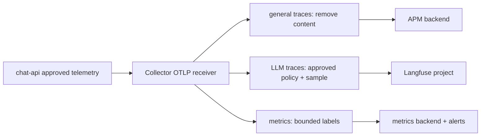
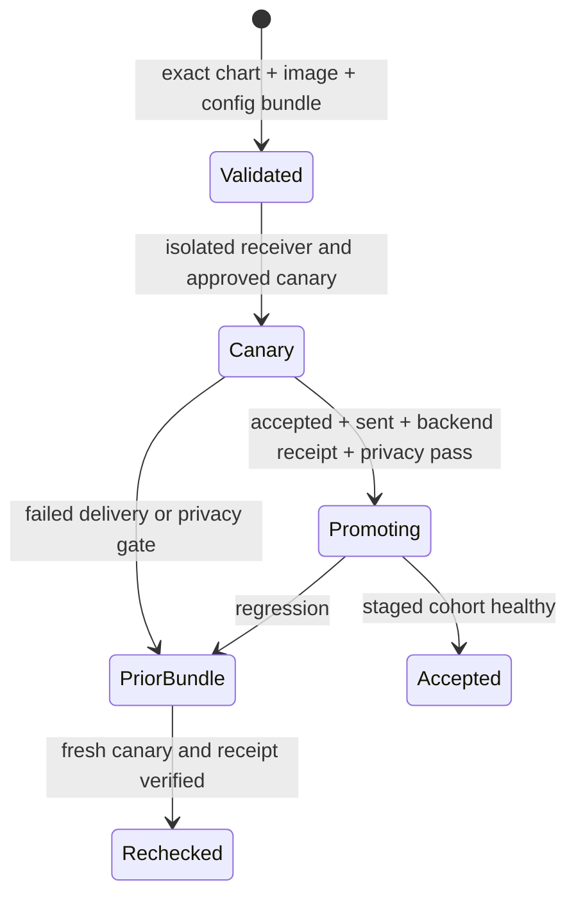

# Production tracing policy

Role: decision guide. Prerequisites: [OTel concepts](opentelemetry/01_concepts.md) and [Python lifecycle](opentelemetry/02_python_instrumentation.md), or equivalent knowledge. Use this compact policy after a working local trace, then follow the linked operational owners for deployment.

## Give each boundary one owner

For chat-api, FastAPI owns the inbound SERVER, HTTPX owns the outbound CLIENT and propagation, and manual `rag.retrieve` owns retrieval meaning. One process bootstrap owns global providers. One generation wrapper owns each physical model request; retries are separate attempts under a workflow. Exporting one completed span to two backends is fan-out, while creating two generation spans around the same request is duplicate capture.

Keep service identity on the resource: stable logical `service.name`, immutable artifact `service.version`, environment, and a distinct per-process `service.instance.id`. Keep bounded operation/model/outcome categories on measurements. Unique request and trace IDs belong in traces/log correlation, not metric dimensions.

## Route data according to its approved audience

This diagram shows why an LLM destination may receive different data from general APM:

The split must occur before destination-specific transforms so a mutation for one path cannot accidentally change the other's privacy contract. Denying raw content at the source gives a stronger default than a regex trying to discover credentials later. Enable rich capture only after reviewing access, retention and deletion for its destination. Keep independently emitted metrics outside trace sampling. [Production architecture](opentelemetry/03_production_architecture.md) develops the actual pipelines and signal-retention consequences.

Tail sampling needs one stable owner for all spans of each trace. Ordinary load balancing is insufficient. [Scaling and resilience](opentelemetry/deployment/05_scaling_and_resilience.md) develops routing, membership changes and finite buffer capacity. Persistent exporter queues preserve already queued exports, not undecided tail-sampler state or every SDK measurement.

## Prove a change before promoting it

Suppose chat-api's `/chat` succeeds after a Collector image upgrade, but no deployment canary reaches the backend. The HTTP response proves application behavior; it does not certify export. Compare accepted and sent counts for a fresh canary, then search its exact ID in the controlled destination. Accepted increases with sent failures indicate an exporter/policy/credential boundary; if acceptance stays flat, start with receiver address, TLS/auth, network reachability or application export.

Readiness only proves the configured process health gate. It cannot bypass the canary delivery/privacy gate. Restore the prior reviewed chart/image/config/secret-reference bundle when promotion fails; verify its compatibility with any queue storage format before downgrade. [Security and upgrades](opentelemetry/deployment/06_security_operations_and_upgrades.md) owns the complete procedure.

## Production-readiness checklist

- [ ] Providers initialize before work, once per process; shutdown follows client closure.
- [ ] Resource identities differ by worker and preserve application identity through gateways.
- [ ] Capture ownership produces one generation per physical request.
- [ ] Public and internal identity boundaries reject missing/invalid credentials before work.
- [ ] Raw content is absent unless explicitly reviewed; privacy canaries are absent at every destination.
- [ ] Metrics use bounded dimensions and actual exported label names; alerts have traffic/no-data guards and tests.
- [ ] Queues fit measured request size/rate and outage duration; recovery throughput exceeds live arrival.
- [ ] Sampling has stable trace affinity and known loss on restart/membership change.
- [ ] Exact image/chart/config is validated, and accepted/sent/backend receipt proves delivery.
- [ ] Operators can diagnose receiver, processor, exporter and backend failures separately.
- [ ] Rollback bundle, credential rotation, retention, capacity/cost budgets and ownership are recorded.

## Decision exercise

The backend starts returning 429, accepted rate stays constant, CPU is low and queues grow. Should you double gateway replicas?

Reasoned answer

First treat backend quota/output capacity as the constraint. More exporters may add pressure without raising permitted throughput. Inspect retry/send failures, preserve a measured finite buffer, reduce approved traffic or agree a higher backend quota, and verify catch-up throughput before scaling. Scale Collector compute when measurements show Collector saturation, not from queue occupancy alone.

