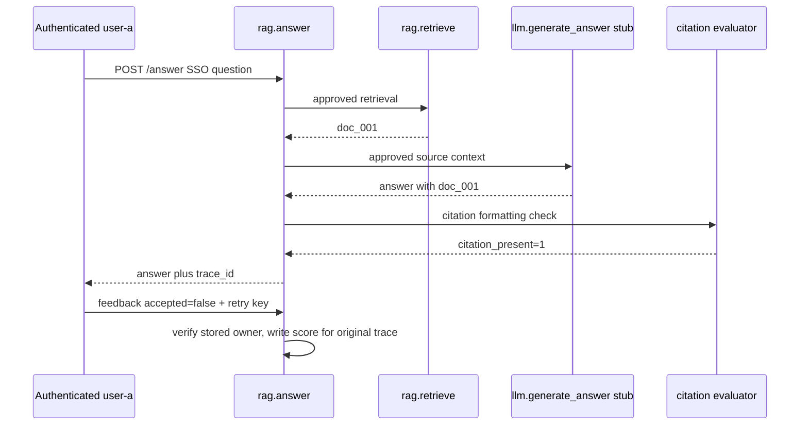
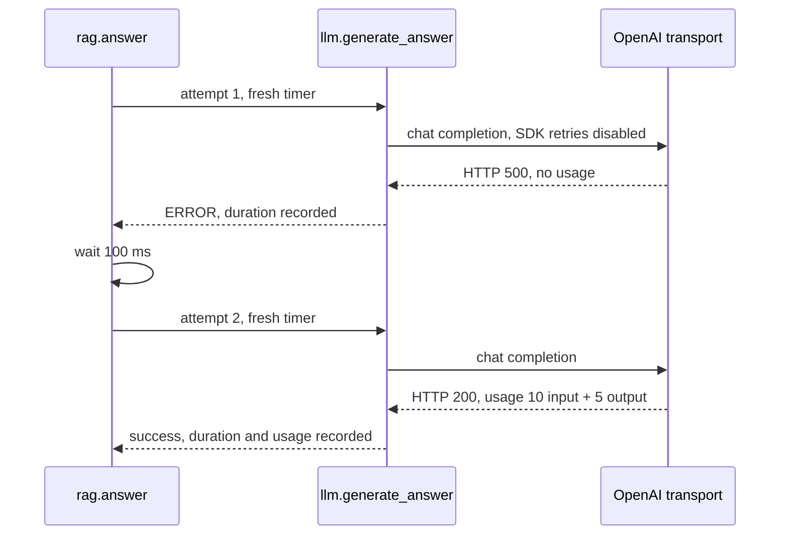

# Example: RAG with OpenTelemetry and Langfuse

Last checked against the Langfuse guide and official documentation on 2026-07-20.

This example shows a single Python service that:

- records a RAG trace in Langfuse;
- creates retriever, generation, and evaluator observations;
- records OpenTelemetry metrics on success and failure;
- handles empty retrieval without asking the model to invent an answer;
- stores safe, idempotent user feedback as a score.

Use the direct SDK bootstrap from [README.md](README.md). Set `LANGFUSE_RELEASE` and `LANGFUSE_TRACING_ENVIRONMENT` before constructing the client.

## First run the complete local application

From the repository root, use [the local lab setup](README.md#run-the-local-baselines). The canonical [rag_app.py](local/rag_app.py) implements `/answer`, authenticated server-derived identity, answer ownership, late feedback, metric recording and shutdown. Its model is deterministic; real Langfuse helpers export spans to the console and scores go to a local fixture. No provider or Langfuse backend receipt is claimed in this mode.

```bash
cd examples/local
LAB_PUBLIC_TOKEN=local-user-token uvicorn rag_app:app --host 127.0.0.1 --port 8083
```

In a second terminal:

```bash
curl --fail-with-body -sS http://127.0.0.1:8083/answer -H 'authorization: Bearer local-user-token' -H 'content-type: application/json' -d '{"question":"How do I reset SSO?"}'
```

Use the returned `langfuse_trace_id` in the feedback path below; the token identifies the same owner. Replace `RETURNED_TRACE_ID` with that exact value.

```bash
curl --fail-with-body -i http://127.0.0.1:8083/answers/RETURNED_TRACE_ID/feedback -H 'authorization: Bearer local-user-token' -H 'content-type: application/json' -H 'idempotency-key: feedback-0001' -d '{"accepted":false,"comment":"Stale citation"}'
```

The first request returns an answer and trace ID; feedback returns 204. Repeating the same key and payload returns 204, while changing its payload returns 409. An unknown or another owner's answer returns 404 without revealing existence. The fixture binds each score ID to the answer and retry key. Its dictionary state is process-local and lost on restart; production replaces it with a tenant-scoped durable repository plus an outbox for uncertain score writes. Do not hold a database lock across an external backend call: commit the outbox intent then deliver and reconcile separately.

The diagram follows one SSO request through completion and a later judgment:



The feedback arrives after the generation ended, so it is a judgment attached to an existing trace rather than a nested timed model call. Change the input to `EMPTY`: retrieval returns no documents, the service returns `no_context`, and generation/duration/token measurements are absent because no model call was attempted. The citation check only checks formatting; it cannot prove the model's claim is entailed by the source.

## 🔄 Shape of the Trace

```text
rag.answer
  rag.retrieve
  llm.generate_answer
  evaluator.citation_check
```

## Provider-backed RAG continuation

The next block is an implementation excerpt for replacing the local generation stub. It requires Profile A, a configured OpenAI account, and an authorized retrieval implementation. The local fixture owns the complete route, persistence and lifecycle; this function alone is not a web service.

## 🛠️ RAG Code

```python
import os
import time
from dataclasses import dataclass

from langfuse import propagate_attributes
from openai import APIConnectionError, APIStatusError, OpenAI
from opentelemetry import metrics

from observability import langfuse

openai = OpenAI(max_retries=0, timeout=1.0)
meter = metrics.get_meter("example.rag")

retrieval_documents = meter.create_histogram(
    "rag.retrieval.documents",
    unit="{document}",
    description="Number of documents returned by retrieval",
)
empty_retrievals = meter.create_counter(
    "rag.retrieval.empty",
    unit="{request}",
    description="RAG requests where retrieval returned no documents",
)
token_usage = meter.create_histogram(
    "gen_ai.client.token.usage",
    unit="{token}",
    description="Input and output tokens used by model calls",
)
operation_duration = meter.create_histogram(
    "gen_ai.client.operation.duration",
    unit="s",
    description="Duration of GenAI client operations",
)
operation_failures = meter.create_counter(
    "gen_ai.client.operation.failures",
    unit="{request}",
    description="Failed GenAI client operations",
)

from privacy import safe_text


@dataclass(frozen=True)
class Document:
    id: str
    title: str
    snippet: str
    score: float


def retrieve(query: str, *, limit: int) -> list[Document]:
    # Replace this with vector, hybrid, or keyword search. Enforce document ACLs
    # before returning results; observability must not bypass retrieval authorization.
    return [
        Document(
            id="doc_001",
            title="SSO Administration",
            snippet="Workspace admins can reset SSO configuration from Security settings.",
            score=0.82,
        )
    ][:limit]


def answer_question(question: str, *, user_id: str, session_id: str) -> dict:
    model = "gpt-4o-mini"
    prompt_version = "rag-prompt-v18"
    safe_question = safe_text(question, limit=1_000)

    # Environment is a first-class propagated field. Release is configured once on
    # the client through LANGFUSE_RELEASE (or Langfuse(release=...)).
    with propagate_attributes(
        trace_name="rag.answer",
        user_id=user_id,
        session_id=session_id,
        environment=os.environ["LANGFUSE_TRACING_ENVIRONMENT"],
        version=prompt_version,
        metadata={"retrievalStrategy": "hybrid-v2"},
        tags=["rag"],
    ):
        with langfuse.start_as_current_observation(
            as_type="span",
            name="rag.answer",
            input={"question": safe_question},
        ) as root:
            trace_id = langfuse.get_current_trace_id()

            with langfuse.start_as_current_observation(
                as_type="retriever",
                name="rag.retrieve",
                input={"query": safe_question, "limit": 5},
            ) as retrieval:
                documents = retrieve(question, limit=5)
                retrieval_documents.record(
                    len(documents),
                    {"retrieval.strategy": "hybrid-v2"},
                )
                if not documents:
                    empty_retrievals.add(1, {"retrieval.strategy": "hybrid-v2"})

                # Retain IDs, titles, and scores. Do not export full document bodies.
                retrieval.update(
                    output=[
                        {"id": doc.id, "title": safe_text(doc.title, limit=200), "score": doc.score}
                        for doc in documents
                    ],
                    metadata={"topK": 5, "index": "support-kb"},
                )

            if not documents:
                result = {
                    "status": "no_context",
                    "answer": "I could not find approved source material for this question.",
                    "citations_present": False,
                    "langfuse_trace_id": trace_id,
                }
                root.update(output=result, metadata={"stopReason": "empty_retrieval"})
                return result

            # Raw authorized snippets go to the model. Only a masked copy goes to tracing.
            context = "\n\n".join(
                f"[{doc.id}] {doc.title}\n{doc.snippet}" for doc in documents
            )
            messages = [
                {
                    "role": "system",
                    "content": "Answer using only the provided context and cite document IDs.",
                },
                {
                    "role": "user",
                    "content": f"Question: {question}\n\nContext:\n{context}",
                },
            ]
            traced_messages = [
                {"role": message["role"], "content": safe_text(message["content"])}
                for message in messages
            ]

            metric_attrs = {
                "http.route": "/answer",
                "gen_ai.operation.name": "chat",
                "gen_ai.provider.name": "openai",
                "gen_ai.request.model": model,
            }
            for attempt in range(1, 3):
                try:
                    started = time.perf_counter()
                    outcome = "success"
                    attempt_error = None

                    with langfuse.start_as_current_observation(
                        as_type="generation",
                        name="llm.generate_answer",
                        model=model,
                        input={"messages": traced_messages},
                        model_parameters={"temperature": 0.2},
                    ) as generation:
                        try:
                            response = openai.chat.completions.create(
                                model=model,
                                messages=messages,
                                temperature=0.2,
                            )
                            answer = response.choices[0].message.content or ""
                            usage = response.usage

                            if usage:
                                token_usage.record(
                                    usage.prompt_tokens,
                                    metric_attrs | {"gen_ai.token.type": "input"},
                                )
                                token_usage.record(
                                    usage.completion_tokens,
                                    metric_attrs | {"gen_ai.token.type": "output"},
                                )

                            generation.update(
                                output=safe_text(answer),
                                usage_details={
                                    "input_tokens": usage.prompt_tokens,
                                    "output_tokens": usage.completion_tokens,
                                } if usage is not None else None,
                            )
                        except Exception as exc:
                            outcome = "error"
                            error_type = type(exc).__name__
                            operation_failures.add(
                                1,
                                metric_attrs | {"error.type": error_type},
                            )
                            generation.update(level="ERROR", status_message=error_type)
                            attempt_error = exc
                            # The observation records only the bounded error class.
                            raise RuntimeError(error_type) from None
                        finally:
                            operation_duration.record(
                                time.perf_counter() - started,
                                metric_attrs | {"app.outcome": outcome},
                            )
                except Exception as exc:
                    provider_error = attempt_error if attempt_error is not None else exc
                    retryable = isinstance(provider_error, APIConnectionError) or (
                        isinstance(provider_error, APIStatusError)
                        and (provider_error.status_code in {408, 409, 429} or provider_error.status_code >= 500)
                    )
                    if attempt == 2 or not retryable:
                        raise
                    time.sleep(0.1)
                else:
                    break

            citation_ids = {doc.id for doc in documents}
            with langfuse.start_as_current_observation(
                as_type="evaluator",
                name="evaluator.citation_check",
                input={"candidate_ids": sorted(citation_ids), "answer": safe_text(answer)},
            ) as evaluator:
                matched_ids = sorted(doc_id for doc_id in citation_ids if doc_id in answer)
                citations_present = int(bool(matched_ids))
                evaluator.update(
                    output={"citation_present": bool(citations_present), "matched_ids": matched_ids}
                )
                langfuse.score_current_trace(
                    name="citation_present",
                    value=citations_present,
                    data_type="BOOLEAN",
                )

            result = {
                "status": "answered",
                "answer": answer,
                "citations_present": bool(citations_present),
                "langfuse_trace_id": trace_id,
            }
            root.update(
                output={
                    "status": result["status"],
                    "answer": safe_text(answer),
                    "citations_present": result["citations_present"],
                }
            )
            return result
```

The SDK normally retries selected errors twice. Here `max_retries=0` gives the application ownership: a synthetic 500 ends one ERROR generation and one duration measurement; after 100 ms, a new generation owns the second HTTP request. Only connection failures, 408, 409, 429 and 5xx responses get that one retry. A 401 ends the request immediately. The observation receives a sanitized exception containing only the error class; raw provider bodies are kept out of telemetry. Missing usage on the failed request remains unknown; do not insert zero tokens or infer that the provider did no billable work. The timer restarts inside the loop, so backoff belongs to `rag.answer` latency rather than either physical attempt.

For the SSO request, the parent survives the failed attempt while each generation closes before the next begins:



The two generation records share the `rag.answer` parent, rather than making the retry a child of the failed generation. One successful answer therefore does not imply one physical provider request.

The one-second provider timeout is a deliberately small lab setting, chosen inside the public request budget; tune it from measured model latency. SDK transport timeouts bound network phases, so this excerpt does not enforce a hard end-to-end deadline. Before deploying, enforce the public deadline in the request owner, include retrieval and retry delay, and cancel work when that deadline expires. Two attempts can incur duplicate provider work even if the first response was lost. See the [official SDK retry and timeout options](https://github.com/openai/openai-python#retries), checked 2026-10-28.

Run the local transport check from the repository root after the lab setup:

```bash
python examples/local/provider_retry_test.py
```

It executes both documented provider continuations with a real SDK and an in-memory HTTP transport: 500 → 200 must produce two HTTP requests and two generation records, the first failed without reported usage and the second successful with known usage. No paid provider or hosted Langfuse call occurs.

The model-call duration is recorded in `finally`, so timeouts and provider errors are part of latency distributions. Failures also increment a counter and mark the Langfuse generation as an error. This avoids dashboards that report only successful-call latency.

> 💡 **Key insight:** Recording `operation_duration` in `finally` means provider errors and timeouts count toward latency distributions — omitting this makes tail latency appear artificially low.

## 🔒 Safe Feedback Endpoint

> ⚠️ **Watch out:** Never write a score for a caller-supplied trace ID — validate ownership against the authenticated user's own application record first.

Do not expose a helper that writes a score for any caller-supplied trace ID. Authorize against the application record that stored the answer, not against baggage or a value echoed by the browser.

The following is a production adapter excerpt: connect the fail-closed repository function to your application storage before exposing it. The executable local endpoint is in `local/rag_app.py`.

```python
from typing import Annotated
from uuid import NAMESPACE_URL, uuid5

from fastapi import Depends, FastAPI, Header, HTTPException
from pydantic import BaseModel, Field

from observability import langfuse

app = FastAPI()


class FeedbackBody(BaseModel):
    accepted: bool
    comment: str | None = Field(default=None, max_length=500)


class Identity(BaseModel):
    user_id: str
    tenant_id: str


from identity import require_identity


def load_stored_answer(trace_id: str):
    raise NotImplementedError("Supply a tenant-scoped application answer repository")


@app.post("/answers/{trace_id}/feedback", status_code=204)
def record_feedback(
    trace_id: str,
    body: FeedbackBody,
    identity: Annotated[Identity, Depends(require_identity)],
    idempotency_key: Annotated[str, Header(min_length=8, max_length=128)],
) -> None:
    answer = load_stored_answer(trace_id)
    if (
        answer is None
        or answer.user_id != identity.user_id
        or answer.tenant_id != identity.tenant_id
    ):
        # Do not reveal whether another tenant's trace exists.
        raise HTTPException(status_code=404, detail="answer not found")

    score_id = str(uuid5(NAMESPACE_URL, f"{answer.id}:user_accepted:{idempotency_key}"))
    langfuse.create_score(
        score_id=score_id,
        trace_id=answer.langfuse_trace_id,
        name="user_accepted",
        value=1 if body.accepted else 0,
        data_type="BOOLEAN",
        comment=safe_text(body.comment, limit=500) if body.comment else None,
    )
```

Persist the idempotency key and request outcome if the application must return the same HTTP response across retries. A deterministic score ID prevents duplicate Langfuse scores when a request is retried after an uncertain network result.

## ⚠️ What `citation_present` Does Not Prove

This evaluator checks only whether at least one retrieved document ID appears as a substring in the answer.

> ⚠️ **Watch out:** An ID appearing as a substring does not confirm the answer correctly attributes the source — use this score only as a cheap formatting signal, not a groundedness check.

- False positive: the answer says "Unlike `[doc_001]`, this claim has no source." The ID is present, but it does not support the claim.
- False negative: the answer correctly paraphrases the retrieved source but uses a footnote format that omits the raw document ID.
- It does not check whether every factual claim is supported, whether the cited document entails the claim, or whether the cited passage was actually in the model context.

Use it as a cheap formatting signal. For groundedness, evaluate claim-to-source entailment against the exact retrieved passages, require structured citation spans, and calibrate the evaluator on human-reviewed examples.

## 🔔 What to Alert On

Export OpenTelemetry metrics and alert on:

- empty-retrieval rate with a minimum request-volume guard;
- model-call p95 duration by service, environment, model, operation, and outcome;
- model failure rate by low-cardinality error type;
- token usage by model and token type;
- HTTP request error rate from FastAPI instrumentation.

Use Langfuse for trace inspection, prompt-version comparison, cost/latency analysis, and examples behind low evaluator or user-feedback scores.

## Recap

- Authorized retrieval supplies approved context before a model call.
- Empty retrieval returns no_context without manufacturing a generation.
- Generation duration and tokens measure attempted calls, independently of trace retention.
- Store the trace with the answer so late feedback can verify ownership.
- Citation presence is formatting evidence; groundedness requires claim/source evaluation.

## Check yourself

**EMPTY returns HTTP 200. Should model duration receive a zero?**

<details><summary>Answer</summary>

No call occurred. A zero measurement would incorrectly imply a very fast model request. Record retrieval/HTTP outcomes; omit model duration and usage for that request.

</details>

**A retry reuses a feedback key but changes accepted=false to true. What should happen?**

<details><summary>Answer</summary>

409 rejects a payload conflict. A retry must repeat the original operation, otherwise one key would ambiguously name two judgments.

</details>

**A provider returns 500, then 200 with 15 reported tokens. How many durations and token measurements belong to the request?**

<details><summary>Answer</summary>

Two attempt durations belong to sibling generations, with one failure measurement. Only the successful response supplies token usage: one input and one output measurement totaling 15. The first request's consumption is unknown, so neither zero nor another 15 can be inferred. The parent includes the 100 ms wait, which is absent from the two attempt durations.

</details>

## Try it

Using the existing `/answer` scaffold, add a second empty-retrieval trigger without adding a model call. Hint: change the retrieval condition and keep the early-return path.

<details><summary>Worked solution</summary>

Extend the local document selection to return [] for both `EMPTY` and `NO_PERMISSION`, then invoke each. Both increment empty-retrieval and record document count zero, while neither creates llm.generate_answer. In production, authorization belongs in the retriever and the public result must avoid disclosing forbidden document existence.

</details>
