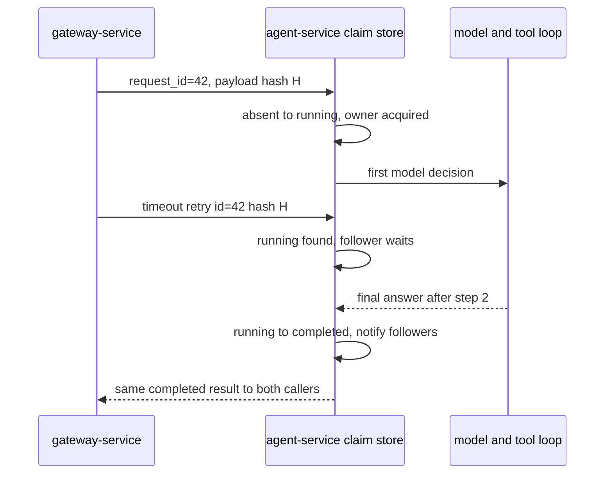

# Example: Multi-Service Agent

Last checked against the Langfuse and OpenTelemetry documentation on 2026-07-20.

This example has:

- a gateway that authenticates the caller and owns public request/session identity;
- an internal agent service with a real, bounded model-directed tool loop;
- W3C trace context and allowlisted Langfuse baggage across HTTP;
- one outcome record for every model and tool call;
- idempotent retry and explicit downstream-failure behavior.

Use bootstrap profile A from [README.md](README.md) in both processes. Each process initializes the Langfuse trace provider/exporter and OTLP metric reader before instrumenting FastAPI or HTTPX. Set a different `OTEL_SERVICE_NAME` in each process and the same `LANGFUSE_RELEASE` / `LANGFUSE_TRACING_ENVIRONMENT` deployment values.

## Run the complete local services

After [the lab setup](README.md#run-the-local-baselines), run these in separate terminals from `examples/local`. Tokens below are public loopback fixture values, not production credentials. The internal token is bound by the verifier to account-a; a client-controlled account field or baggage cannot expand it.

```bash
OTEL_SERVICE_NAME=agent-service INTERNAL_AGENT_TOKEN=local-gateway-token uvicorn agent_service:app --host 127.0.0.1 --port 8081
```

```bash
OTEL_SERVICE_NAME=gateway-service LAB_PUBLIC_TOKEN=local-user-token INTERNAL_AGENT_TOKEN=local-gateway-token AGENT_SERVICE_URL=http://127.0.0.1:8081 uvicorn gateway_service:app --host 127.0.0.1 --port 8080
```

```bash
curl --fail-with-body -sS http://127.0.0.1:8080/answer -H 'authorization: Bearer local-user-token' -H 'content-type: application/json' -d '{"question":"How do I reset SSO?"}'
```

Expect `steps=2`, `stop_reason=final_answer`, and a trace ID shared by the gateway, HTTPX CLIENT and agent SERVER/business spans. A fixed model decision asks for account tier then returns an answer using that result. These are two decisions and one tool call; steps cannot stand in for tool totals. `/run` without the internal credential returns 401 **before** any model/tool work. The complete modules are [gateway_service.py](local/gateway_service.py), [agent_service.py](local/agent_service.py), [identity.py](local/identity.py), [result_store.py](local/result_store.py), [privacy.py](local/privacy.py), and [observability.py](local/observability.py).

Optional retrieval process, used by the three-service propagation lesson:

```bash
OTEL_SERVICE_NAME=retrieval-service INTERNAL_AGENT_TOKEN=local-gateway-token uvicorn retrieval_service:app --host 127.0.0.1 --port 8082
```

Restart the gateway with `RETRIEVAL_SERVICE_URL=http://127.0.0.1:8082` in its environment, then send a fresh request. Stop servers with Ctrl-C; close HTTP clients before flushing exporters. The [verification runner](local/verify_local.py) also starts, tests and cleans up all four local fixtures, including RAG, without real backend keys.

The provider-backed snippets below are continuation excerpts: replace the fixed decision fixture with a reviewed real-provider request and durable tenant-scoped stores. The loopback identity fixture is intentionally one account and one process; it is not a production authentication service.

## 🏗️ Architecture

```text
client
  -> gateway-service SERVER span
       gateway.answer
       -> HTTPX CLIENT span + traceparent + bounded baggage
          -> agent-service SERVER span
               agent.answer (max 5 decision steps)
                 llm.decide
                 tool.search_docs or tool.lookup_account
                 ...
                 llm.decide/final_answer
```

The Langfuse client is constructed with `should_export_span=lambda span: True` in the shared bootstrap so the FastAPI and HTTPX spans that connect the services are not filtered out. Do not configure a second global trace provider in either process.

> ⚠️ **Watch out:** Configuring a second global trace provider in either service creates duplicate spans and splits trace context — the Langfuse client already owns the provider.

## 🛠️ Gateway Service

```python
# gateway_service.py
import asyncio
import os
from contextlib import asynccontextmanager
from uuid import uuid4

import httpx
from fastapi import Depends, FastAPI, HTTPException
from langfuse import propagate_attributes
from opentelemetry import baggage, context
from opentelemetry.instrumentation.fastapi import FastAPIInstrumentor
from opentelemetry.instrumentation.httpx import HTTPXClientInstrumentor
from pydantic import BaseModel, Field

# This import initializes trace export and the metric reader before instrumentation.
from observability import langfuse, shutdown_observability
from privacy import safe_text


class AnswerRequest(BaseModel):
    question: str = Field(min_length=1, max_length=4_000)


class Identity(BaseModel):
    user_id: str
    tenant_id: str
    account_id: str


class ServerSession(BaseModel):
    session_id: str


from identity import require_identity


def load_session(identity=Depends(require_identity)) -> ServerSession:
    return ServerSession(session_id=identity.session_id)


@asynccontextmanager
async def lifespan(app: FastAPI):
    app.state.agent_client = httpx.AsyncClient(
        base_url=os.getenv("AGENT_SERVICE_URL", "http://agent-service:8080"),
        timeout=httpx.Timeout(20.0, connect=2.0),
        limits=httpx.Limits(max_connections=100, max_keepalive_connections=20),
        headers={"authorization": f"Bearer {os.environ['INTERNAL_AGENT_TOKEN']}"},
    )
    try:
        yield
    finally:
        await app.state.agent_client.aclose()
        shutdown_observability()


app = FastAPI(lifespan=lifespan)
HTTPXClientInstrumentor().instrument()
FastAPIInstrumentor.instrument_app(app)


async def call_agent(payload: dict) -> dict:
    """Retry only an idempotent internal request, then return a stable public error."""
    last_error: Exception | None = None

    for attempt in range(2):
        try:
            response = await app.state.agent_client.post("/run", json=payload)
        except httpx.TimeoutException as exc:
            last_error = exc
            if attempt == 0:
                await asyncio.sleep(0.1)
                continue
            raise HTTPException(status_code=504, detail="agent timed out") from exc
        except httpx.ConnectError as exc:
            last_error = exc
            if attempt == 0:
                await asyncio.sleep(0.1)
                continue
            raise HTTPException(status_code=503, detail="agent unavailable") from exc

        if response.status_code >= 500:
            if attempt == 0:
                await asyncio.sleep(0.1)
                continue
            raise HTTPException(status_code=503, detail="agent unavailable")
        if response.status_code >= 400:
            # Internal 4xx responses indicate a contract/authentication failure, not a
            # caller error. Do not leak the downstream response body.
            raise HTTPException(status_code=502, detail="agent request rejected")
        return response.json()

    raise HTTPException(status_code=503, detail="agent unavailable") from last_error


@app.post("/answer")
async def answer(
    body: AnswerRequest,
    identity: Identity = Depends(require_identity),
    session: ServerSession = Depends(load_session),
) -> dict:
    request_id = str(uuid4())
    safe_question = safe_text(body.question, limit=1_000)

    # Preserve current trace, discard caller baggage before adding trusted fields.
    baggage_handle = context.attach(baggage.clear())
    try:
        with propagate_attributes(
            trace_name="agent.answer",
            user_id=identity.user_id,
            session_id=session.session_id,
            environment=os.environ["LANGFUSE_TRACING_ENVIRONMENT"],
            version=os.getenv("AGENT_VERSION", "agent-dev"),
            metadata={"entrypoint": "public-api"},
            tags=["agent", "gateway"],
            as_baggage=True,
        ):
            with langfuse.start_as_current_observation(
                as_type="span",
                name="gateway.answer",
                input={"question": safe_question},
            ) as span:
                trace_id = langfuse.get_current_trace_id()
                try:
                    result = await call_agent(
                        {
                            "request_id": request_id,
                            "question": body.question,
                            # This is trusted service-to-service input derived from auth. It
                            # is not baggage and the internal route authenticates the gateway.
                            "account_id": identity.account_id,
                        }
                    )
                except HTTPException as exc:
                    span.update(level="ERROR", status_message=f"downstream_{exc.status_code}")
                    raise

                public_result = {
                    "answer": result["answer"],
                    "stop_reason": result["stop_reason"],
                    "steps": result["steps"],
                    "langfuse_trace_id": trace_id,
                }
                span.update(
                    output={
                        **public_result,
                        "answer": safe_text(public_result["answer"]),
                    }
                )
                return public_result
    finally:
        context.detach(baggage_handle)

```

A completion-only cache cannot make overlapping retries safe: both requests can see no result and begin model work. The canonical local `ResultStore` claims a request atomically before execution; followers wait for its completed result, and a changed payload with the same key gets 409. A failed owner leaves failed state and needs a new explicit request. Its state is process-local, so it prevents overlap only within that one running service. The diagram below shows why completed-row uniqueness is weaker.



Claim acquisition precedes model work, so a follower does not start a second generation. A unique constraint written only after completion would allow both calls to enter the loop. For production use, store a tenant-scoped payload hash, ownership token, state and lease in a durable transaction; renew ownership while working and fence stale owners before publishing completion. Do not automatically rerun unknown-outcome writes when a lease expires. Tool-specific transactional idempotency is required at each write boundary, because process failure can occur after a write and before completion is persisted. This local read-only fixture does not claim durable exactly-once execution.

## 🛠️ Agent Service

The model decides whether to call an allowed tool or return a final answer. `MAX_STEPS` bounds model decision iterations; tool names and arguments are validated before execution.

```python
# agent_service.py
import json
import os
import time
from contextlib import asynccontextmanager
from fastapi import Depends, FastAPI, HTTPException
from openai import OpenAI
from opentelemetry import metrics
from opentelemetry.instrumentation.fastapi import FastAPIInstrumentor
from pydantic import BaseModel, Field

from observability import langfuse, shutdown_observability
from privacy import safe_text

MAX_STEPS = 5
MODEL = "gpt-4o-mini"
openai = OpenAI()
meter = metrics.get_meter("example.agent")

agent_steps = meter.create_histogram("agent.steps", unit="{step}")
tool_calls = meter.create_counter("agent.tool.calls", unit="{call}")
tool_failures = meter.create_counter("agent.tool.failures", unit="{call}")
llm_duration = meter.create_histogram("gen_ai.client.operation.duration", unit="s")
llm_failures = meter.create_counter("gen_ai.client.operation.failures", unit="{request}")
token_usage = meter.create_histogram("gen_ai.client.token.usage", unit="{token}")


class RunRequest(BaseModel):
    request_id: str = Field(min_length=8, max_length=128)
    question: str = Field(min_length=1, max_length=4_000)
    account_id: str = Field(pattern=r"^[a-zA-Z0-9_-]{1,128}$")


from identity import require_gateway
from result_store import ResultStore

store = ResultStore()


def search_docs(query: str) -> list[dict]:
    return [{"id": "doc_001", "snippet": "Admins can reset SSO in Security settings."}]


def lookup_account(account_id: str) -> dict:
    from identity import ACCOUNTS
    return dict(ACCOUNTS[account_id])


TOOLS = [
    {
        "type": "function",
        "function": {
            "name": "search_docs",
            "description": "Search approved support documentation.",
            "parameters": {
                "type": "object",
                "properties": {"query": {"type": "string", "maxLength": 1000}},
                "required": ["query"],
                "additionalProperties": False,
            },
        },
    },
    {
        "type": "function",
        "function": {
            "name": "lookup_account",
            "description": "Return the authenticated account's tier and region.",
            "parameters": {"type": "object", "properties": {}, "additionalProperties": False},
        },
    },
]


def execute_tool(name: str, raw_arguments: str, *, request: RunRequest) -> dict:
    # Normalize untrusted model output before using it as a span name or metric label.
    metric_name = name if name in {"search_docs", "lookup_account"} else "unsupported_tool"
    outcome = "success"

    with langfuse.start_as_current_observation(
        as_type="tool",
        name=f"tool.{metric_name}",
        input={"tool": metric_name},
    ) as tool:
        try:
            arguments = json.loads(raw_arguments or "{}")
            if not isinstance(arguments, dict):
                raise TypeError("tool_arguments_must_be_an_object")

            if name == "search_docs":
                query = arguments["query"]
                if not isinstance(query, str) or not query.strip():
                    raise ValueError("invalid_search_query")
                tool.update(input={"query": safe_text(query, limit=1_000)})
                value = search_docs(query[:1_000])
                traced_output = {"documents": [doc["id"] for doc in value]}
            elif name == "lookup_account":
                tool.update(input={"account_ref": "authenticated_account"})
                value = lookup_account(request.account_id)
                traced_output = {"tier": value["tier"], "region": value["region"]}
            else:
                raise ValueError("unsupported_tool")

            tool.update(output=traced_output)
            return value
        except Exception as exc:
            outcome = "error"
            error_type = type(exc).__name__
            tool_failures.add(1, {"tool.name": metric_name, "error.type": error_type})
            tool.update(level="ERROR", status_message=error_type)
            raise
        finally:
            # Exactly one call measurement, after the outcome is known.
            tool_calls.add(1, {"tool.name": metric_name, "app.outcome": outcome})


@asynccontextmanager
async def lifespan(app: FastAPI):
    try:
        yield
    finally:
        shutdown_observability()


app = FastAPI(lifespan=lifespan)
FastAPIInstrumentor.instrument_app(app)


def execute_agent(request: RunRequest) -> dict:

    messages: list[dict] = [
        {
            "role": "system",
            "content": (
                "Answer support questions with approved tool results. Use account tier/region "
                "when relevant, cite document IDs, and do not invent missing facts."
            ),
        },
        {"role": "user", "content": request.question},
    ]
    stop_reason = "max_steps"
    answer = "I could not complete the request within the tool-step limit."
    steps_used = 0

    with langfuse.start_as_current_observation(
        as_type="agent",
        name="agent.answer",
        input={"question": safe_text(request.question, limit=1_000)},
        metadata={"maxSteps": MAX_STEPS},
    ) as agent:
        for step in range(1, MAX_STEPS + 1):
            steps_used = step
            metric_attrs = {
                "http.route": "/run",
                "gen_ai.operation.name": "chat",
                "gen_ai.provider.name": "openai",
                "gen_ai.request.model": MODEL,
            }
            started = time.perf_counter()
            outcome = "success"

            with langfuse.start_as_current_observation(
                as_type="generation",
                name="llm.decide",
                model=MODEL,
                input={
                    "messages": [
                        {"role": m["role"], "content": safe_text(str(m.get("content", "")))}
                        for m in messages[-8:]
                    ]
                },
                model_parameters={"temperature": 0.1},
            ) as generation:
                try:
                    response = openai.chat.completions.create(
                        model=MODEL,
                        messages=messages,
                        tools=TOOLS,
                        tool_choice="auto",
                        temperature=0.1,
                    )
                    choice = response.choices[0]
                    message = choice.message
                    usage = response.usage
                    if usage is not None:
                        token_usage.record(usage.prompt_tokens, metric_attrs | {"gen_ai.token.type": "input"})
                        token_usage.record(usage.completion_tokens, metric_attrs | {"gen_ai.token.type": "output"})
                    generation.update(
                        output={
                            "finish_reason": choice.finish_reason,
                            "content": safe_text(message.content or ""),
                            "tool_names": [
                                call.function.name if call.function.name in {"search_docs", "lookup_account"}
                                else "unsupported_tool"
                                for call in (message.tool_calls or [])[:5]
                            ],
                        },
                        usage_details={
                            "input_tokens": usage.prompt_tokens,
                            "output_tokens": usage.completion_tokens,
                        } if usage is not None else None,
                    )
                except Exception as exc:
                    outcome = "error"
                    error_type = type(exc).__name__
                    llm_failures.add(1, metric_attrs | {"error.type": error_type})
                    generation.update(level="ERROR", status_message=error_type)
                    agent.update(level="ERROR", status_message="model_call_failed")
                    raise HTTPException(status_code=503, detail="model unavailable") from exc
                finally:
                    llm_duration.record(
                        time.perf_counter() - started,
                        metric_attrs | {"app.outcome": outcome},
                    )

            messages.append(message.model_dump(exclude_none=True))
            if not message.tool_calls:
                answer = message.content or ""
                stop_reason = "final_answer"
                break

            for call in message.tool_calls:
                name = call.function.name
                try:
                    tool_result = execute_tool(
                        name,
                        call.function.arguments or "{}",
                        request=request,
                    )
                    content = json.dumps(tool_result)
                except Exception as exc:
                    # Validation and execution failures are visible as a bounded result. The
                    # next decision may recover; arbitrary exception messages never leak.
                    content = json.dumps({"error": type(exc).__name__})

                messages.append(
                    {"role": "tool", "tool_call_id": call.id, "content": content[:4_000]}
                )

        result = {"answer": answer, "steps": steps_used, "stop_reason": stop_reason}
        agent_steps.record(
            steps_used,
            {"gen_ai.agent.name": "support_agent", "app.stop_reason": stop_reason},
        )
        agent.update(
            output={"answer": safe_text(answer), "steps": steps_used},
            metadata={"stopReason": stop_reason},
        )
    return result


@app.post("/run")
def run_agent(request: RunRequest, identity=Depends(require_gateway)) -> dict:
    if request.account_id != identity.account_id:
        raise HTTPException(status_code=403, detail="account scope mismatch")
    return store.run(
        (identity.tenant_id, request.request_id), request.model_dump(),
        lambda: execute_agent(request),
    )
```

The account result is no longer discarded: when selected, it becomes a tool message used by the next model decision. A failed search, account lookup, or model call records an error observation and an operational metric. Tool-call metrics are emitted once, after the final outcome is known.

## 🔍 Failure Policy

| Failure | Retry | Client result | Idempotency rule |
| --- | --- | --- | --- |
| Gateway connection failure | Once with short backoff | `503` | Reuse the same `request_id` |
| Gateway timeout | Once | `504` | Agent result store deduplicates the request |
| Agent `5xx` | Once | `503` | Retry only the whole read-only run |
| Agent `4xx` | No | `502` | Treat as internal auth/contract defect |
| Read-only tool failure | Agent can choose another step | Bounded error result or final failure | Count the execution once |
| Write tool failure | Operation-specific only | Explicit partial/failure result | Require a tool-level idempotency key; never replay blindly |
| Model failure | No hidden application retry in this example | Agent `503`, gateway `503` | Add bounded provider retries only if their total latency fits the deadline |

Set an end-to-end deadline shorter than the public proxy timeout. Retry budgets must fit within it; otherwise retries convert a fast error into a slow error.

## 🔔 Correlation and Alerts

Verify that the gateway server span, HTTP client span, agent server span, Langfuse observations, and logs share one trace ID. Baggage carries only opaque user/session identity and bounded trace attributes; authorization-sensitive account identity travels in an authenticated internal request.

Alert on signals actually produced here:

- gateway 5xx/timeout rate with traffic guards;
- agent p95 latency and max-step stops;
- tool failure rate by bounded tool name;
- model failure rate and p95 duration by model and service;
- Collector/exporter loss if using an intermediate metrics Collector.

Thumbs-down and groundedness alerts require score producers and a native Langfuse Monitor or a scheduled Metrics API bridge. They are intentionally not claimed by this example.

## Recap

- Authenticate public and internal boundaries before model/tool work.
- HTTP propagation connects remote spans; verified identity controls account access.
- Bound decision iterations independently from the number of tools per decision.
- An atomic in-flight claim prevents overlapping local retries from doing duplicate work.
- Durable crash recovery and write-tool idempotency need stronger ownership and transaction boundaries.

## Check yourself

**Both retries see no completed row. Is completion-row uniqueness enough?**

<details><summary>Answer</summary>

No. Work begins before either inserts completion. Claim running state atomically first; followers wait rather than execute.

</details>

**The caller guesses another account ID and supplies it with valid traceparent. Is the account authorized?**

<details><summary>Answer</summary>

No. Trace context is correlation. The verifier's account scope is authoritative; a mismatch is rejected before tool execution.

</details>

## Try it

Using `ResultStore.run`, submit the same key with a different question while the first request is running. Hint: fingerprint the whole payload before checking state.

<details><summary>Worked solution</summary>

The second call raises 409 because its fingerprint differs, even if the first is not yet complete. Reusing a key cannot merge distinct intended operations. The original owner still completes normally.

</details>
