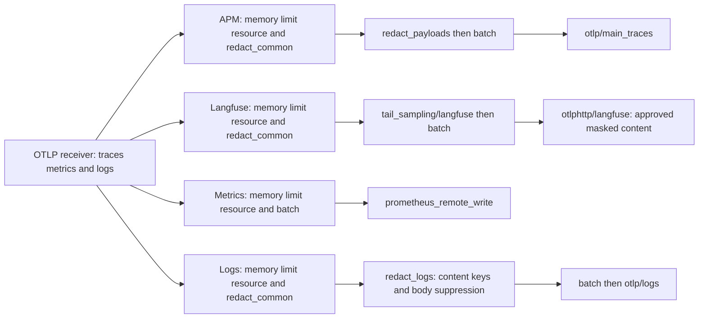
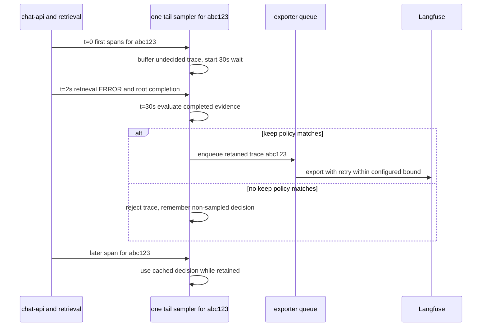

# Example: Collector, Prometheus, Langfuse, and Alerts

Collector schema and local sampling/privacy tests checked on 2026-10-14 against Contrib 0.158.0. External Langfuse destinations and durable recovery require the production gates below.

This example uses the OpenTelemetry Collector as a production routing layer:

- traces go to a general tracing backend;
- LLM and agent traces also go to Langfuse;
- metrics go to a Prometheus-compatible backend;
- logs go to a log backend;
- alert rules run from metrics, while Langfuse is used for investigation and quality workflows.

The diagram follows one SSO request into four independently owned outputs. Look at the extra content deletion on APM and the sampling decision only on Langfuse.



The main trace destination receives operational shape without content; the Langfuse destination may retain approved masked content after its trace decision. Metrics do not inherit trace sampling, and logs do not wait for the tail decision. Therefore a log can retain a valid trace ID for a trace absent from Langfuse, while the same trace still exists in the unsampled main backend. Universal secrets must be removed on each relevant branch, not just the one that happened to be inspected during a smoke test.

## 🔀 Collector Configuration

```yaml
extensions:
  health_check:
    endpoint: 0.0.0.0:13133
  file_storage:
    directory: /var/lib/otelcol/storage
    create_directory: true

receivers:
  otlp:
    protocols:
      grpc:
        endpoint: 0.0.0.0:4317
      http:
        endpoint: 0.0.0.0:4318

processors:
  memory_limiter:
    check_interval: 1s
    limit_mib: 1024
    spike_limit_mib: 256
  batch:
    timeout: 5s
    send_batch_size: 1024
  resource:
    attributes:
      - key: deployment.environment.name
        value: prod
        action: upsert
  attributes/redact_common:
    actions:
      - key: http.request.header.authorization
        action: delete
      - key: http.request.header.cookie
        action: delete
      - key: http.response.header.set_cookie
        action: delete
      - key: db.query.text
        action: delete
      - key: db.statement
        action: delete
      - key: exception.message
        action: delete
      - key: exception.stacktrace
        action: delete
      - key: user.email
        action: delete
  attributes/redact_payloads:
    actions:
      - key: gen_ai.system_instructions
        action: delete
      - key: gen_ai.input.messages
        action: delete
      - key: gen_ai.output.messages
        action: delete
      - key: gen_ai.tool.definitions
        action: delete
      - key: gen_ai.tool.call.arguments
        action: delete
      - key: gen_ai.tool.call.result
        action: delete
      - key: langfuse.observation.input
        action: delete
      - key: langfuse.observation.output
        action: delete
      - key: langfuse.trace.input
        action: delete
      - key: langfuse.trace.output
        action: delete
      - key: llm.prompts
        action: delete
      - key: llm.completions
        action: delete
  transform/redact_logs:
    error_mode: propagate
    log_statements:
      - context: log
        statements:
          - delete_key(attributes, "gen_ai.system_instructions")
          - delete_key(attributes, "gen_ai.input.messages")
          - delete_key(attributes, "gen_ai.output.messages")
          - delete_key(attributes, "gen_ai.tool.definitions")
          - delete_key(attributes, "gen_ai.tool.call.arguments")
          - delete_key(attributes, "gen_ai.tool.call.result")
          - delete_key(attributes, "langfuse.observation.input")
          - delete_key(attributes, "langfuse.observation.output")
          - delete_key(attributes, "langfuse.trace.input")
          - delete_key(attributes, "langfuse.trace.output")
          - delete_key(attributes, "llm.prompts")
          - delete_key(attributes, "llm.completions")
          - set(body, "[REDACTED_BY_DEFAULT]") where body != nil
  tail_sampling/langfuse:
    decision_wait: 30s
    num_traces: 50000
    expected_new_traces_per_sec: 500
    decision_cache:
      sampled_cache_size: 100000
      non_sampled_cache_size: 100000
    policies:
      - name: drop-explicit-no-sample
        type: drop
        drop:
          drop_sub_policy:
            - name: do-not-sample
              type: boolean_attribute
              boolean_attribute:
                key: app.do_not_sample
                value: true
      - name: keep-llm-errors
        type: and
        and:
          and_sub_policy:
            - name: is-llm-workflow
              type: boolean_attribute
              boolean_attribute:
                key: llm.workflow
                value: true
            - name: has-error-status
              type: status_code
              status_code:
                status_codes: [ERROR]
      - name: keep-provider-error-types
        type: and
        and:
          and_sub_policy:
            - name: is-llm-workflow
              type: boolean_attribute
              boolean_attribute:
                key: llm.workflow
                value: true
            - name: provider-error-type
              type: string_attribute
              string_attribute:
                key: error.type
                values: ["RateLimitError", "TimeoutError", "APIConnectionError"]
      - name: keep-slow-llm-traces
        type: and
        and:
          and_sub_policy:
            - name: is-llm-workflow
              type: boolean_attribute
              boolean_attribute:
                key: llm.workflow
                value: true
            - name: trace-latency-over-15s
              type: latency
              latency:
                threshold_ms: 15000
      - name: keep-large-agent-traces
        type: and
        and:
          and_sub_policy:
            - name: is-llm-workflow
              type: boolean_attribute
              boolean_attribute:
                key: llm.workflow
                value: true
            - name: many-spans
              type: span_count
              span_count:
                min_spans: 40
      - name: keep-high-input-token-traces
        type: and
        and:
          and_sub_policy:
            - name: is-llm-workflow
              type: boolean_attribute
              boolean_attribute:
                key: llm.workflow
                value: true
            - name: high-input-tokens
              type: numeric_attribute
              numeric_attribute:
                key: gen_ai.usage.input_tokens
                min_value: 8000
      - name: keep-high-output-token-traces
        type: and
        and:
          and_sub_policy:
            - name: is-llm-workflow
              type: boolean_attribute
              boolean_attribute:
                key: llm.workflow
                value: true
            - name: high-output-tokens
              type: numeric_attribute
              numeric_attribute:
                key: gen_ai.usage.output_tokens
                min_value: 4096
      - name: keep-high-cost-traces
        type: and
        and:
          and_sub_policy:
            - name: is-llm-workflow
              type: boolean_attribute
              boolean_attribute:
                key: llm.workflow
                value: true
            - name: high-estimated-cost
              type: numeric_attribute
              numeric_attribute:
                key: app.llm.cost_microusd
                min_value: 500000
      - name: keep-guardrail-blocks
        type: and
        and:
          and_sub_policy:
            - name: is-llm-workflow
              type: boolean_attribute
              boolean_attribute:
                key: llm.workflow
                value: true
            - name: guardrail-blocked
              type: boolean_attribute
              boolean_attribute:
                key: app.guardrail.blocked
                value: true
      - name: keep-selected-models
        type: and
        and:
          and_sub_policy:
            - name: is-llm-workflow
              type: boolean_attribute
              boolean_attribute:
                key: llm.workflow
                value: true
            - name: model-under-review
              type: string_attribute
              string_attribute:
                key: gen_ai.request.model
                values: ["gpt-4.1", "claude-3-5-sonnet"]
      - name: keep-selected-experiments
        type: and
        and:
          and_sub_policy:
            - name: is-llm-workflow
              type: boolean_attribute
              boolean_attribute:
                key: llm.workflow
                value: true
            - name: experiment-under-review
              type: string_attribute
              string_attribute:
                key: app.experiment.name
                values: ["rag-reranker-v2", "prompt-v17"]
      - name: keep-selected-tenant-tiers
        type: and
        and:
          and_sub_policy:
            - name: is-llm-workflow
              type: boolean_attribute
              boolean_attribute:
                key: llm.workflow
                value: true
            - name: high-value-tenant-tier
              type: string_attribute
              string_attribute:
                key: app.tenant.tier
                values: ["enterprise", "internal"]
      - name: keep-new-release-burn-in
        type: and
        and:
          and_sub_policy:
            - name: is-llm-workflow
              type: boolean_attribute
              boolean_attribute:
                key: llm.workflow
                value: true
            - name: release-under-observation
              type: string_attribute
              string_attribute:
                key: service.version
                values: ["2026.07.20-1"]
      - name: sample-normal-llm-workflows
        type: and
        and:
          and_sub_policy:
            - name: is-llm-workflow
              type: boolean_attribute
              boolean_attribute:
                key: llm.workflow
                value: true
            - name: sample-five-percent
              type: probabilistic
              probabilistic:
                sampling_percentage: 5

exporters:
  otlp/main_traces:
    endpoint: traces.example.com:4317
    tls:
      insecure: false
    sending_queue:
      enabled: true
      queue_size: 10000
      storage: file_storage
    retry_on_failure:
      enabled: true
      initial_interval: 5s
      max_interval: 30s
      max_elapsed_time: 10m

  otlphttp/langfuse:
    endpoint: ${env:LANGFUSE_OTEL_ENDPOINT}
    headers:
      Authorization: "Basic ${env:LANGFUSE_AUTH_STRING}"
      x-langfuse-ingestion-version: "4"
    sending_queue:
      enabled: true
      queue_size: 10000
      storage: file_storage
    retry_on_failure:
      enabled: true
      initial_interval: 5s
      max_interval: 30s
      max_elapsed_time: 10m

  prometheus_remote_write:
    endpoint: https://prometheus.example.com/api/v1/write
    translation_strategy: UnderscoreEscapingWithoutSuffixes
    resource_to_telemetry_conversion:
      enabled: true
    remote_write_queue:
      enabled: true
      queue_size: 10000
      num_consumers: 5
    retry_on_failure:
      enabled: true
      initial_interval: 5s
      max_interval: 30s
      max_elapsed_time: 10m

  otlp/logs:
    endpoint: logs.example.com:4317
    tls:
      insecure: false
    sending_queue:
      enabled: true
      queue_size: 10000
      storage: file_storage
    retry_on_failure:
      enabled: true
      initial_interval: 5s
      max_interval: 30s
      max_elapsed_time: 10m

service:
  extensions: [health_check, file_storage]
  pipelines:
    traces/main:
      receivers: [otlp]
      processors: [memory_limiter, resource, attributes/redact_common, attributes/redact_payloads, batch]
      exporters: [otlp/main_traces]

    traces/langfuse:
      receivers: [otlp]
      processors: [memory_limiter, resource, attributes/redact_common, tail_sampling/langfuse, batch]
      exporters: [otlphttp/langfuse]

    metrics:
      receivers: [otlp]
      processors: [memory_limiter, resource, batch]
      exporters: [prometheus_remote_write]

    logs:
      receivers: [otlp]
      processors: [memory_limiter, resource, attributes/redact_common, transform/redact_logs, batch]
      exporters: [otlp/logs]
```

The general trace backend receives `attributes/redact_payloads`; Langfuse does not, because masked LLM payloads are useful there. Both trace paths still remove credentials, database statements, and exception fields. Named events use the logs pipeline, which removes sensitive event attributes and replaces bodies entirely in this safe-default template. Replace that rule only with a tested structured-log allowlist.

The tail sampler in this configuration belongs only to `traces/langfuse`.
The `logs` pipeline does not receive its keep/drop decision. A log can therefore
retain a `trace_id` for a trace rejected from Langfuse, even though this example's
unsampled `traces/main` pipeline may still retain that trace in the general
backend. If every trace destination uses tail sampling, the same log can remain
when no trace backend has the trace. See
[Trace Sampling Does Not Sample Logs](../opentelemetry/03_production_architecture.md#trace-sampling-does-not-sample-logs)
for head-sampling filters, tail-aligned buffering tradeoffs, and the required
relationship between error logs and span status.

> 💡 **Key insight:** The tail sampler applies only to `traces/langfuse` — the general traces pipeline is unaffected, so traces rejected from Langfuse may still appear in the general backend.

These lists are deny-by-key second lines of defense. Application code must allowlist captured content before it creates spans or log events, especially on the richer Langfuse path. Add keys for every captured header and instrumentation library, then test canary secrets in span attributes, log-event attributes and bodies, and exception data.

`UnderscoreEscapingWithoutSuffixes` is explicit: dots and unsupported characters become underscores, while unit and counter-type suffixes are not added. Histogram structural series still use `_bucket`, `_count`, and `_sum`. The PromQL below is written for that strategy. If you choose the default `UnderscoreEscapingWithSuffixes`, regenerate and test every series name instead of copying these rules.

Validate Collector config before deployment:

```bash
otelcol validate --config collector.yaml
```

## 🔌 Langfuse Authentication and Region

> ⚠️ **Watch out:** Store the auth string in a secret manager, not a ConfigMap or committed `.env` file — it encodes your full Langfuse ingestion credentials.

`LANGFUSE_AUTH_STRING` is Base64 encoding of the existing `public_key:secret_key` pair. It is not a third credential. Create it without a trailing newline and inject it through the deployment secret manager:

```bash
export LANGFUSE_PUBLIC_KEY="pk-lf-..."
export LANGFUSE_SECRET_KEY="sk-lf-..."
export LANGFUSE_AUTH_STRING="$(printf '%s' "${LANGFUSE_PUBLIC_KEY}:${LANGFUSE_SECRET_KEY}" | base64 | tr -d '\n')"
```

Select the endpoint for the project's data region:

```bash
# EU
export LANGFUSE_OTEL_ENDPOINT="https://cloud.langfuse.com/api/public/otel"
# US:    https://us.cloud.langfuse.com/api/public/otel
# Japan: https://jp.cloud.langfuse.com/api/public/otel
# HIPAA: https://hipaa.cloud.langfuse.com/api/public/otel
# Self-hosted: https://langfuse.example.com/api/public/otel
```

> 💡 **Key insight:** `LANGFUSE_AUTH_STRING` is your existing public/secret key pair Base64-encoded — it is not a new credential to provision or rotate independently.

Store the keys and encoded value in a secret manager, not a ConfigMap or committed `.env` file. Restrict the storage directory for `file_storage`; it contains telemetry buffered during outages. The `x-langfuse-ingestion-version: 4` header opts raw OTLP spans into Langfuse Cloud Fast Preview so v2 views update in real time.

## 🗺️ Application Environment

Applications export to the Collector, not directly to every backend.

```bash
export OTEL_SERVICE_NAME="agent-service"
export LANGFUSE_RELEASE="2026.07.20-1"
export LANGFUSE_TRACING_ENVIRONMENT="prod"
export OTEL_RESOURCE_ATTRIBUTES="service.version=${LANGFUSE_RELEASE},deployment.environment.name=${LANGFUSE_TRACING_ENVIRONMENT}"
export OTEL_EXPORTER_OTLP_ENDPOINT="http://otel-collector:4317"
export OTEL_EXPORTER_OTLP_PROTOCOL="grpc"
export OTEL_SEMCONV_STABILITY_OPT_IN="http"
```

`OTEL_SEMCONV_STABILITY_OPT_IN=http` selects the stable HTTP metric and attribute names used by the rules below. During a migration, `http/dup` emits old and stable telemetry together and therefore requires deduplication; do not leave it enabled accidentally.

> ⚠️ **Watch out:** Do not leave `OTEL_SEMCONV_STABILITY_OPT_IN=http/dup` enabled in production — it emits duplicate telemetry that must be deduplicated before alerting on it.

The Collector tail-sampling policy above keeps complete LLM traces when they
match important values or thresholds:

- error status or selected `error.type` values;
- trace latency above 15 seconds;
- large agent traces with at least 40 spans;
- high input/output token counts;
- estimated LLM cost at or above `$0.50`;
- guardrail blocks;
- selected models, experiments, tenant tiers, or release burn-in values;
- 5% of normal LLM workflow traffic.

Set the `llm.workflow` marker on the root workflow span so the Collector can
distinguish LLM traces from ordinary service traces. Map the fields that make
Langfuse observations useful instead of sending only a workflow marker:

```python
import json

from opentelemetry import trace
from privacy import safe_text as mask

tracer = trace.get_tracer(__name__)

with tracer.start_as_current_span("rag.answer") as span:
    span.set_attribute("llm.workflow", True)
    span.set_attribute("langfuse.trace.name", "rag.answer")
    span.set_attribute("langfuse.user.id", "opaque-user-123")
    span.set_attribute("langfuse.session.id", "opaque-session-456")
    span.set_attribute("langfuse.release", "2026.07.20-1")
    span.set_attribute("langfuse.environment", "prod")
    span.set_attribute("langfuse.trace.metadata.tenantTier", "enterprise")
    span.set_attribute("langfuse.trace.metadata.experiment", "rag-reranker-v2")
    span.set_attribute("langfuse.observation.input", json.dumps({"question": "[MASKED]"}))

    with tracer.start_as_current_span("chat gpt-4o-mini") as generation:
        generation.set_attribute("langfuse.observation.type", "generation")
        generation.set_attribute("gen_ai.operation.name", "chat")
        generation.set_attribute("gen_ai.provider.name", "openai")
        generation.set_attribute("gen_ai.request.model", "gpt-4o-mini")
        generation.set_attribute("gen_ai.usage.input_tokens", 820)
        generation.set_attribute("gen_ai.usage.output_tokens", 164)
        generation.set_attribute(
            "langfuse.observation.input",
            json.dumps({"messages": "[MASKED_BY_POLICY]"}),
        )
        answer = run_model_call()
        generation.set_attribute(
            "langfuse.observation.output",
            json.dumps({"answer": mask(answer)}),
        )

    span.set_attribute(
        "langfuse.observation.output",
        json.dumps({"answer": mask(answer)}),
    )
```

In real code, propagate trace name, user/session, release, environment, and selected metadata to every span with an allowlisted baggage-to-span processor. Set observation type, model, safe input/output, and mutually exclusive usage buckets on the relevant generation. Supplied usage enables cost inference when the model matches a Langfuse price definition; explicit cost details override inferred cost when a negotiated price must be used.

Sampling-relevant attributes should be bounded and set as early as possible.
Attributes known only after completion, such as token counts and estimated cost,
are still useful for tail sampling because the Collector decides after buffering
the trace. Replace example values such as `2026.07.20-1`, `rag-reranker-v2`, and
token thresholds with values that match your release and cost model.

At scale, route by trace ID before the tail-sampling Collector tier so all spans
for the same trace reach the same sampling decision point.

### Tail-Sampler Capacity

The values above are sizing inputs, not universal production defaults:

- `decision_wait: 30s` holds a trace until the decision window expires. It must cover normal trace duration plus network/export delay. Spans arriving after the decision use the decision cache when possible; very late spans can be dropped or separated from their trace.
- `num_traces: 50000` caps simultaneously tracked undecided traces. A first estimate is peak new traces/second multiplied by `decision_wait`, then add headroom for bursts and long traces. Here, `500 * 30 = 15000`, so 50,000 leaves burst headroom but must still be load-tested with the real spans-per-trace and payload sizes.
- `expected_new_traces_per_sec` sizes internal maps; set it from peak, not average, traffic.
- Decision-cache entries remember sampled and rejected IDs after a decision. Too small a cache increases mishandling of late spans; too large consumes memory.

Run the tail-sampling tier behind trace-ID-aware load balancing. Alert on active/accepted/dropped traces by policy, sampling-policy evaluation errors, traces dropped because capacity was exceeded, late spans, decision latency, Collector RSS versus the memory limit, receiver refusal, and exporter queue/send failures. Compare `otelcol_processor_tail_sampling_*`, `otelcol_processor_refused_spans`, `otelcol_exporter_enqueue_failed_spans`, and `otelcol_exporter_send_failed_spans` with the exact names exposed by the deployed Collector version.

The persistent OTLP queues protect already-sampled data across a Collector restart. They do not persist the tail sampler's in-memory undecided traces. A restart during `decision_wait` loses those decisions. Prometheus Remote Write uses its bounded `remote_write_queue`; if the deployment needs a durable metrics WAL, use a component/backend path that explicitly supports one and test recovery.

Use `drop-explicit-no-sample` only for traces you are comfortable losing even if
another policy would keep them. If errors must always win, remove that drop
policy.

> ⚠️ **Watch out:** The `drop-explicit-no-sample` policy runs before all keep policies — setting `app.do_not_sample=true` drops traces that error or cost policies would otherwise retain.

If a Python service uses the Langfuse SDK directly, it can still export Langfuse traces itself. Choose one path per service to avoid duplicate spans:

- SDK direct export: easiest for Python LLM code.
- Collector export: best when platform teams centralize telemetry.

## 🔔 Alert Rules

These rules match the configured `UnderscoreEscapingWithoutSuffixes` strategy and the stable HTTP semantic convention. Resource-to-telemetry conversion supplies `service_name` and `deployment_environment_name`. Inspect actual series before enabling pages.

The 15-second LLM threshold needs useful histogram resolution. Configure a view in the application with boundaries around it rather than accepting a backend bucket layout that jumps from 10 to 30 seconds:

```python
from opentelemetry.sdk.metrics import MeterProvider
from opentelemetry.sdk.metrics.aggregation import ExplicitBucketHistogramAggregation
from opentelemetry.sdk.metrics.view import View

meter_provider = MeterProvider(
    metric_readers=[metric_reader],
    resource=resource,
    views=[
        View(
            instrument_name="gen_ai.client.operation.duration",
            aggregation=ExplicitBucketHistogramAggregation(
                boundaries=[0.25, 0.5, 1, 2, 5, 10, 15, 20, 30, 60]
            ),
        )
    ],
)
```

### HTTP Error Rate

```yaml
groups:
  - name: llm-app-operational
    rules:
      - alert: HighHttp5xxRate
        expr: |
          (
            sum by (service_name, deployment_environment_name, http_route) (
              rate(http_server_request_duration_count{
                service_name="gateway-service",
                deployment_environment_name="prod",
                http_route="/answer",
                http_response_status_code=~"5.."
              }[5m])
            )
            /
            sum by (service_name, deployment_environment_name, http_route) (
              rate(http_server_request_duration_count{
                service_name="gateway-service",
                deployment_environment_name="prod",
                http_route="/answer"
              }[5m])
            )
          ) > 0.02
          and
          sum by (service_name, deployment_environment_name, http_route) (
            rate(http_server_request_duration_count{
              service_name="gateway-service",
              deployment_environment_name="prod",
              http_route="/answer"
            }[5m])
          ) >= 1
        for: 10m
        labels:
          severity: page
        annotations:
          summary: "HTTP 5xx rate is above 2%"
```

### LLM Latency

```yaml
      - alert: HighLlmLatency
        expr: |
          (
            histogram_quantile(
              0.95,
              sum by (
                le, service_name, deployment_environment_name, http_route,
                gen_ai_operation_name, gen_ai_request_model
              ) (
                rate(gen_ai_client_operation_duration_bucket{
                  service_name="agent-service",
                  deployment_environment_name="prod",
                  http_route="/run"
                }[10m])
              )
            ) > 15
          )
          and on (
            service_name, deployment_environment_name, http_route,
            gen_ai_operation_name, gen_ai_request_model
          )
          sum by (
            service_name, deployment_environment_name, http_route,
            gen_ai_operation_name, gen_ai_request_model
          ) (
            rate(gen_ai_client_operation_duration_count{
              service_name="agent-service",
              deployment_environment_name="prod",
              http_route="/run"
            }[10m])
          ) >= 0.2
        for: 15m
        labels:
          severity: page
        annotations:
          summary: "LLM p95 latency is above 15 seconds"
```

### Token Usage Spike

```yaml
      - alert: TokenUsageSpike
        expr: |
          (
            sum by (
              service_name, deployment_environment_name,
              gen_ai_request_model, gen_ai_token_type
            ) (
              rate(gen_ai_client_token_usage_sum{
                service_name="agent-service",
                deployment_environment_name="prod"
              }[15m])
            )
            >
            2 * avg_over_time(
              sum by (
                service_name, deployment_environment_name,
                gen_ai_request_model, gen_ai_token_type
              ) (
                rate(gen_ai_client_token_usage_sum{
                  service_name="agent-service",
                  deployment_environment_name="prod"
                }[15m])
              )[6h:15m]
            )
          )
          and
          sum by (
            service_name, deployment_environment_name,
            gen_ai_request_model, gen_ai_token_type
          ) (
            rate(gen_ai_client_token_usage_sum{
              service_name="agent-service",
              deployment_environment_name="prod"
            }[15m])
          ) > 10
        for: 30m
        labels:
          severity: ticket
        annotations:
          summary: "Token usage is more than 2x recent baseline"
```

### Agent Tool Failures

```yaml
      - alert: AgentToolFailureRateHigh
        expr: |
          (
            sum by (service_name, deployment_environment_name, tool_name) (
              rate(agent_tool_failures{
                service_name="agent-service",
                deployment_environment_name="prod"
              }[5m])
            )
            /
            sum by (service_name, deployment_environment_name, tool_name) (
              rate(agent_tool_calls{
                service_name="agent-service",
                deployment_environment_name="prod"
              }[5m])
            )
          ) > 0.05
          and
          sum by (service_name, deployment_environment_name, tool_name) (
            rate(agent_tool_calls{
              service_name="agent-service",
              deployment_environment_name="prod"
            }[5m])
          ) >= 0.2
        for: 10m
        labels:
          severity: page
        annotations:
          summary: "Agent tool failure rate is above 5%"
```

### Empty Retrievals

```yaml
      - alert: RagEmptyRetrievalsHigh
        expr: |
          (
            sum by (service_name, deployment_environment_name) (
              rate(rag_retrieval_empty{
                service_name="rag-service",
                deployment_environment_name="prod"
              }[10m])
            )
            /
            sum by (service_name, deployment_environment_name) (
              rate(http_server_request_duration_count{
                service_name="rag-service",
                deployment_environment_name="prod",
                http_route="/answer"
              }[10m])
            )
          ) > 0.10
          and
          sum by (service_name, deployment_environment_name) (
            rate(http_server_request_duration_count{
              service_name="rag-service",
              deployment_environment_name="prod",
              http_route="/answer"
            }[10m])
          ) >= 0.2
        for: 15m
        labels:
          severity: ticket
        annotations:
          summary: "RAG empty retrieval rate is above 10%"
```

## 🧪 Quality Alerts from Langfuse

Use a native Langfuse Monitor when its observation/score metric, filters, and notification behavior cover the threshold. For a custom bridge, query Langfuse on a schedule and publish both a quality gauge and a monotonic `llm.quality.score.observations` counter incremented by the number of newly processed scores. Make the polling cursor and counter durable so restarts do not double-count windows.

Examples:

- average `answer_relevance` by trace name and prompt version;
- percentage of `user_accepted = 1`;
- safety pass rate;
- groundedness score p50 and p10;
- cost per successful answer;
- failed experiment gates.

Then alert on sustained drops:

```yaml
      - alert: AnswerQualityDropped
        expr: |
          avg_over_time(llm_quality_score{
            service_name="rag-service",
            deployment_environment_name="prod",
            score_name="answer_relevance",
            trace_name="rag.answer"
          }[30m]) < 0.75
          and
          increase(llm_quality_score_observations{
            service_name="rag-service",
            deployment_environment_name="prod",
            score_name="answer_relevance",
            trace_name="rag.answer"
          }[30m]) > 100
        for: 30m
        labels:
          severity: ticket
        annotations:
          summary: "RAG answer relevance dropped below threshold"
```

## Follow a tail decision through arrival, expiry and export

For trace `abc123`, every service must reach the same sampler through the trace-ID-aware routing tier taught in [production architecture](../opentelemetry/03_production_architecture.md). This timeline shows the configured 30-second window; it is a worked sequence, not a measured capacity recommendation.



The failure attribute can influence the decision only if it arrives before the window closes. Late spans use decision-cache state where available; cache expiry, capacity eviction, or a restart can remove that state, so late arrivals must be measured and tested. Exporter persistent queues begin after the sampling decision: they can preserve already retained spans through restart, but the sampler's undecided buffer remains memory state. A restart at t=15s therefore loses evidence the persistent queue never received. Increase the wait only from measured complete-trace arrival time and capacity; a longer window multiplies active memory and still cannot recover a head-dropped trace. The isolated local suite below accelerates this window solely for tests, without asserting production arrival guarantees.

## Run the local policy and privacy suite

Install the Python SDK/OTLP packages described in [Python instrumentation](../opentelemetry/02_python_instrumentation.md), plus `PyYAML`. Supply an executable Contrib 0.158.0 binary; the script checks its version before starting private loopback listeners. Run from the repository root:

```bash
python -m pip install PyYAML opentelemetry-exporter-otlp-proto-http
python examples/local/otel_collector_test.py /path/to/otelcol-contrib
python examples/local/otel_collector_signal_test.py /path/to/otelcol-contrib
```

The first command's script reads [otel_collector_routing.yaml](local/otel_collector_routing.yaml), extracted from the complete deployment template above. Each of twelve named `keep-*` policies runs in isolation, with the probabilistic fallback absent. It emits a matching trace, a just-below/nonmatching trace, a boolean-false workflow gate, and the string `"true"` gate through the real Python SDK and OTLP exporter. Only the matching trace may survive. This verifies actual boolean type semantics instead of relying on YAML alone. A separate trace matching both explicit drop and error keep must be dropped. Success prints twelve isolated-policy PASS lines, then `PASS drop overrides matching error keep` and the suite PASS. Local processes terminate and temporary output files are removed even on failure.

The suite revealed why schema validation alone is insufficient: pinned `numeric_attribute.min_value` is an integer field. A dollar threshold `0.50` could become zero and leave the runtime evaluator invalid. This template instead uses `app.llm.cost_microusd=500000` with an integer threshold of 500000, representing $0.50. Emit the estimate using a reviewed decimal calculation, for example `int(Decimal("0.50") * 1_000_000)`, never a currency-formatted string. Keep the human-facing `app.llm.cost_usd` value if useful, but the sampling policy reads the explicit integer carrier. The positive/negative fixtures at 500000/499999 prove the boundary. See the [pinned policy schema](https://github.com/open-telemetry/opentelemetry-collector-contrib/blob/v0.158.0/processor/tailsamplingprocessor/config.go) (checked 2026-10-14).

The second script verifies a separate boundary with local file destinations replacing APM and Langfuse. A span's approved masked payload survives only on the richer branch; synthetic secret attributes disappear on both. A real SDK named log retains its event name, trace/span correlation and boolean field while its secret attributes and body are suppressed. The script also records SDK `llm.tokens` with `http.route=/chat`, exports to the Collector, and confirms a scraped `llm_tokens_total` series has `http_route`, token-type, service and environment labels. Success ends with `PASS named-log body/attribute privacy, SDK bool type, trace correlation, destination split and actual exported metric labels`. The scrape proves metric label composition, not remote-write transport to an authenticated backend.

These tests are safe local checks. Real backend ingestion, Langfuse content/access controls, durable queue restart recovery, tail-state loss during restart, load capacity, trace-ID router membership changes, and all alert-rule variants remain staging gates. Run those with production-like approved data and record the recovery/loss budget before calling the deployment production-ready.

## ✅ Executable Policy and Rule Tests

The broad smoke fixture below can confirm delivery, but its 100-percent normal fallback cannot prove each named keep policy: that fallback would also retain a trace whose critical policy failed. Use the isolated executable suite first; it disables the fallback and runs each named policy alone with positive and negative fixtures. A separate test covers explicit-drop precedence. For an optional delivery smoke test, replace the Langfuse exporter with `debug` and change only `sample-five-percent` to 100 percent. The following generator emits one trace for every policy plus an unmatched trace. It uses explicit timestamps, so the latency case does not sleep for 16 seconds.

```python
# emit_sampling_cases.py
import time

from opentelemetry import trace
from opentelemetry.exporter.otlp.proto.http.trace_exporter import OTLPSpanExporter
from opentelemetry.sdk.trace import TracerProvider
from opentelemetry.sdk.trace.export import SimpleSpanProcessor
from opentelemetry.trace import Status, StatusCode

provider = TracerProvider()
provider.add_span_processor(
    SimpleSpanProcessor(OTLPSpanExporter(endpoint="http://localhost:4318/v1/traces"))
)
trace.set_tracer_provider(provider)
tracer = trace.get_tracer("tail-sampling-policy-test")


def emit(name, attributes, *, error=False, duration_s=0.01, child_count=0):
    start = time.time_ns()
    root = tracer.start_span(name, start_time=start, attributes=attributes)
    with trace.use_span(root, end_on_exit=False):
        for index in range(child_count):
            child = tracer.start_span(f"child-{index}")
            child.end()
        if error:
            root.set_status(Status(StatusCode.ERROR))
    root.end(end_time=start + int(duration_s * 1_000_000_000))


base = {"llm.workflow": True}
cases = [
    ("drop-explicit-no-sample", base | {"app.do_not_sample": True}, {}),
    ("keep-llm-errors", base, {"error": True}),
    ("keep-provider-error-types", base | {"error.type": "TimeoutError"}, {}),
    ("keep-slow-llm-traces", base, {"duration_s": 16}),
    ("keep-large-agent-traces", base, {"child_count": 39}),  # root + 39 = 40
    ("keep-high-input-token-traces", base | {"gen_ai.usage.input_tokens": 8000}, {}),
    ("keep-high-output-token-traces", base | {"gen_ai.usage.output_tokens": 4096}, {}),
    ("keep-high-cost-traces", base | {"app.llm.cost_microusd": 500000}, {}),
    ("keep-guardrail-blocks", base | {"app.guardrail.blocked": True}, {}),
    ("keep-selected-models", base | {"gen_ai.request.model": "gpt-4.1"}, {}),
    ("keep-selected-experiments", base | {"app.experiment.name": "rag-reranker-v2"}, {}),
    ("keep-selected-tenant-tiers", base | {"app.tenant.tier": "enterprise"}, {}),
    ("keep-new-release-burn-in", base | {"service.version": "2026.07.20-1"}, {}),
    ("sample-normal-llm-workflows", base, {}),
    ("unmatched-non-llm", {"app.fixture": "unmatched"}, {}),
]

for name, attributes, options in cases:
    emit(name, attributes, **options)

provider.force_flush()
provider.shutdown()
```

Run it and assert the debug output contains every `keep-*` case and the 100-percent normal sample, but not `drop-explicit-no-sample` or `unmatched-non-llm`. Also test a trace just below every threshold. The test override is important: a five-percent policy cannot make a deterministic CI assertion.

Validate Prometheus syntax and semantics:

```bash
promtool check rules alerts.yaml
promtool test rules alert_tests.yaml
```

A minimal rule-unit fixture for the HTTP alert is:

```yaml
# alert_tests.yaml
rule_files: [alerts.yaml]
evaluation_interval: 1m
tests:
  - interval: 1m
    input_series:
      - series: 'http_server_request_duration_count{service_name="gateway-service",deployment_environment_name="prod",http_route="/answer",http_response_status_code="200"}'
        values: '0+100x20'
      - series: 'http_server_request_duration_count{service_name="gateway-service",deployment_environment_name="prod",http_route="/answer",http_response_status_code="500"}'
        values: '0+3x20'
    alert_rule_test:
      - eval_time: 20m
        alertname: HighHttp5xxRate
        exp_alerts:
          - exp_labels:
              severity: page
              service_name: gateway-service
              deployment_environment_name: prod
              http_route: /answer
            exp_annotations:
              summary: "HTTP 5xx rate is above 2%"
  - interval: 1m
    input_series:
      - series: 'http_server_request_duration_count{service_name="gateway-service",deployment_environment_name="prod",http_route="/answer",http_response_status_code="500"}'
        values: '0+1x20'
    alert_rule_test:
      - eval_time: 20m
        alertname: HighHttp5xxRate
        exp_alerts: []
```

Add fixtures for every rule: one firing case, one below-threshold case, one below-minimum-volume case, and one series from another service/environment that must not affect the result. These tests catch name-translation, label, denominator, and threshold errors that `promtool check rules` cannot.

## 🔍 Incident Workflow

When an alert fires:

1. Open the alert and identify service, release, route, model, or tool labels.
2. Open Langfuse filtered by the same time window, trace name, release, model, tag, or score.
3. Inspect representative traces.
4. Classify the failure as retrieval, prompt, model, tool, guardrail, provider, or infrastructure.
5. Turn representative failures into dataset items.
6. Run an experiment for the proposed fix.
7. Deploy behind a release/version marker and watch both metrics and Langfuse dashboards.

## ✅ Production Notes

- Keep Collector receivers private; do not expose them publicly.
- Use TLS/mTLS or network policy between applications and Collectors.
- Redact sensitive headers and high-risk attributes in the Collector.
- Use `memory_limiter` and `batch` processors.
- Mount persistent queue storage, protect it as sensitive data, and test restart recovery.
- Use `/` on the health-check extension for liveness and add a readiness check that fails when required exporters cannot make progress; a live Collector with full queues is not ready for more traffic.
- Alert on enqueue failures, permanent send failures, retry exhaustion, queue utilization, refused telemetry, and backend authentication failures for every exporter.
- Avoid routing duplicate traces to Langfuse from both SDK and Collector.
- Keep metric labels low-cardinality.
- Validate dashboards and alerts in staging before paging production teams.


## Recap and practice

Separate destination pipelines own separate content and retention policies. The SDK emits boolean workflow gates, the sampling tier decides after trace assembly, and log export proceeds independently. Deterministic tests must remove a normal-traffic fallback or it can conceal a broken critical policy. Schema validation is necessary but runtime fixtures reveal conversion and evaluator defects.

### Check yourself

1. Every critical trace appears when the fallback is 100%. Has each critical policy passed?
2. Why does a trace carrying `llm.workflow="true"` fail the boolean workflow gate?
3. Does a local Prometheus scrape prove an authenticated remote-write destination received the samples?

<details><summary>Reasoned answers</summary>

1. No. The fallback alone can retain them. Isolate named policies and include negative cases before testing the assembled policy interactions.
2. It is a string, while the policy requires a typed boolean. The SDK preserves this distinction in OTLP; do not use string truthiness as instrumentation semantics.
3. No. It proves local aggregation/mapping/exposure. Remote transport, authentication, tenant routing and backend queryability need a separate integration gate.

</details>

### Try it: a privacy policy changes

Your log backend may now retain an allowlisted operational body instead of suppressing every body. Design the smallest safe change and canary test. Predict whether a secret inside a nested string is removed by deleting `exception.message`.

<details><summary>Worked solution</summary>

Define and implement a structured allowlist/masker before export, preserving only approved fields. Keep the conservative Collector body replacement until that test passes. Test named event attributes, body strings, nested JSON and exception paths on every destination with synthetic markers. Deleting a key named `exception.message` removes that field only; it cannot discover the same string hidden under a different allowed key. Validate syntax and execute the signal test, then test the proposed masking function with changed nesting before a canary deployment.

</details>
