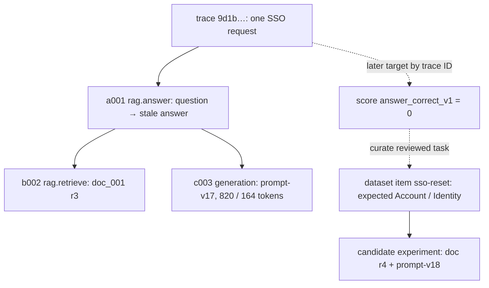
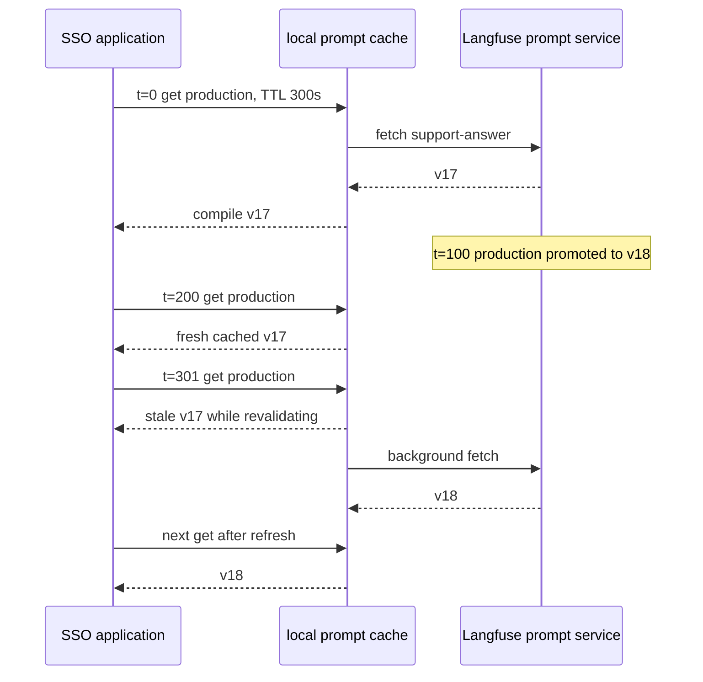

# Langfuse Overview and Data Model

Pinned baseline retained; audit remediation and version-sensitive research checked 2026-10-14.

## Follow one stale SSO answer before naming the objects

Role: foundation. You need basic Python and shell use and the trace/span/context model in
[OpenTelemetry concepts](../opentelemetry/01_concepts.md). The specialist AI terms are introduced here.
The teaching baseline is Python SDK **4.17.0** with the observation-first server-v4 model;
SDK and server major versions are separate. Python SDK v5 is now GA; the migration boundary is in
[the section index](README.md#whats-changing). Sources checked 2026-10-14.

A user asks “How do I reset SSO?” Our support application searches a document collection, gives
one matching document to a model, and returns “Open Settings > Security.” This is **retrieval
augmented generation (RAG)**: application-selected evidence is included in the model request.
The answer is wrong after the UI moved to Account > Identity. An HTTP trace reports a successful
820-ms model call. That tells us the provider responded, but cannot establish that the instruction
was current. We need evidence about the retrieved revision, prompt version, and resulting answer.

Use one trace for this request. A trace is the shared correlation identity; observations are the
individual timed steps, built from OTel spans. The root observation records the user's task and
final answer. A retriever child records what search supplied. A generation child records one
model invocation, its approved request/response, and usage. Parent IDs express containment;
matching names alone do not. Here are illustrative IDs, shortened for readability:

| Observation | ID | Parent | Evidence |
| --- | --- | --- | --- |
| `rag.answer` | `a001` | none | question → final answer, release `sso-a1` |
| `rag.retrieve` | `b002` | `a001` | `doc_001`, revision `r3`, score `0.82` |
| `llm.generate_answer` | `c003` | `a001` | prompt-v17, 820 input / 164 output tokens |

All three have trace ID `9d1b…`. The diagram separates the execution tree from records added later:



The solid root-to-child edges describe work during the original request. The later score is a
judgment, not a timed child that keeps that request open. The dataset item copies an approved
problem and expected result so we can replay the task. An experiment executes that task again
under a candidate configuration; it creates new execution evidence rather than editing `c003`.

Suppose a thumbs-down arrives five minutes later. The application must retain the original trace
ID with the displayed answer, then the feedback service targets that ID. Starting a new trace
for the feedback endpoint is useful for its own latency, but putting the score on that new trace
would judge the feedback handler rather than the answer. A score on `c003` would instead judge
that particular model call; choose trace-level correctness for the complete SSO workflow.

The first diagnosis follows the evidence: search supplied r3; the model repeated r3 faithfully;
therefore changing temperature is unlikely to repair stale instructions. Replace/re-index r3 with
reviewed r4, turn this failure into a regression item, and compare the same task before promotion.
A citation pointing to `doc_001` proves presence of that ID, not that r3 was correct or current.
[Evaluation](05_evaluation_metrics_alerting.md) develops that distinction into a release gate.

You can stop after the core model if your goal is reading an existing trace. To emit the same
three-observation tree yourself, continue to [the SDK smoke run](02_python_sdk_v4.md#run-one-complete-sso-workflow).
The remaining sections refine where each field belongs; prompt management has separate cache
state because the question “which version actually ran?” requires it.

## 📦 Core Objects

### Trace

A trace is one end-to-end user or system workflow.

Examples:

- A chat message from HTTP request to final streamed answer.
- A RAG answer that retrieves documents, reranks them, calls a model, validates output, and stores feedback.
- An agent task with planning, tool calls, retries, and final synthesis.

In the v4/Fast Preview observation-first model, a trace is primarily the correlation envelope identified by the OpenTelemetry trace ID. The observations carry the work and payload. Shared trace dimensions include:

- `name`
- `userId`
- `sessionId`
- `release`
- `version`
- `tags`
- trace-level `metadata`

The input and output of the root observation are the current source of trace input and output. Older ingestion paths may still expose separately written trace-level input/output fields for compatibility, but new v4 instrumentation should not write two competing copies.

Use a trace name for the product workflow, such as `chat.answer`, `support.agent`, or `code_review.generate`, not for high-cardinality values.

Layered explanation:

- Beginner intuition: one trace is one story from request to result.
- Technical mechanics: Langfuse uses the OpenTelemetry trace ID to correlate observations; the root observation supplies current trace I/O, while propagated attributes supply shared dimensions.
- Production implications: root trace names, release/version, environment, user/session, and tags decide whether dashboards and incident filters work.
- Common mistakes: naming traces with request IDs, setting trace attributes only on a leaf span, and failing to separate release from prompt/workflow version.

### Observation

An observation is Langfuse's representation of a span. It has a name, timing, input, output, metadata, level, status message, and type.

Common observation types:

| Type | Use for |
| --- | --- |
| `span` | Generic work such as request handling, parsing, routing, or policy checks |
| `generation` | LLM text or chat completion calls |
| `embedding` | Embedding model calls |
| `retriever` | Vector search, keyword search, hybrid search, or document lookup |
| `tool` | Tool calls made by an agent or chain |
| `agent` | Agent loop or agent-level task |
| `chain` | Multi-step orchestration |
| `evaluator` | Evaluation logic |
| `guardrail` | Safety, policy, or validation checks |
| `event` | Point-in-time marker |

Pick the most specific type because the Langfuse UI and metrics can use it for filtering and visualization.

Layered explanation:

- Beginner intuition: an observation is one step in the trace.
- Technical mechanics: observations are OpenTelemetry spans with Langfuse-specific type and fields; they can nest under parent observations.
- Production implications: good observation boundaries make slow steps, bad tool calls, empty retrieval, and guardrail failures visible.
- Common mistakes: recording only the final LLM call, using generic names like `process`, and storing large or sensitive payloads in metadata.

### Generation

A generation is a special observation for model calls. It should include:

- model name
- model parameters
- input messages or prompt
- output text or structured output
- token usage via `usage_details`
- optional cost details when you must override inferred pricing
- provider and request metadata when useful

Generations are where most LLM debugging starts: prompt, model, retrieved context, tool state, token usage, latency, and final output all meet there.

In a provider-faithful trace, `generation.input` is the actual prompt or message array sent for that model call. A stateless agent therefore repeats earlier context on every call: the second generation usually contains the same system and conversation messages as the first, plus the assistant tool call and tool result. This is not Langfuse-specific. The OpenTelemetry GenAI conventions define `gen_ai.input.messages` as the chat history provided to one model invocation, in send order, so OTel-native instrumentations produce the same repeated-history shape before Langfuse ingestion. See the [OpenTelemetry GenAI content-capture guidance](../opentelemetry/06_genai_and_llm_observability.md#full-request-versus-filtered-telemetry).

Langfuse does not require that representation. With manual instrumentation, you can make a frequently reviewed generation easier to scan by recording only the step's relevant input, such as the newest user message or an `input_delta` / `new_context` object:

```python
generation.update(
    input={
        "input_delta": [
            {"role": "tool", "content": tool_result},
        ]
    },
    output={
        "role": "assistant",
        "content": final_answer,
    },
)
```

This compact form reduces repeated history in the UI, but it is no longer an exact record of the model request and cannot support faithful replay by itself. Name the field so reviewers know it is a delta; keep the full request in approved metadata only when debugging or replay requires it and the privacy policy allows it. A practical default is reviewer-friendly user input and final output on the root observation, explicit arguments/results on tool observations, and full messages on generations only when exact model-call debugging is worth the duplication.

The `input_delta` wrapper above is a Langfuse manual-observation shape, not the OpenTelemetry schema for `gen_ai.input.messages`. On a raw OTel span, keep a schema-valid ordered message array, use filtering/truncation only as an intentional capture policy, and add a bounded `app.gen_ai.input.capture_mode` marker so the compact value is not mistaken for the full request.

Langfuse can infer usage when it has a tokenizer and can infer cost when usage plus a matching model-price definition are available. Provider/SDK-supplied usage is preferred to inferred usage. User-supplied `usage_details` and `cost_details` take precedence over inferred values; supplied cost is used verbatim, so provide it only for an authoritative provider charge or custom agreement. Usage detail buckets must be mutually exclusive or totals and inferred cost can be double-counted.

For example, an inclusive provider count says input=820, including 600 cache-hit tokens,
and output=164. Store `{"input": 220, "input_cached_tokens": 600, "output": 164}`.
Then the total is 220 + 600 + 164 = 984. Storing input=820 *and* cached=600 yields 1584;
600 tokens have been counted twice. If your provider instead reports uncached input separately,
do not subtract the cached count again. Match bucket keys to the project's pricing definition;
correct totals alone do not guarantee correct cached-token pricing.
[Usage contract, checked 2026-10-14](https://langfuse.com/docs/observability/features/token-and-cost-tracking).

> ⚠️ **Watch out:** If usage detail buckets overlap, token totals and inferred cost will be silently double-counted with no error from Langfuse.

Layered explanation:

- Beginner intuition: a generation is the model call receipt.
- Technical mechanics: it is a generation-type observation with model fields, model parameters, input/output, usage details, optional cost details, and optional prompt link.
- Production implications: token and cost analytics, model migration comparisons, streaming latency, and prompt regressions depend on accurate generation fields.
- Common mistakes: not recording usage, hiding the model name behind an alias without metadata, and capturing full prompts before privacy review.

### Event

An event is a point-in-time observation. Use it for something meaningful that happened but does not need duration tracking.

This Langfuse observation type is not the OpenTelemetry Span Event API. The
OTel API is being deprecated in favor of named log records, while Langfuse
[`event` remains a supported observation type](https://langfuse.com/docs/observability/features/observation-types).
The [Langfuse OTLP endpoint](https://langfuse.com/integrations/native/opentelemetry)
ingests traces rather than the OTel logs signal; use the Langfuse SDK when the
marker must appear as a Langfuse event observation, and send vendor-neutral
OTel log-based events to a logs backend.

Examples:

- routing decision made;
- cache hit or miss;
- tool selected;
- guardrail decision emitted;
- user feedback submitted;
- fallback path triggered.

Use spans for work that has duration. Use events for instantaneous markers inside a larger workflow.

Layered explanation:

- Beginner intuition: an event is a timestamped marker.
- Technical mechanics: events can be represented as point-in-time observations where duration is not meaningful.
- Production implications: events are useful for decisions and state changes, but overusing them can clutter traces.
- Common mistakes: using events for work that should have latency, or recording every minor branch as an event.

### Scores

A score measures quality or feedback. Scores can be attached to:

- traces
- observations
- sessions
- dataset runs

Score data types:

| Type | Value shape | Example |
| --- | --- | --- |
| `NUMERIC` | float | relevance `0.87` |
| `BOOLEAN` | `0` or `1` | hallucination detected `0`, accepted answer `1` |
| `CATEGORICAL` | string | `"correct"`, `"partially_correct"`, `"unsafe"` |
| `TEXT` | string | reviewer notes |

Use scores for things that can change after tracing: user feedback, human review, LLM-as-judge results, regression checks, and dataset evaluations. Use tags for describing what a trace is.

> 💡 **Key insight:** Scores and tags are not interchangeable — using tags for quality labels silently blocks quality dashboards, experiment comparisons, and release-gate analytics.

Layered explanation:

- Beginner intuition: a score says whether something was good, safe, useful, or accepted.
- Technical mechanics: scores have a name, value, data type, optional comment, optional metadata, and a target such as trace, observation, session, or dataset run.
- Production implications: scores power quality dashboards, annotation workflows, eval gates, and release comparisons.
- Common mistakes: using tags for quality labels, changing score meanings over time without configs, and scoring the wrong target.

### Sessions and Users

`user_id` lets you analyze behavior, cost, and quality by end user or account. `session_id` groups multiple traces into a conversation or workflow.

In production, use stable internal identifiers, not raw email addresses or personally identifiable values. If your privacy model requires anonymization, use an approved keyed pseudonym or token before sending them to Langfuse. A plain hash of a guessable email can be reversed by hashing candidate emails; it is not anonymization. Pseudonyms remain personal data when they can be linked back to a person.

Layered explanation:

- Beginner intuition: a user owns requests; a session groups related requests.
- Technical mechanics: trace attributes propagate across observations so sessions can aggregate traces and user filters can segment usage.
- Production implications: sessions make multi-turn chat and agent debugging possible; user IDs enable cost and quality analysis by account segment.
- Common mistakes: using email addresses, rotating identifiers too often, or treating baggage-propagated IDs as trusted authorization data.

### Releases and Versions

Use:

- `release` for deployed application version, such as a Git SHA or container image tag.
- `version` for logical workflow or prompt version where relevant.

This lets you answer questions like:

- Did latency increase after the last deploy?
- Did answer quality change after prompt v17?
- Did a model migration increase refusal or tool failure rates?

Layered explanation:

- Beginner intuition: release says which code shipped; version says which AI workflow design ran.
- Technical mechanics: release and version are trace/observation fields that appear as dimensions in Langfuse analytics.
- Production implications: without both, regressions turn into archaeology.
- Common mistakes: putting Git SHA in `version`, putting prompt version in `release`, or using unique build timestamps that make grouping useless.

### Metadata

Metadata is useful for filtering and segmentation, but it must be deliberate.

Good metadata:

- `tenantTier`
- `feature`
- `route`
- `model_family`
- `retrievalStrategy`
- `experiment`
- `region`

Avoid metadata with unbounded cardinality:

- full prompts
- raw document text
- request IDs as filter keys
- unique user names as key names
- secrets or credentials

For raw OpenTelemetry ingestion, top-level filterable trace metadata should use `langfuse.trace.metadata.<key>` attributes. Standard OTel attributes are still captured but may land under catch-all metadata and be less useful for Langfuse filtering.

> ⚠️ **Watch out:** Generic OTel attributes without the `langfuse.trace.metadata.<key>` prefix land in catch-all metadata and cannot be used as Langfuse dashboard filters.

Layered explanation:

- Beginner intuition: metadata is the context you want to filter by later.
- Technical mechanics: SDK metadata maps to first-level Langfuse metadata; raw OTel attributes need the `langfuse.trace.metadata.*` or `langfuse.observation.metadata.*` prefix for first-level filtering.
- Production implications: metadata schema becomes part of your observability contract.
- Common mistakes: high-cardinality keys, raw documents, secrets, nested values you expect to filter by, and inconsistent casing.

### Prompts

Prompt management lets you version prompts independently from application code. In production, connect prompt versions to traces so quality, latency, and cost can be compared across prompt changes.

A runnable production workflow fetches the `production` label (the default), compiles variables, and links the returned prompt object to the exact generation:

```python
from langfuse import get_client
from openai import OpenAI

langfuse = get_client()
openai = OpenAI()

prompt = langfuse.get_prompt(
    "support-answer",
    label="production",       # Or use version=17 for a pinned rollout/experiment.
    cache_ttl_seconds=300,
)
compiled = prompt.compile(question="How do I reset SSO?")

with langfuse.start_as_current_observation(
    as_type="generation",
    name="support-answer",
    model="gpt-4o-mini",
    input=compiled,
    prompt=prompt,             # Links this persisted name/version.
) as generation:
    response = openai.responses.create(model="gpt-4o-mini", input=compiled)
    generation.update(output=response.output_text)
```

For a third-party integration that creates the generation, Python SDK 4.14.0 or later can propagate the prompt link:

```python
from langfuse import propagate_attributes
from langfuse.openai import OpenAI

client = OpenAI()
prompt = langfuse.get_prompt("support-answer", label="production")

with propagate_attributes(prompt=prompt):
    response = client.responses.create(
        model="gpt-4o-mini",
        input=prompt.compile(question="How do I reset SSO?"),
    )
```

Propagation links only generation observations. A prompt set explicitly on a generation wins over the propagated prompt.

A prompt **label** is a movable pointer: `production` may point to v17 now and v18 after
promotion. A fetched prompt object carries a concrete version; linking that object to the generation
records what actually ran, rather than whichever version the label points to when you investigate.
The cache below explains why two instances can temporarily execute different versions:



Moving the label did not invalidate every process's cache. The t=301 request can still run v17;
its generation must link v17. For an experiment, pin `version=18` instead of comparing a moving
label. On a cold process with no cached value and an unavailable service, a configured fallback
can run, but it has no persisted prompt version. The fallback flag distinguishes that evidence
from a managed version. [Cache semantics](https://langfuse.com/docs/prompt-management/features/caching),
checked 2026-10-14. Fetch errors and caching policy need acceptance tests for your SDK version;
[production operation](04_production_observability.md) owns rollout and rollback decisions.

Prompt fetches use a client cache. Fresh entries return locally; expired entries can be served stale while background revalidation runs. Pre-fetch at startup if an instance must not accept traffic without the managed prompt. A `fallback=` value covers a first fetch when both cache and network are unavailable:

```python
prompt = langfuse.get_prompt(
    "support-answer",
    label="production",
    fallback="Answer this support question: {{question}}",
)
compiled = prompt.compile(question="How do I reset SSO?")
```

Check `prompt.is_fallback`. A fallback has no persisted Langfuse prompt version and cannot be linked to a generation; omit `prompt=prompt` and do not propagate it. Record a bounded `promptFallback=true` metadata flag and alert on fallback use instead.

A useful prompt lifecycle is:

1. Store prompt templates in Langfuse.
2. Point a protected or controlled environment label at the approved version.
3. Fetch that label, or pin an immutable version for an experiment.
4. Link the returned prompt object to generation observations.
5. Run experiments before promotion.
6. Watch quality and cost after release.

### Datasets and Experiments

Datasets represent curated examples. Experiments run a task against dataset items and store traces plus evaluation scores.

Use datasets for:

- regression tests before prompt/model changes
- benchmark sets for important workflows
- examples from production failures
- representative user questions
- red-team or safety suites

Good teams continuously turn interesting production traces into dataset items.

Layered explanation:

- Beginner intuition: datasets are the saved examples you use to test changes before users see them.
- Technical mechanics: dataset items contain input, optional expected output, metadata, and optional source trace/observation links; experiment runs execute a task and attach scores.
- Production implications: dataset quality determines whether release gates catch meaningful regressions.
- Common mistakes: including only easy examples, failing to preserve source trace links, and letting expected outputs become stale.

## 📊 Langfuse Metrics

Langfuse metrics are derived from observability and evaluation traces. They are strongest for:

- quality from scores and feedback
- cost and token usage
- latency by model, prompt version, user, or trace name
- volume by trace, token, model, tag, release, or version

Use custom dashboards and the metrics API for product and AI quality questions. Use OpenTelemetry metrics for infrastructure alerting and SLOs.

## 🗺️ End-to-End Trace Example

This compact shape gives future debuggers enough evidence without turning Langfuse into a raw data lake:

```json
{
  "trace": {
    "id": "9d1b6c3e7f9a4d8bb1e2c3a4f5d6e7a8",
    "name": "rag.answer",
    "user_id": "user_8f3a",
    "session_id": "chat_2026_06_18_001",
    "release": "sha-6f4c2d1",
    "version": "rag-prompt-v18",
    "tags": ["rag", "support"],
    "metadata": {
      "tenantTier": "enterprise",
      "retrievalStrategy": "hybrid-v2"
    },
    "environment": "prod"
  },
  "observations": [
    {
      "type": "span",
      "name": "rag.answer",
      "parent_observation_id": null,
      "input": {"question": "How do I reset SSO?"},
      "output": {"answer": "Use Security settings [doc_001]."}
    },
    {
      "type": "retriever",
      "name": "rag.retrieve",
      "input": {"query": "How do I reset SSO?"},
      "output": [{"id": "doc_001", "score": 0.82}],
      "metadata": {"index": "support-kb", "topK": 5}
    },
    {
      "type": "generation",
      "name": "llm.generate_answer",
      "model": "provider-model-name",
      "model_parameters": {"temperature": 0.2},
      "usage_details": {"input_tokens": 820, "output_tokens": 164}
    }
  ],
  "scores": [
    {"name": "citation_present", "data_type": "BOOLEAN", "value": 1},
    {"name": "answer_relevance", "data_type": "NUMERIC", "value": 0.86}
  ]
}
```

Avoid copying this literally into every service. Use it as a minimum review shape: identity, workflow, versioning, step evidence, model usage, and quality.

## 📐 Tradeoffs and Decision Points

| Decision | Prefer this | Tradeoff |
| --- | --- | --- |
| Trace granularity | One trace per user-visible workflow | Too broad hides failures; too narrow loses causality. |
| Observation granularity | One observation per meaningful step | Excessive tiny spans create noise and cost. |
| Input/output capture | Capture safe, useful debugging evidence | Full payload capture can violate privacy or increase retention risk. |
| Metadata | Low-cardinality fields used for filtering | High-cardinality metadata hurts usability and analytics. |
| Scores vs tags | Scores for quality judgments, tags for classification | Misusing tags for quality blocks evaluation analytics. |
| Dataset inclusion | Representative, reviewed failures and common paths | Random dumps of production data create noisy regression tests. |

## 🔍 Troubleshooting the Data Model

| Symptom | Likely cause | Fix |
| --- | --- | --- |
| Trace appears but filtering by user/session is unreliable | Trace attributes were set on only one span or not propagated | Use SDK `propagate_attributes()` or baggage plus an allowlisted span processor for raw OTel. |
| Metrics cannot group by `tenantTier` or `retrievalStrategy` | Values were sent as generic OTel attributes under catch-all metadata | Use SDK metadata or `langfuse.trace.metadata.<key>` / `langfuse.observation.metadata.<key>`. |
| LLM cost and token charts are empty | Generations do not include usage details or provider integration did not capture them | Record `usage_details` on generations or use an integration that captures usage. |
| Agent trace is hard to read | All work was recorded as one generic span | Add `agent`, `tool`, `generation`, `retriever`, and `guardrail` observations at natural boundaries. |
| Quality dashboards disagree across teams | Score names or value meanings are inconsistent | Define score configs and evaluator versions; document score semantics. |
| Production failures are not reproducible | Interesting traces never become dataset items | Add a triage step to promote failures into datasets with source trace IDs. |

## 🔗 How Langfuse Relates to OpenTelemetry

| OpenTelemetry concept | Langfuse concept |
| --- | --- |
| Trace | Langfuse trace |
| Span | Langfuse observation |
| Span attributes | Observation fields, metadata, and mapped trace attributes |
| Resource attributes | Service metadata |
| Context propagation | Parent-child relationships across functions and services |
| Baggage | Optional carrier for Langfuse trace attributes across service boundaries |
| OTLP exporter | Direct or Collector-based ingestion into Langfuse |

The practical rule: use OpenTelemetry to represent distributed work consistently, then use Langfuse fields to make LLM behavior understandable.

## 🏷️ Naming Guidelines

Use stable, low-cardinality names:

- `chat.answer`
- `rag.retrieve`
- `llm.generate_answer`
- `agent.execute`
- `tool.web_search`
- `guardrail.output_policy`

Avoid embedding request-specific values:

- Bad: `answer-user-12345`
- Bad: `query-where-is-my-order-987`
- Bad: `tool-call-169236482`

Put variable details in input, output, metadata, or span attributes depending on sensitivity and query needs.

## 🗺️ Minimal Trace Shape for Production LLM Apps

Every important LLM trace should answer:

- Who or what requested this? (`user_id`, `session_id`, tenant metadata)
- Which workflow ran? (`trace_name`, tags)
- Which code and prompt version ran? (`release`, `version`, prompt metadata)
- Which model was called? (generation model)
- What input and output were observed? (respecting privacy controls)
- What did it cost? (tokens and cost fields where available)
- Was it good? (scores, feedback, guardrail results)
- What changed after deploys? (release/version dimensions)

## ✅ Data Model Checklist

- Define stable trace names for each product workflow.
- Define observation names and types for retrieval, tools, generations, agents, guardrails, evaluators, and persistence steps.
- Decide which input/output fields are safe to capture and which must be redacted or disabled.
- Standardize trace attributes: user, session, environment, release, version, tags, and filterable metadata.
- Record token usage on every generation.
- Use scores for feedback and quality; use tags only for known-at-trace-time labels.
- Link prompt/workflow versions to traces and experiments.
- Convert reviewed production failures into dataset items with source trace or observation IDs.
- Keep the same terminology and field casing across services.

## Rebuild the model from memory

- A successful provider call says that work completed; approved generation evidence explains the answer.
- One trace ID joins the root task and children; parent IDs show which step owns each child.
- A later score targets retained identity; a dataset preserves a reviewed task for a new experiment.
- Exclusive token buckets prevent double counting; cache labels and concrete versions are different state.

**Q: The model cites r3 correctly, but r3 contains obsolete instructions. Should citation presence pass mean answer correctness passes?**

<details><summary>Answer</summary>

No. Citation presence checks an identifier, while correctness compares the answer to current approved
instructions. The retriever's r3 evidence explains the mistake. Fix the source and add a correctness
regression case; do not reinterpret the citation score as a correctness score.

</details>

**Q: A feedback handler creates trace B after answer trace A ended. Where should answer correctness be scored?**

<details><summary>Answer</summary>

Target stored trace A, or its generation ID if judging only that invocation. Trace B measures the
feedback handler. The original observations do not need reopening to attach a later judgment.

</details>

**Q: Input=820 includes 600 cached tokens. You store input=820, cached=600, output=164. What fails first?**

<details><summary>Answer</summary>

The represented total becomes 1584 instead of 984. Convert inclusive input into input=220 plus
cached=600. Then check the matching model-price definition; pricing is a separate mapping.

</details>
