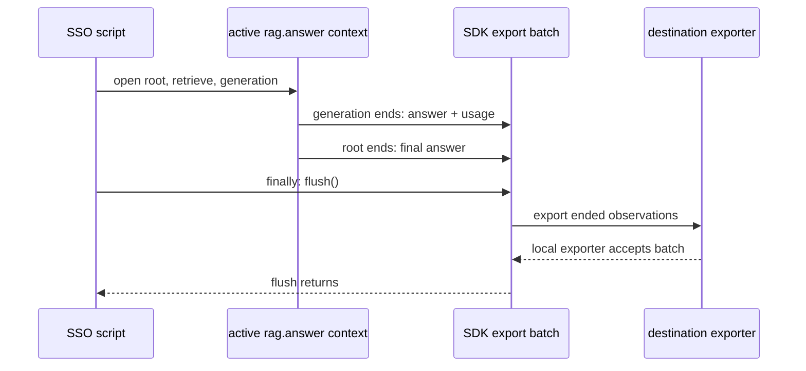
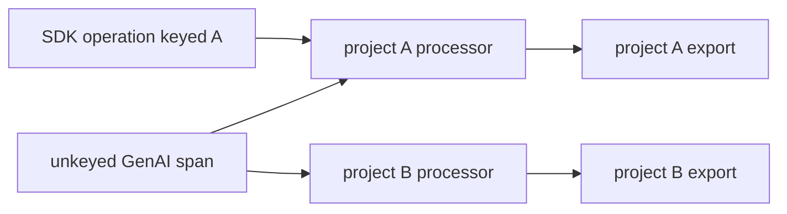

# Python SDK v4

Pinned SDK 4.17.0; local execution and migration research checked 2026-10-14.

## 🧭 Mental Model

This lesson deliberately pins Langfuse Python SDK 4.17.0. Python SDK v5 is now GA; see [migration context](README.md#whats-changing). Import from `langfuse`, not from the legacy `langfuse.decorators` module.

Use the SDK when you are writing Python LLM application code and want Langfuse-specific features such as observations, generations, scores, prompt management, datasets, and experiments.

The SDK is a thin LLM-aware layer over OpenTelemetry:

```text
your Python code
  -> Langfuse context managers/decorators/manual observations
  -> OpenTelemetry spans in the active context
  -> Langfuse exporter batches spans asynchronously
  -> Langfuse UI/API receives traces, observations, generations, scores
```

It solves application-level trace shape: what the workflow did, which model calls happened, what inputs/outputs were safe to record, and how feedback/scores attach later. It does not replace provider SDKs, authorization, redaction policy, general logs, or infrastructure metrics.

Use the SDK when you can edit the Python code. Use [03_otel_ingestion_and_mapping.md](03_otel_ingestion_and_mapping.md) when the service is not Python/JS, when a platform team requires raw OTLP, or when a Collector owns routing.

## Run one complete SSO workflow

Role: implementation. Read [the request-to-score model](01_overview_data_model.md) first.
This first run uses the real SDK and a deterministic model stub, so it requires no provider key,
Langfuse account, or external ingest. The in-memory exporter replaces network export and lets
us check that the final batch contains the expected observations.

From the repository root:

```bash
python3 -m venv /tmp/langfuse-notes-venv
/tmp/langfuse-notes-venv/bin/pip install "langfuse==4.17.0"
/tmp/langfuse-notes-venv/bin/python examples/local/langfuse_sdk_smoke.py
```

The complete canonical script is [langfuse_sdk_smoke.py](../examples/local/langfuse_sdk_smoke.py).
It invokes `main()` explicitly, opens `rag.answer`, retrieves approved synthetic `doc_001`, then
opens `llm.generate_answer` under the still-active root. It updates generation output/usage and
root output, prints the trace and generation IDs, and calls `flush()` in `finally` before shutdown.
Its keys are dummy local identifiers; `span_exporter=memory` prevents trace network export.
There is no API write or auth check in local mode.

Expected output contains an answer and two generated hexadecimal IDs, followed by:

```text
PASS: 3 observations; one trace; both children parented to rag.answer; final batch flushed
```

IDs vary each run; the provider output and tree are deterministic. The assertions inspect *exported*
spans, rather than trusting names or return values. All three share a trace ID; both children have
the root's observation ID as parent. That is the first usable result. It verifies context and
batch export locally, not that a Langfuse server indexed it.

Ending work and exporting its evidence are separate steps. Watch the last batch in this sequence:



Without flush, the script can return a correct answer then exit while evidence is still queued.
In this run D is memory; in remote mode D is an OTLP sender. A flush returning is not a backend
query proving storage, and failed/blocked network delivery needs separate diagnosis.

To repeat against a real project, set the three variables in Configure from approved secret
management and run the same script with `--remote`. It sends only the synthetic SSO data.
Then find its printed trace ID in the matching project's UI and verify all three observations,
the parent IDs, output and usage. If no record appears, diagnose credentials, region, tracing
switch, sampling and exporter failures in that order; a successful answer proves none of those.
External ingestion remains an explicit credential-dependent gate for this collection.

Continue below to replace the stub with a provider. Keep this local smoke as the context baseline;
privacy, filtering and multi-project routing are later changes, each with a separate boundary.

## 🛠️ Install

```bash
pip install "langfuse==4.17.0"
```

Use `langfuse>=4.14.0,<5` when the application uses propagated prompt linking shown below. Earlier v4 releases can use explicit observation-level `prompt=prompt` linking but do not support `propagate_attributes(prompt=...)`.

For a typical LLM service you may also install provider clients and OpenTelemetry instrumentations:

```bash
pip install openai httpx fastapi uvicorn opentelemetry-instrumentation-fastapi opentelemetry-instrumentation-httpx
```

## 🛠️ Configure

Set credentials in the environment:

```bash
export LANGFUSE_PUBLIC_KEY="pk-lf-..."
export LANGFUSE_SECRET_KEY="sk-lf-..."
export LANGFUSE_BASE_URL="https://cloud.langfuse.com"
```

Use the base URL for your Langfuse region or self-hosted instance. The current SDK uses `LANGFUSE_BASE_URL`; older examples using `LANGFUSE_HOST` should be updated.

Common environment variables:

| Variable | Use |
| --- | --- |
| `LANGFUSE_PUBLIC_KEY` | Project public key |
| `LANGFUSE_SECRET_KEY` | Project secret key |
| `LANGFUSE_BASE_URL` | Cloud region or self-hosted URL |
| `LANGFUSE_DEBUG` | Debug logging during development |
| `LANGFUSE_SAMPLE_RATE` | Client-side trace sampling from `0.0` to `1.0` |
| `LANGFUSE_TRACING_ENABLED` | Set to `false` to disable tracing without changing code |
| `LANGFUSE_TIMEOUT` | HTTP timeout in seconds |
| `LANGFUSE_RELEASE` | Release identifier when not passed in code |
| `LANGFUSE_TRACING_ENVIRONMENT` | Environment name when not passed in code |

Production setup rules:

- Load keys from secret management, not source code.
- Use the Langfuse Cloud region or self-hosted URL that matches the project.
- Keep `LANGFUSE_DEBUG` off outside troubleshooting.
- Set `LANGFUSE_RELEASE` to the deployed artifact and `LANGFUSE_TRACING_ENVIRONMENT` to `prod`, `staging`, or `dev`.
- Treat `LANGFUSE_TRACING_ENABLED=false` as a temporary kill switch, not a permanent privacy control.

## 🛠️ Initialize

```python
from langfuse import get_client

langfuse = get_client()

if not langfuse.auth_check():
    raise RuntimeError("Langfuse authentication failed")
```

`get_client()` returns a singleton client configured from the environment. For explicit configuration:

```python
from langfuse import Langfuse

langfuse = Langfuse(
    public_key="pk-lf-...",
    secret_key="sk-lf-...",
    base_url="https://cloud.langfuse.com",
)
```

Constructor arguments override environment values for that client instance. In production, prefer environment variables for credentials and deployment-specific settings, and use constructor arguments only when the process intentionally talks to multiple projects or needs test-specific overrides.

## 🛠️ Context Manager Instrumentation

The context manager is the clearest way to instrument production code because parent-child relationships are explicit and automatic.

```python
from langfuse import get_client, propagate_attributes
from openai import OpenAI

langfuse = get_client()
openai = OpenAI()


def answer_question(question: str, user_id: str, session_id: str) -> str:
    with propagate_attributes(
        user_id=user_id,
        session_id=session_id,
        trace_name="chat.answer",
        metadata={"feature": "chat", "tenantTier": "enterprise"},
        tags=["chat", "production"],
        version="prompt-v17",
    ):
        with langfuse.start_as_current_observation(
            as_type="span",
            name="chat.answer",
            input={"question": question},
        ) as root:
            messages = [{"role": "user", "content": question}]

            with langfuse.start_as_current_observation(
                as_type="generation",
                name="llm.generate_answer",
                model="gpt-4o-mini",
                input={"messages": messages},
                model_parameters={"temperature": 0.2},
            ) as generation:
                response = openai.chat.completions.create(
                    model="gpt-4o-mini",
                    messages=messages,
                    temperature=0.2,
                )
                answer = response.choices[0].message.content or ""
                usage = response.usage

                generation.update(output=answer)
                if usage is not None:
                    generation.update(usage_details={
                        "input": usage.prompt_tokens,
                        "output": usage.completion_tokens,
                    })
                else:
                    generation.update(metadata={"usageMissing": True})

            root.update(output={"answer": answer})

            return answer
```

Missing provider usage is unknown, not measured zero. The example records a bounded
`usageMissing` flag and omits usage when the provider did not supply it. If splitting cached or
reasoning subtypes later, convert inclusive counts into exclusive buckets as taught in 01.

For new code, set trace input and output on the root observation. Langfuse keeps legacy trace input/output helpers for migration cases, but root observation input/output is the current default pattern.

Layered explanation:

- Beginner intuition: `with start_as_current_observation(...)` opens a timed block; nested blocks become children.
- Technical mechanics: the SDK sets the observation as the active OpenTelemetry span, and child SDK/framework/OTel spans inherit the active context.
- Production implications: wrap the product workflow first, then add retrieval, tool, generation, guardrail, and persistence observations underneath.
- Common mistakes: starting only a generation span, forgetting root output, or creating spans outside the active context in worker threads without context propagation.

### Link Managed Prompts

Link a prompt explicitly when your code creates the generation. This is the narrowest and preferred relationship:

```python
prompt = langfuse.get_prompt("support-answer", label="production")

with langfuse.start_as_current_observation(
    as_type="generation",
    name="support-answer",
    prompt=prompt,
    input=prompt.compile(question=question),
) as generation:
    answer = call_model(prompt.compile(question=question))
    generation.update(output=answer)
```

When OpenAI, OpenInference, LiteLLM `langfuse_otel`, or another integration creates the generation and offers no `prompt=` argument, Python SDK 4.14.0 or later can propagate the link:

```python
from langfuse import get_client, propagate_attributes
from langfuse.openai import OpenAI

langfuse = get_client()
client = OpenAI()
prompt = langfuse.get_prompt("support-answer", label="production")

with propagate_attributes(prompt=prompt):
    response = client.responses.create(
        model="gpt-4o-mini",
        input=prompt.compile(question="How do I reset SSO?"),
    )
```

The propagated prompt attaches only to generation observations. It does not link root, retriever, tool, or generic span observations. An explicit prompt on a generation takes precedence over the propagated prompt. Do not propagate `prompt` when `prompt.is_fallback` is true: a local fallback has no persisted Langfuse prompt version to link.

## 🛠️ Decorator Instrumentation

Use `@observe()` for stable functions where function boundaries match observation boundaries.

```python
from langfuse import observe


@observe(as_type="retriever", name="rag.retrieve")
def retrieve_documents(query: str) -> list[dict]:
    return vector_store.search(query, limit=5)


@observe(as_type="tool", name="tool.lookup_order")
def lookup_order(order_id: str) -> dict:
    return orders_api.get(order_id)
```

The decorator can capture inputs and outputs. Disable capture on sensitive functions:

```python
from langfuse import observe


@observe(as_type="tool", name="tool.payment_lookup", capture_input=False, capture_output=False)
def payment_lookup(account_id: str) -> dict:
    return payment_service.lookup(account_id)
```

Layered explanation:

- Beginner intuition: `@observe()` turns a function call into an observation.
- Technical mechanics: the decorator captures timing and, by default, inputs/outputs unless disabled.
- Production implications: decorators work best for stable, reusable boundaries like retrievers, tools, guards, and evaluators.
- Common mistakes: decorating sensitive functions without disabling capture, using decorators on huge low-value helpers, or mixing old `langfuse.decorators` imports with v4 imports.

## 🛠️ Manual Observations

Manual observations are useful for background tasks or lifecycles that do not fit a `with` block. End them explicitly.

```python
from langfuse import get_client

langfuse = get_client()

span = langfuse.start_observation(name="background.embed_batch", as_type="span")
try:
    span.update(input={"batch_size": 128})
    process_batch()
    span.update(output={"status": "ok"})
finally:
    span.end()
```

If you need nested children under a manual observation, create them from that observation object so the hierarchy remains correct.

Layered explanation:

- Beginner intuition: manual observations are "start now, end later" spans.
- Technical mechanics: `start_observation()` creates an observation but does not manage a `with` scope for you.
- Production implications: use them for batch jobs, queues, and callback-style lifecycles where a context manager is awkward.
- Common mistakes: forgetting `.end()`, losing parent-child links, or using manual spans where a context manager would be clearer.

## 🛠️ Trace and Observation IDs

Store trace IDs when another system must attach data later: user feedback, human review, async evaluation, support tickets, or incident links.

```python
from langfuse import get_client

langfuse = get_client()


def answer_for_ui(question: str) -> dict:
    with langfuse.start_as_current_observation(
        as_type="span",
        name="chat.answer",
        input={"question": question},
    ) as root:
        trace_id = langfuse.get_current_trace_id()
        answer = run_chat(question)
        root.update(output={"answer": answer})
        return {
            "answer": answer,
            "langfuse_trace_id": trace_id,
        }
```

Use `get_current_observation_id()` when an evaluator or feedback item should attach to a specific generation, retriever, tool, or guardrail observation. Use `get_trace_url()` in internal logs or incident comments when people need a direct Langfuse link.

## 🔗 Cross-Service Attribute Propagation

For distributed tracing, use OpenTelemetry context propagation for trace IDs. If downstream Langfuse spans must inherit `user_id`, `session_id`, tags, or metadata, propagate them as baggage.

```python
import requests
from langfuse import get_client, propagate_attributes

langfuse = get_client()


def call_agent_service(user_id: str, session_id: str, question: str) -> dict:
    with langfuse.start_as_current_observation(as_type="span", name="gateway.request"):
        with propagate_attributes(
            user_id=user_id,
            session_id=session_id,
            trace_name="agent.answer",
            metadata={"entrypoint": "api"},
            tags=["agent"],
            as_baggage=True,
        ):
            response = requests.post(
                "https://agent.internal/answer",
                json={"question": question},
                timeout=10,
            )
            response.raise_for_status()
            return response.json()
```

Rules for baggage:

- Keep values small.
- Never put secrets or raw PII in baggage.
- Propagate only stable identifiers needed by downstream services.
- Prefer internal IDs over email addresses, names, or full account data.

For propagated Langfuse attributes, keep values as short strings. Metadata keys should be alphanumeric; use names like `tenantTier` or `retrievalStrategy` instead of keys with spaces or punctuation.

Important mechanics:

- W3C trace context links spans across services.
- Baggage carries selected Langfuse trace attributes that downstream spans should also set.
- HTTP propagation requires an instrumented HTTP client/server or explicit header injection/extraction in raw OpenTelemetry code.
- Baggage is observability context, not an authorization source.

See [03_otel_ingestion_and_mapping.md](03_otel_ingestion_and_mapping.md) for the raw OpenTelemetry version of this pattern and [examples/02_multi_service_agent.md](../examples/02_multi_service_agent.md) for a gateway/agent example.

## 🛠️ Custom Trace IDs

Use a deterministic Langfuse trace ID when an external system already owns the request ID and you need stable correlation or idempotent batch processing.

```python
from langfuse import Langfuse, get_client

langfuse = get_client()

external_request_id = "support-ticket-12345"
trace_id = Langfuse.create_trace_id(seed=external_request_id)

with langfuse.start_as_current_observation(
    as_type="span",
    name="support.answer",
    trace_context={"trace_id": trace_id},
) as span:
    span.update(input={"ticketId": external_request_id})
    answer = answer_ticket(external_request_id)
    span.update(output={"answer": answer})
```

Trace IDs must be 32 lowercase hexadecimal characters. `create_trace_id(seed=...)` creates a valid deterministic ID from an arbitrary string.

## 🛠️ Updating Current Observations

Use current-observation helpers when lower-level code should enrich the active span without receiving the observation object.

```python
from langfuse import get_client

langfuse = get_client()


def validate_answer(answer: str) -> bool:
    passed = "forbidden" not in answer.lower()
    langfuse.update_current_span(
        metadata={"guardrail": "keyword_check", "passed": passed},
    )
    return passed
```

Use `update_current_generation()` from code that runs inside an active generation and needs generation-specific fields such as usage, cost, model, or completion start time.

## 🔒 Capture, Redaction, and Filtering

The SDK can capture inputs and outputs, but your application owns the privacy decision. Decide capture policy before rollout:

| Data | Typical policy |
| --- | --- |
| User prompt | Capture if allowed; redact secrets and regulated data. |
| Retrieved document IDs | Capture. |
| Retrieved document bodies | Usually suppress or capture short approved snippets only. |
| Tool request/response | Capture IDs/statuses; suppress secrets and high-risk data. |
| Payment, auth, medical, legal, or credentials data | Disable capture unless governance explicitly allows it. |

Use per-observation capture controls for sensitive functions, and use export-stage masking for data created by third-party instrumentation.

Before instrumenting a real tool result, project it into an approved bounded schema. The runnable
[allowlist fixture](../examples/local/langfuse_capture_policy.py) receives nested token/header/body/
exception data and forwards only catalog-approved document ID/revision plus bounded status:

```bash
python3 examples/local/langfuse_capture_policy.py
```

Its expected output is `status=ok`, document `doc_001/r4`, and a PASS line proving the synthetic
secret and email are absent from the projected representation. Change the catalog to your approved
source, and disable automatic decorator/wrapper I/O capture so raw arguments cannot bypass the
projection. Updating a manual observation with safe output does not undo earlier automatic capture.
The fixture validates this one application-owned carrier; third-party spans and exception/log paths
still require export masking and independent destination inspection.

The email-regex patch below is an explanatory SDK masking API example, **not a complete privacy
policy**. It handles string attributes only and does not remove tokens, arrays, serialized JSON,
exception content or unexpected attribute keys. Production masking must cover the actual typed
carriers and prevent raw diagnostic logging; never approve it merely because one email was replaced.


```python
import re
from typing import Optional

from langfuse import Langfuse
from langfuse.types import MaskOtelSpansParams, MaskOtelSpansResult, OtelSpanPatch

email_pattern = re.compile(r"\b[\w.-]+?@[\w.-]+?\.\w+?\b")


def mask_otel_spans(*, params: MaskOtelSpansParams) -> Optional[MaskOtelSpansResult]:
    patches = {}
    for identifier, span in params.spans.items():
        replacements = {}
        for key, value in span.attributes.items():
            if isinstance(value, str):
                masked = email_pattern.sub("[EMAIL_REDACTED]", value)
                if masked != value:
                    replacements[key] = masked
        if replacements:
            patches[identifier] = OtelSpanPatch(set_attributes=replacements)
    return MaskOtelSpansResult(span_patches=patches)


langfuse = Langfuse(mask_otel_spans=mask_otel_spans)
```

Keep masking fast. It runs during export and can delay flushing if it does heavy work.

By default, the current SDK exports Langfuse SDK spans, GenAI spans, and known LLM instrumentation spans. If you need other spans, use `should_export_span`; if you need only Langfuse-created spans, filter explicitly.

```python
from langfuse import Langfuse
from langfuse.span_filter import is_default_export_span

langfuse = Langfuse(
    should_export_span=lambda span: (
        is_default_export_span(span)
        or (
            span.instrumentation_scope is not None
            and span.instrumentation_scope.name.startswith("my_llm_framework")
        )
    )
)
```

Filtering is powerful but dangerous. Dropping a parent span can create orphaned observations, and dropping non-LLM business spans can remove the context that explains a generation.

To keep AI work plus its root/business ancestors while excluding operational siblings,
use the explicit [rooted GenAI view](03_otel_ingestion_and_mapping.md#keep-a-rooted-genai-view-instead-of-operational-subtrees).
That section demonstrates the same policy with a Collector, with this SDK's
`should_export_span`, and with a raw OTel exporter wrapper. A shared provider can send
all spans to APM and only the selected view to Langfuse; a separate provider is not
required for destination filtering.

## 🧪 Scores in Application Code

Use `score_current_trace()` for inline user feedback or guardrail outcomes on the active trace.

```python
from langfuse import get_client

langfuse = get_client()


def record_user_feedback(accepted: bool) -> None:
    langfuse.score_current_trace(
        name="user_accepted",
        value=1 if accepted else 0,
        data_type="BOOLEAN",
    )
```

Use `create_score()` when scoring happens out of band and you already know the trace ID or observation ID.

```python
from langfuse import get_client

langfuse = get_client()

langfuse.create_score(
    trace_id="9d1b6c3e7f9a4d8bb1e2c3a4f5d6e7a8",
    name="answer_relevance",
    value=0.86,
    data_type="NUMERIC",
    comment="LLM-as-judge relevance score",
)
```

Use deterministic `score_id` values for idempotent evaluators that may retry.

## 🛠️ Flush and Shutdown

The SDK sends telemetry asynchronously. In long-running web services, normal process shutdown hooks are usually enough. In scripts, workers, tests, and serverless functions, flush before exit.

> ⚠️ **Watch out:** In scripts and serverless functions, skipping `flush()` means the last batch of telemetry is silently discarded when the process exits.

```python
from langfuse import get_client

langfuse = get_client()

try:
    run_job()
finally:
    langfuse.flush()
```

Use `shutdown()` when the process is ending and you want to close resources after flushing.

Short-lived process checklist:

- Initialize the client once.
- Run the traced work.
- Attach any scores.
- Call `flush()` before exit.
- Call `shutdown()` when the process is truly ending and the client should close resources.

## 🔍 Debugging and Sampling

Enable debug logs only while troubleshooting:

```bash
export LANGFUSE_DEBUG=true
```

Sample at the SDK layer when you need to reduce successful trace volume before export:

```bash
export LANGFUSE_SAMPLE_RATE=0.1
```

or:

```python
from langfuse import Langfuse

langfuse = Langfuse(sample_rate=0.1)
```

`LANGFUSE_SAMPLE_RATE` is a head-sampling decision. It is made before the request finishes, so it cannot know about a later exception, thumbs-down score, groundedness result, or safety evaluator outcome. Do not claim that a 10-percent SDK sample will later "keep all failures."

> 💡 **Key insight:** Head sampling is irreversible — a score attached to an unsampled trace is never sent, and no later feedback can recover a trace the SDK already discarded.

Choose an implementable retention mechanism:

- Keep `LANGFUSE_SAMPLE_RATE=1` for candidate traffic, then use an external trace buffer/tail-sampling Collector that can decide from final span status and completion attributes.
- Head-sample only from facts known when the root starts, such as environment, release burn-in, route, internal-test cohort, or a bounded tenant tier.
- If negative feedback arrives minutes later, retain the original trace up front or store the application payload in an approved system from which a feedback worker can create a separate evaluation record. Feedback cannot recover a trace that the SDK already discarded.

Tail buffering increases Collector memory, bandwidth before the decision, and the amount of sensitive content temporarily held. Apply capture/redaction policy before buffering and size the decision window and trace capacity from peak traffic.

Disable tracing without removing instrumentation:

```bash
export LANGFUSE_TRACING_ENABLED=false
```

Sampling implications:

- Unsampled traces do not send observations or associated scores.
- Scores attached to an unsampled trace are not sent; a later score cannot reverse the head decision.
- SDK sampling is simple and cheap, but only start-time attributes can influence an outcome-aware policy at that point.
- If you sample in the Collector, preserve complete traces. Partial traces are hard to debug.
- Tail sampling can retain completed errors and safety attributes only when all spans reach the same decision point before its window closes.

## 🗺️ Production Architecture Patterns

| Pattern | Shape | Notes |
| --- | --- | --- |
| Web API | FastAPI/Flask request span -> Langfuse root observation -> retrieval/tool/generation children | Add user/session/release/version early; export metrics separately. |
| Worker | Queue job -> root observation -> batch item spans -> evaluator scores | Flush before worker shutdown; keep job IDs in metadata, not metric labels. |
| Serverless | Handler -> root observation -> generation/tool children -> flush | Keep flush time in latency budget; consider immediate export only after testing. |
| Multi-service | Gateway root -> HTTP trace context/baggage -> downstream child observations | Requires HTTP instrumentation or manual W3C propagation. |
| Experiment runner | Dataset item -> task trace -> evaluator scores -> dataset run | Use deterministic score IDs and stable run names. |

## 🔌 Singleton and Multi-Project Use

`get_client()` uses a singleton pattern. In normal single-project services, calling it from many modules returns the same client and avoids duplicate exporters.

```python
from langfuse import get_client

langfuse = get_client()
```

Multi-project use is experimental. If more than one project client exists in the same process, pass `public_key` when retrieving a client. Without an explicit project key, the SDK returns a disabled client to avoid cross-project data leakage.

> ⚠️ **Watch out:** In multi-project mode, calling `get_client()` without a `public_key` returns a silently disabled client — traces disappear with no error.

```python
from langfuse import Langfuse, get_client

Langfuse(public_key="pk-lf-project-a", secret_key="sk-lf-...")
Langfuse(public_key="pk-lf-project-b", secret_key="sk-lf-...")

project_a = get_client(public_key="pk-lf-project-a")
project_b = get_client(public_key="pk-lf-project-b")
```

Prefer separate processes or services for separate tenants/projects unless there is a strong operational reason to multiplex.

The difficult case is third-party OpenTelemetry instrumentation. Those spans do not carry the Langfuse public-key routing attribute, so any span that passes the filter can be processed by every configured project's span processor and sent to every project.

This is unsafe because the integration call has no project key:

```python
from langfuse import Langfuse
from langfuse.openai import OpenAI

Langfuse(public_key="pk-lf-project-a", secret_key="sk-a")
Langfuse(public_key="pk-lf-project-b", secret_key="sk-b")

client = OpenAI()
client.chat.completions.create(
    model="gpt-4o-mini",
    messages=[{"role": "user", "content": "project-specific data"}],
)  # Missing langfuse_public_key: routing is ambiguous.
```

Carry the intended key on every top-level SDK/integration execution:

```python
response = client.chat.completions.create(
    model="gpt-4o-mini",
    messages=[{"role": "user", "content": "project A data"}],
    langfuse_public_key="pk-lf-project-a",
)
```

For decorators, pass `langfuse_public_key=` to the top-level observed function call. For LangChain, create `CallbackHandler(public_key="pk-lf-project-a")`. Test a deliberately missing-key call and assert it is rejected or absent from every project. If an instrumentation cannot carry the key, isolate projects in separate processes instead of relying on filters to prevent cross-project disclosure.

Multi-project processors create an additional trust boundary. An unkeyed third-party span can
reach both processors even though your application intended one destination:



The project key is routing evidence, not tenant authorization. Separate processes prevent this
processor fan-out because each process has one project's exporter. A filter test must cover a
missing-key span, not only the happy keyed call.

## 🔍 Troubleshooting

| Symptom | Likely cause | Fix |
| --- | --- | --- |
| No traces appear | Missing credentials, wrong `LANGFUSE_BASE_URL`, tracing disabled, or process exits before flush | Run `auth_check()`, enable `LANGFUSE_DEBUG`, verify base URL/keys, call `flush()` in scripts. |
| Only some spans appear | Default span filter drops non-LLM spans | Add `should_export_span` logic or create important business spans with the Langfuse SDK. |
| Trace tree is broken | Parent span filtered out or context lost across threads/tasks/services | Preserve parent spans; instrument HTTP/threading; propagate W3C context and allowlisted baggage. |
| Feedback cannot attach | UI response did not store trace ID | Return/store `get_current_trace_id()` with the user-visible message. |
| Scores duplicated | Evaluator retries without stable score IDs | Use deterministic `score_id`, for example `<trace_id>:<score_name>:<evaluator_version>`. |
| Sensitive data appears | Capture policy or masking is incomplete | Disable capture on sensitive observations; add export-stage masking; review third-party instrumentation. |
| Token/cost charts missing | Generation usage was not recorded | Add `usage_details` or use an integration that captures provider usage. |
| Debug logging is too noisy | `LANGFUSE_DEBUG` left on | Disable it after troubleshooting. |

## ✅ Production Checklist

- Set `LANGFUSE_PUBLIC_KEY`, `LANGFUSE_SECRET_KEY`, and `LANGFUSE_BASE_URL` from secret management.
- Call `auth_check()` at service startup when failing fast is acceptable.
- Use stable trace and observation names.
- Add `user_id`, `session_id`, `release`, `version`, tags, and filterable metadata early in the trace.
- Use `propagate_attributes(..., as_baggage=True)` only for cross-service attributes that should travel downstream.
- Disable input/output capture for sensitive paths.
- Record token usage on generations.
- Add user feedback and evaluator results as scores.
- Flush in short-lived processes.
- Avoid mixing old SDK v3 patterns with v4 imports in the same codebase.
- Return or persist trace IDs for later feedback and review.
- Add redaction/masking tests for representative sensitive inputs.
- Verify default span filtering keeps the parent spans needed to understand traces.
- Keep operational metrics and logs in their own telemetry stack.

## 🔌 Official References

- SDK overview: <https://langfuse.com/docs/observability/sdk/overview>
- SDK instrumentation: <https://langfuse.com/docs/observability/sdk/instrumentation>
- SDK advanced features: <https://langfuse.com/docs/observability/sdk/advanced-features>
- Python SDK reference: <https://python.reference.langfuse.com/langfuse>

## Retain the implementation reasoning

- Active observation context creates parentage; the same function names alone cannot join work.
- End each scope to finalize payloads, then flush short-lived processes to export the final batch.
- Inspect exported IDs locally and query the matching project for a separate remote-delivery proof.
- Suppress sensitive capture before instrumentation; test routing/filtering as independent changes.

**Q: A new thread starts retrieval after the root has closed. Does its name make it a child?**

<details><summary>Answer</summary>

No. Parentage is decided from context at creation. Capture and attach the intended OTel context
across the thread boundary, or explicitly parent the observation. Verify the actual parent ID.
A root that has ended can still correlate later work, but that is a deliberate lifecycle choice.

</details>

**Q: The answer prints but remote trace lookup misses it. Is model success proof of telemetry delivery?**

<details><summary>Answer</summary>

No. Provider work and exporter work are separate. Check ended/queued spans, final flush, export
failures and the selected project. Auth success alone also does not prove ingestion/indexing.

</details>

**Try it:** Extend the smoke with a `guardrail` child that rejects an answer missing `doc_001`.
Leave the provider stub unchanged; then remove its citation. Keep the guardrail inside the root,
record a bounded pass/fail result, and change the expected exported name set. Hint: the guardrail
must exist in both outcomes, because checking was attempted in both.

<details><summary>Worked solution</summary>

After the generation block, open `start_as_current_observation(name="guardrail.citation",
as_type="guardrail")`; compute `passed = "[doc_001]" in answer`; update output with
`{"passed": passed}`. Add `guardrail.citation` to the assertion's expected set and parent checks.
Both runs export four observations with the same root parent. Only the guardrail output changes;
this check establishes citation presence, not factual accuracy.

</details>
