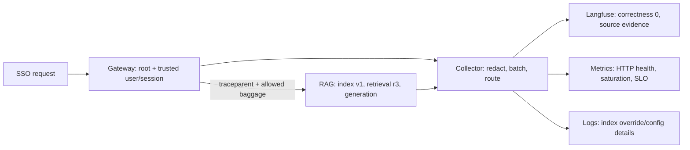
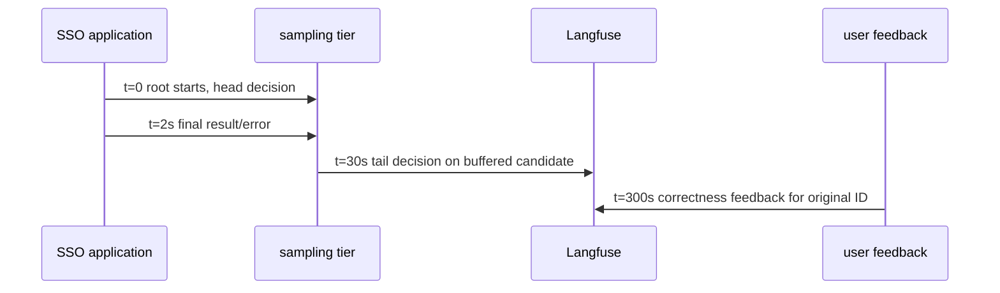

# Production Observability Workflows

Pinned baseline retained; incident reasoning retained; credential migration research checked 2026-10-28.

## Diagnose and recover one SSO rollout

Role: implementation. Start after [the SDK smoke](02_python_sdk_v4.md); raw-OTLP deployments
also require [the mapping chapter](03_otel_ingestion_and_mapping.md). These incident values are a
worked scenario, not a recorded production incident or universal threshold recommendation.

Staging answered the SSO question correctly. Ten minutes after release `sso-a2`, the enterprise
segment's `answer_correct_v1` mean fell from 0.94 to 0.62 over 200 reviewed answers. HTTP errors
and p95 model duration stayed steady. “The model is getting worse” is one hypothesis; the evidence
must distinguish it from the source, prompt and tool hypotheses.

| Evidence | Healthy `sso-a1` | Failing `sso-a2` |
| --- | --- | --- |
| Prompt / provider model | v17 / same pinned model | v17 / same pinned model |
| Retriever index | `support-kb-v2` | `support-kb-v1` |
| SSO document | `doc_001`, r4 | `doc_001`, r3 |
| Approved expected action | Account > Identity | Account > Identity |
| Answer / citation | Account > Identity / doc_001 | Settings > Security / doc_001 |
| Citation present check | 1 | 1 |
| Correctness review | 1 | 0 |

Inspect one low-scoring trace, then compare several failed and healthy traces in the same segment.
The generation accurately repeats the obsolete source. The constant prompt/model and changed
index support an index-selection regression; they do not prove that every other cause is impossible.
A presence-only citation evaluator stays green because both revisions share a document ID. That is
why revision and corpus evidence are necessary, and why correctness requires a separate rubric.

The release changed an enterprise-specific index override to v1. Restore the approved mapping to
v2 (or roll back the compatible code/config bundle), then repeat the *same* synthetic question.
The recovery trace must show v2, r4 and Account > Identity, not merely a lower latency. Confirm new
enterprise observations pass review and the segment metric recovers over the chosen evaluation
window. Overall recovery while enterprise remains at 0.62 is insufficient: healthy standard traffic
can hide the unresolved segment. Keep the incident open until the affected segment passes.

Freeze an approved copy of this question, expected action and revision requirements into the
regression dataset; preserve the source trace link. [Evaluation](05_evaluation_metrics_alerting.md)
shows how this evidence becomes a same-snapshot baseline/candidate decision. A reviewed expected
answer is essential: replaying the stale answer as the expectation would preserve the bug.

The signals cross components with different responsibilities:



Correlation finds the right request across those systems; baggage does not grant authorization.
Langfuse's evidence selects the source hypothesis, logs identify the config override, and metrics
show whether the repair introduced a service-health problem. A Collector outage can remove traces
without reducing request rate, so monitor telemetry delivery alongside product signals.

### Make privacy and cost choices before this evidence leaves the service

The running request is synthetic and approved. For real traffic, choose fields deliberately: document
ID, revision and rank can explain source selection without retaining full private source text.
Do not turn a trace into a dataset until the copied fields and longer-lived dataset access/retention
are approved. A reversible application kill switch stops future capture; it does not delete existing
traces, exports, dataset copies or backups. Follow the data store's approved deletion process and
verify all copies within policy scope after a leak.

A plain hash of a guessable email is not anonymization. Use approved keyed pseudonyms or tokens,
protect the linking secret/table, and treat linkable IDs as personal data. Apply an allowlist before
instrumentation; a regex that replaces email strings cannot suppress access tokens inside arrays,
headers, exception messages or third-party payloads. Exercise those carriers in capture tests.

For a cost spike, keep the same boundary discipline. A generation's reported 820 input includes
600 cache-hit tokens: storing 820 + 600 + 164 counts 1584 instead of 984. Convert to exclusive
220/600/164 buckets and inspect the matched pricing keys before changing the model. Separately,
two generation observations for one proxy call double the apparent work even if each usage record
is correct. Compare actual provider calls, recorded observations and authoritative billing; inferred
Langfuse cost is engineering evidence, not the provider invoice.

### Retain evidence while an outcome is still observable

The timing of the retention decision limits which diagnosis is possible:



A head-dropped trace never reaches the tail buffer. A complete candidate retained through 30 seconds
can be selected by its final error, but feedback at 300 seconds arrives after that decision.
Only a candidate retained up front can supply the original trace at that time. Raising the head
rate helps future traffic; it cannot recover previously discarded bytes. Budget buffering from
arrival rate × decision window × measured payload size, and redact before buffering. If the data
must never leave the service, sampling does not solve that privacy requirement.

## 🧭 Mental Model

Production Langfuse instrumentation should make real incidents and product questions easier to answer.

Good traces are not just pretty trees. They connect user impact, model behavior, cost, quality, and deploy history.

Use Langfuse as the AI workflow layer in a broader observability system:

```text
user impact / alert / feedback
  -> metrics identify unhealthy service, route, model, release, or score
  -> Langfuse traces explain prompt/retrieval/tool/model behavior
  -> logs provide exact exceptions and audit evidence
  -> datasets and experiments verify the fix
```

Langfuse solves "what happened inside the LLM workflow and was it good?" Native Monitors can notify on supported observation and score cost, latency, volume, and quality thresholds. External metrics and incident systems remain necessary for infrastructure SLOs, unsupported signals, and richer paging/escalation. Langfuse also does not replace logs for forensic detail or privacy controls that decide what may leave the application.

> 💡 **Key insight:** Langfuse is the LLM behavior layer of your observability stack — not a replacement for it; wire it alongside your metrics backend and log system, not instead of them.

## 📦 What to Capture

Capture enough to debug and evaluate the workflow:

- trace name and observation names
- user and session identifiers
- release and prompt or workflow version
- model and provider
- input and output where privacy rules allow it
- retrieval metadata: query, document IDs, scores, and corpus version
- tool names, inputs, outputs, and errors
- guardrail decisions
- token usage
- scores and user feedback

Do not capture secrets, credentials, payment data, raw medical data, or sensitive documents unless your legal, security, and compliance model explicitly allows it.

Layered capture guidance:

- Beginner intuition: capture the decision trail, not every byte.
- Technical mechanics: root observations hold workflow input/output; child observations hold step-specific input/output, metadata, status, and timing.
- Production implications: capture policy affects privacy, retention, dashboard value, and whether traces can be shared in incidents.
- Common mistakes: recording huge documents in metadata, disabling all capture and losing debuggability, or assuming provider SDK inputs are automatically safe.

## 🗺️ Trace Design by Workflow

### Chat

```text
chat.answer
  input.normalize
  memory.load
  llm.generate_answer
  guardrail.output_policy
  response.persist
```

Useful dimensions:

- `user_id`
- `session_id`
- `release`
- `version`
- `model`
- `tenant_tier`
- `conversation_mode`

Tradeoffs:

- Capture conversation memory IDs by default; capture full memory content only with a privacy decision.
- Add user feedback scores to the trace the user saw, not the next request.
- Use sessions for multi-turn chat so reviewers can inspect context across traces.

### RAG

```text
rag.answer
  query.rewrite
  rag.retrieve
  rag.rerank
  llm.generate_answer
  evaluator.groundedness
```

Useful retrieval metadata:

- retrieval strategy
- index name and version
- top-k
- document IDs
- retrieval scores
- empty retrieval count
- reranker model

Keep retrieved document text out of metadata. Store small snippets only when allowed and useful.

Tradeoffs:

- Document IDs and scores are usually enough for debugging retrieval ranking.
- Snippets help explain bad answers but increase privacy and retention risk.
- Empty retrieval rate belongs in metrics; representative empty-retrieval traces belong in Langfuse.

### Agent

```text
agent.answer
  agent.plan
  tool.search
  tool.lookup_account
  llm.reflect
  guardrail.tool_policy
  llm.final_answer
```

Useful agent metadata:

- max steps
- actual steps
- tool call count
- failed tool count
- stop reason
- planner version
- policy version

Tradeoffs:

- Record each meaningful tool call; do not hide the entire loop inside one generation.
- Use a max-steps value and stop reason so loops and early exits are obvious.
- Record tool failures as both Langfuse observation errors and low-cardinality OTel metrics.

## 🏷️ Environments, Releases, and Versions

Use all three consistently:

- Environment: where it ran, such as `prod`, `staging`, or `dev`.
- Release: deployed software version, such as Git SHA or image tag.
- Version: workflow, prompt, chain, or agent version.

Example:

```python
import os
from langfuse import Langfuse, propagate_attributes

langfuse = Langfuse(
    release=os.environ["LANGFUSE_RELEASE"],
    environment=os.environ["LANGFUSE_TRACING_ENVIRONMENT"],
)


def run_workflow(user_id: str, session_id: str) -> None:
    with langfuse.start_as_current_observation(as_type="span", name="agent.answer"):
        with propagate_attributes(
            user_id=user_id,
            session_id=session_id,
            trace_name="agent.answer",
            environment=os.environ["LANGFUSE_TRACING_ENVIRONMENT"],
            version=os.getenv("PROMPT_VERSION", "prompt-dev"),
            metadata={
                "agentVersion": os.getenv("AGENT_VERSION", "local"),
            },
            tags=["agent"],
        ):
            execute_agent()
```

Set `LANGFUSE_RELEASE` to the deployed artifact and `LANGFUSE_TRACING_ENVIRONMENT` to the deployment environment before client initialization. `propagate_attributes(environment=...)` may override the environment for a request-scoped execution. Do not put `environment` or `release` in generic metadata, and do not use `version` as a release substitute. Keep all three values low-cardinality and stable.

Production convention:

| Field | Recommended value | Do not use |
| --- | --- | --- |
| Environment | `prod`, `staging`, `dev` | Per-developer names in production dashboards |
| Release | Git SHA, image tag, build ID | Prompt version or request ID |
| Version | Prompt/workflow/agent/evaluator version | Git SHA unless it is truly the logical workflow version |
| Tags | Feature/workflow labels | Quality judgments or user-specific values |
| Metadata | Low-cardinality segment fields | Secrets, raw docs, unbounded unique keys |

## 🔒 Privacy and Data Minimization

Production LLM traces can contain sensitive content. Decide what to capture before broad rollout.

> ⚠️ **Watch out:** Provider SDK integrations (e.g., the OpenAI wrapper) capture inputs and outputs automatically — without an explicit capture policy and masking tests in place before rollout, sensitive data reaches Langfuse silently.

Recommended controls:

- Disable capture on sensitive functions with `capture_input=False` and `capture_output=False`.
- Store document IDs instead of full document bodies when possible.
- Redact secrets before values enter Langfuse.
- Avoid putting PII into baggage, tags, or metadata.
- Use tenant or user surrogate IDs.
- Separate production and development projects if access policies differ.
- Review retention and export policies for your compliance requirements.

Example:

```python
from langfuse import observe


@observe(
    as_type="tool",
    name="tool.get_payment_status",
    capture_input=False,
    capture_output=False,
)
def get_payment_status(account_id: str) -> dict:
    return billing_api.payment_status(account_id)
```

Privacy review questions:

- Which fields can leave the application boundary?
- Which fields may be stored in a third-party SaaS or self-hosted Langfuse instance?
- Which identifiers require approved keyed pseudonyms or tokenization?
- How long should production traces and datasets be retained?
- Can traces be shared through public links, and who can enable that?
- Which traces can be promoted into reusable datasets?
- Are masking tests part of CI or staging validation?

### Rotate keys without losing the delivery proof

Choose the replacement key's permission before rotating it. Since October 16, project keys can
have Full access, Viewer, Ingestion or Scores ingestion permissions; existing keys retain their
previous access. A telemetry-only SSO service uses Ingestion (traces, scores and media), a dedicated
feedback writer uses Scores ingestion, and a reporting job uses Viewer. An Ingestion key cannot
fetch managed prompts or datasets: a service that does those jobs needs a separately approved
credential design or appropriately broader permission, rather than an unexplained switch from
its old Full access key. Never put the project secret in browser code; a server-side feedback
endpoint still owns user/message authorization.
[Project-key permissions](https://langfuse.com/changelog/2026-10-16-project-api-key-permissions), checked 2026-10-28.

For a telemetry-only staging service, verify both sides of the boundary before rollout:

| Credential | Allowed-operation proof | Denied-operation proof |
| --- | --- | --- |
| Ingestion | Send unique synthetic SSO trace; an independent Viewer finds its tree | An authenticated trace/prompt read is refused rather than returning project content |
| Scores ingestion | Submit one synthetic score; Viewer confirms target and value | Trace ingestion and a project-data read are refused |
| Viewer | Read the synthetic trace/score | A synthetic score write is refused |

Use a disposable staging target and assert an authorization denial, not a network error or an
empty successful response. If an ingestion credential correctly fails a read-based startup health
check, change the check to an allowed operation and prove receipt with the separate reader; do not
restore Full access merely to make the check green. These are credential-dependent acceptance
procedures, not locally executed tests. A leaked narrow key can still submit false telemetry, so
rotation and ingestion monitoring remain necessary.

Current deployments can assign API-key expiry dates. Suppose the old project key expires Friday:
create the approved replacement first, update the exporter secret reference, and send a new unique
synthetic SSO canary. Require backend lookup of its full tree before retiring the old key. If export
starts returning 401 while accepted counts rise, restore the approved still-valid credential path
and verify delivery; adding replicas cannot repair authorization. Schedule renewal before expiry,
track the secret reference/version rather than its value, and test webhook/evaluator credentials
separately. Existing unexpired keys are not automatically given expiration dates.
[Key-expiration release](https://langfuse.com/changelog/2026-10-07-api-key-expirations), checked 2026-10-14.

## 📐 Sampling Strategy

Sampling is a tradeoff. For LLM systems, the rare traces are often the most valuable.

`LANGFUSE_SAMPLE_RATE` and ordinary SDK samplers make a head decision when the root starts. They cannot see a later error, thumbs-down, safety score, or final cost. A later score cannot restore an excluded trace, and scores attached to an unsampled trace are not sent.

> ⚠️ **Watch out:** If you rely on negative user feedback to identify bad traces, head-sampling can silently discard those traces before the feedback arrives — they are gone and unrecoverable.

An implementable strategy is:

- Retain 100 percent of a bounded candidate stream until an outcome-aware decision is possible.
- Use start-time head rules only for facts already known: new release, environment, route, internal test traffic, or bounded tenant tier.
- If final errors, tool failures, latency, or safety attributes decide retention, send complete candidate traces to a trace-ID-routed Collector tail-sampling tier.
- If user feedback arrives after export, retain the original candidate trace up front; feedback cannot rescue a head-dropped trace.
- Sample remaining successful high-volume traffic by a documented probability.

If sampling outside Langfuse with the Collector, make sure complete traces reach Langfuse. Dropping key spans can make agent and RAG workflows hard to debug.

Sampling decision points:

| Goal | Strategy | Risk |
| --- | --- | --- |
| Reduce routine volume | Sample successful traces by workflow/model/tenant tier | May miss slow-burn quality regressions. |
| Protect high-risk visibility | Buffer candidate traces and tail-select completed errors/safety attributes; retain feedback candidates up front | Costs memory/bandwidth and temporarily holds all candidate payloads. |
| Control cost centrally | Collector tail/head sampling and routing | Incomplete traces if filters are span-level and too aggressive. |
| Debug a rollout | Temporarily raise sample rate for one release/version | Must remember to return to normal after burn-in. |

Tail sampling requires all spans for a trace to reach the same decision point and arrive within its decision window. Size active-trace capacity from peak new traces per second, trace duration, late arrival, and payload size. Apply masking before buffering; sampling is never a privacy control.

## 📊 Alerting Architecture

Use native Langfuse Monitors first when the signal is available from observations or numeric/categorical scores:

1. Choose the data source and metric, such as p95 generation latency, summed cost, observation count, average groundedness, or categorical failure count.
2. Filter by environment, trace/observation name, model, tags, release, or other bounded dimensions.
3. Set a required alert threshold, optional warning threshold, and an evaluation window.
4. Choose no-data behavior explicitly: treat as zero, keep previous severity, show `NO_DATA`, or notify after sustained no data.
5. Enable renotification only when repeated notification adds operational value.
6. Link Slack, an HMAC-verified webhook, or GitHub Actions automation.

Keep OpenTelemetry metrics plus the incident platform for HTTP/service SLOs, queue depth, CPU/memory, Collector/exporter health, signals unsupported by Monitors, and advanced routing, deduplication, paging, or escalation. A Langfuse webhook can bridge a supported monitor into that broader incident workflow.

## 🔍 Operational Triage

When an incident happens, move from metrics to Langfuse traces:

1. Metrics alert fires: high latency, errors, cost spike, or quality drop.
2. Open Langfuse filtered by trace name, release, model, tag, user segment, or score.
3. Inspect slow or failed traces.
4. Compare generations across versions or releases.
5. Look at scores and feedback distribution.
6. Turn representative failures into dataset items.
7. Run an experiment before shipping the fix.

Incident metadata to preserve:

- alert name and time window
- service, route, model, release, environment
- affected trace names and score names
- representative Langfuse trace URLs or trace IDs
- suspected category: retrieval, prompt, model, tool, guardrail, provider, infrastructure
- dataset items created from the incident

## 🔍 Quality Triage

For a drop in answer quality:

1. Filter traces by score name and low score value.
2. Group by prompt version, release, model, retrieval strategy, and tenant tier.
3. Inspect retrieved documents and tool calls.
4. Check whether failures are retrieval, prompt, model, tool, or policy problems.
5. Add examples to a dataset.
6. Run experiments across candidate prompts or models.
7. Promote the change only after offline and online metrics improve.

Quality failure categories:

| Category | Evidence to inspect |
| --- | --- |
| Retrieval | Empty results, low scores, wrong corpus/index, stale document IDs |
| Prompt | Prompt version, missing instructions, overly long context, bad examples |
| Model | Model name, parameters, provider errors, refusal/drift pattern |
| Tool | Tool inputs/outputs, exceptions, latency, permissions, stale schema |
| Guardrail | Policy version, false positive/negative, blocked output |
| UX/product | User asked unsupported task, missing clarification flow, bad handoff |

## 📊 Cost Triage

For a token or cost spike:

1. Group by trace name, model, user segment, release, and prompt version.
2. Inspect long-context generations and repeated tool loops.
3. Check whether retrieval returned too many documents.
4. Check whether agent max steps or retry logic changed.
5. Add OpenTelemetry metrics for tokens per request and agent step count if not already present.
6. Alert on sustained spikes, not one-off large requests.

Cost controls:

- Store prompt/workflow version on every trace.
- Track input and output tokens by model and workflow.
- Cap retrieval top-k and agent max steps.
- Add budget tests for prompts and context builders.
- Watch model migrations with side-by-side Langfuse dashboards.

## 🗺️ Multi-Service Production Pattern

For a gateway calling downstream LLM services:

- gateway creates the root span and user/session attributes;
- gateway propagates W3C trace context;
- gateway uses baggage only for allowlisted Langfuse attributes;
- downstream services create child spans;
- LLM services use Langfuse `generation`, `tool`, `retriever`, and `agent` observations;
- OpenTelemetry metrics are exported to the metrics backend for SLO alerts.

The gateway should not need to know every downstream LLM detail. It should only establish request identity and trace continuity.

Responsibilities:

| Component | Owns |
| --- | --- |
| Gateway | User/session identity, public route, request validation, trace root, W3C propagation. |
| Agent/RAG service | Agent loop, retrieval, tool calls, generations, guardrails, LLM-specific scores. |
| Collector | Redaction, batching, routing, resource attributes, backend-specific exporters. |
| Metrics backend | SLO alerts, saturation, provider error rate, latency, queue health. |
| Langfuse | Trace inspection, quality/cost analytics, score workflows, native Monitors, datasets, experiments. |
| Logs backend | Exceptions, stack traces, audit events, operational details. |

## 📐 What to Put in Langfuse vs Metrics vs Logs

| Data | Best home |
| --- | --- |
| Prompt, generation output, model, tokens | Langfuse |
| User feedback and evaluator results | Langfuse scores |
| Cost/latency by prompt version or model | Langfuse metrics and dashboards |
| HTTP request rate, p95 latency, error rate | OTel metrics backend |
| Queue depth, worker saturation, CPU, memory | OTel metrics backend |
| Exception stack traces and audit events | Log backend |
| Trace and span IDs | All systems for correlation |

## ⚠️ Common Production Pitfalls

- Capturing everything without a privacy review.
- Naming traces with user IDs or request IDs.
- Forgetting release/version fields, making regressions hard to isolate.
- Using tags for values that should be scores.
- Using scores for values that are only labels.
- Not recording token usage on generations.
- Propagating baggage too broadly.
- Sampling away failure traces.
- Sending only LLM leaf spans to Langfuse while losing the request context.
- Creating dashboards but no native Monitor or external alert for sustained user impact.

## ✅ Testing and Operational Checks

Before production:

- Run one known chat/RAG/agent request in staging and confirm the trace tree is complete.
- Confirm user/session/release/version/environment filters work in Langfuse.
- Verify token usage appears on generations.
- Submit sample feedback and confirm it attaches to the correct trace.
- Trigger a representative tool failure and confirm both Langfuse and metrics record it.
- Run redaction tests against prompts, retrieved docs, tool outputs, headers, and exceptions.
- Validate Collector config and confirm no root spans are dropped.
- Confirm short-lived workers call `flush()` before exit.

After production rollout:

- Compare the new release/version to the previous one for quality, latency, cost, and error traces.
- Review low-score traces daily during burn-in.
- Promote representative failures into datasets.
- Revisit sampling and capture policy after traffic volume is known.

## 🔍 Troubleshooting

| Symptom | Likely cause | Fix |
| --- | --- | --- |
| Incident alert fires but Langfuse has no useful trace | Workflow not instrumented or traces sampled/dropped | Add root/product spans, preserve failure traces, validate exporter/Collector path. |
| Quality regression cannot be isolated | Missing release/version/prompt metadata | Add release and workflow/prompt version to all traces; update rollout checklist. |
| RAG failures are opaque | Retriever output lacks document IDs/scores/index metadata | Record safe retrieval evidence and empty-retrieval metrics. |
| Agent loops are hard to diagnose | Steps/tools not represented as observations | Record agent, tool, generation, stop reason, max steps, and tool failures. |
| Privacy issue found in traces | Capture policy too broad or masking failed | Disable capture on sensitive paths, add masking tests, purge/handle affected data per policy. |
| High-cardinality dashboards are unusable | Request/user-specific values used as names/tags/metric labels | Move variable values to safe metadata/input/output; keep names and labels stable. |
| Scores do not align with user complaints | Feedback attached to wrong trace or score semantics changed | Store trace ID with UI response; define score configs and evaluator versions. |
| Datasets do not catch regressions | Dataset has easy/stale examples only | Add production failures, edge cases, and reviewed expected outputs continuously. |

## ✅ Production Checklist

- Define trace designs for chat, RAG, agent, guardrail, and evaluator workflows.
- Decide capture, masking, retention, and access policy before broad rollout.
- Provision job-specific key permissions; prove both allowed receipt and denied operations, and rehearse rotation before expiry.
- Set environment, release, version, user/session, tags, and metadata consistently.
- Use native Langfuse Monitors for supported observation/score thresholds and an external metrics/incident stack for infrastructure SLOs, unsupported signals, and escalation.
- Preserve complete traces for errors, safety failures, negative feedback, and new releases.
- Record token usage and model parameters on generations.
- Record retriever IDs/scores/index metadata and tool input/output status.
- Attach user feedback, guardrail outcomes, and evaluator results as scores.
- Turn representative production failures into dataset items.
- Validate staging traces, dashboards, alerts, redaction, and Collector filters before production.

## 🔌 Official References

- Langfuse concepts: <https://langfuse.com/docs/observability/data-model>
- SDK instrumentation: <https://langfuse.com/docs/observability/sdk/instrumentation>
- SDK advanced features: <https://langfuse.com/docs/observability/sdk/advanced-features>
- OpenTelemetry ingestion: <https://langfuse.com/integrations/native/opentelemetry>
- Metrics overview: <https://langfuse.com/docs/metrics/overview>
- Monitors: <https://langfuse.com/docs/metrics/features/monitors>

## Retain the incident reasoning

- Join alert dimensions to failed and healthy traces before selecting a cause.
- Constant model/prompt plus changed index/revision points to source selection; a citation can still be stale.
- Roll back the compatible config/code bundle, verify new trace evidence, and require affected-segment recovery.
- Sampling timing bounds diagnosis; privacy must be applied before capture or buffering.

**Q: Overall correctness recovers, but enterprise traces still use v1. Can the incident close?**

<details><summary>Answer</summary>

No. Standard traffic can dominate the mean. Verify index v2/r4 and recovered correctness in the
enterprise segment, with sufficient post-repair coverage over the defined window.

</details>

**Q: A thumbs-down arrives five minutes after a trace was head-dropped. Can a new score rescue it?**

<details><summary>Answer</summary>

No. The original payload was never retained. Raise sampling for future requests or retain the
bounded feedback-candidate stream up front. Approved application evidence can create a separate
evaluation record, but cannot recreate missing trace evidence merely from an ID.

</details>

**Try it:** Change the incident so both releases use index v2/r4, but the candidate prompt omits
the retrieved excerpt. Name the evidence and rollback target before reading the solution.

<details><summary>Worked solution</summary>

Inspect the approved generation request and linked prompt version: correct retrieval does not prove
that context reached the model. Compare compiled prompt inputs, restore the approved prompt/config,
and require a new generation containing the expected approved context plus correct output. Re-indexing
unchanged r4 would not fix the missing prompt context. Keep privacy limits on captured messages.

</details>
