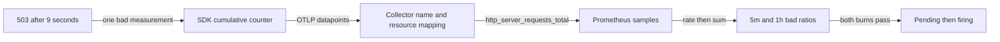
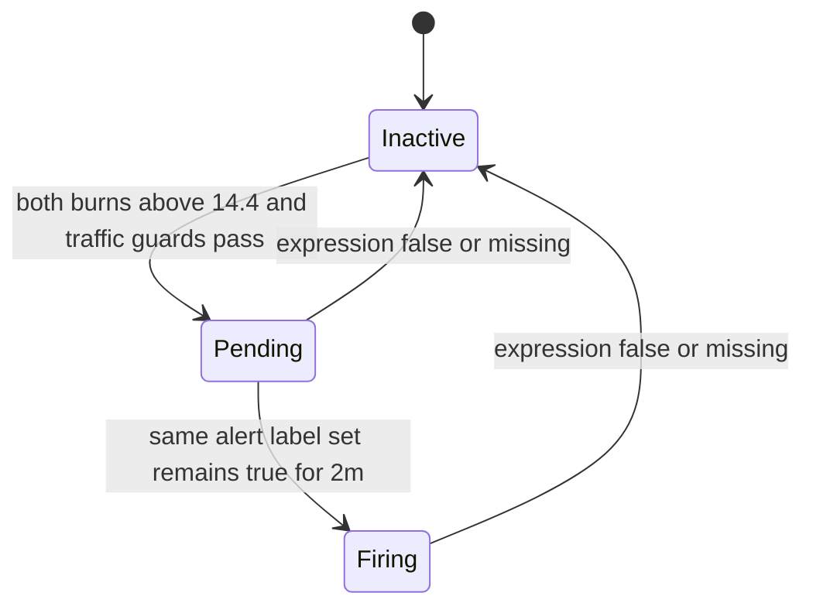

# Custom Metrics And Alerting

Traces are for investigation. Metrics are for detection. Logs are for local
detail. A production observability system needs all three, but alerts should
usually come from metrics.

This chapter explains how to design OpenTelemetry metrics, export them, map
them into Prometheus-style backends, and turn them into useful alerts for
distributed systems and LLM applications.

## From one request to a firing decision

Start after [Python instrumentation](02_python_instrumentation.md): the application owns a configured MeterProvider. Before configuring a backend, run the complete [local measurement carrier](../examples/local/otel_slo_measurements.py) from the repository root using the same environment:

```bash
python examples/local/otel_slo_measurements.py
```

It prints `PASS one good and one bad event; 503 plus 9s counted once`, using real SDK aggregation with no Collector or provider keys. This worked path uses one custom counter, independent of trace sampling. At the end of each `/chat` request it records exactly one terminal outcome. A failed request that also takes nine seconds contributes one bad event, not two.

```python
from opentelemetry import metrics

requests = metrics.get_meter("chat-slo").create_counter(
    "http.server.requests", unit="{request}"
)


def record_request(status_code: int, duration_seconds: float) -> None:
    requests.add(1, {
        "http.route": "/chat",
        "app.slo.result": "bad" if status_code >= 500 or duration_seconds > 8 else "good",
    })
```

`record_request(200, 0.4)` increments the good attribute combination. `record_request(503, 9)` increments the bad combination. The SDK maintains two cumulative sums; there is no request ID label. Span attributes do not automatically become metric attributes, which is why this function passes the classification explicitly.

The diagram shows how these sums become the numbers an alert uses; each boundary can independently lose data.



The Collector translates the metric name and dotted attribute keys. For the pinned remote-write default this counter becomes `http_server_requests_total`, with `http_route` and `app_slo_result` labels. Resource identity is a separate mapping: by default many resource attributes live on `target_info`, not on every series. Every rule below that filters `service_name` and `deployment_environment_name` requires those resource attributes to be promoted. For this tutorial's deliberately bounded Resource, enable `resource_to_telemetry_conversion.enabled: true`; production should promote only approved keys rather than attaching arbitrary resource fields. Confirm the actual result in the backend before using these selectors. See the [pinned exporter mapping documentation](https://github.com/open-telemetry/opentelemetry-collector-contrib/blob/v0.158.0/exporter/prometheusremotewriteexporter/README.md) (checked 2026-10-14).

A faithful backend sample looks like this (exposition excerpt, not Python output):

```text
http_server_requests_total{service_name="chat-api",deployment_environment_name="production",http_route="/chat",app_slo_result="good",instance="a"} 920
http_server_requests_total{service_name="chat-api",deployment_environment_name="production",http_route="/chat",app_slo_result="bad",instance="a"} 80
```

### Turn totals into a rate before combining instances

A cumulative total of 80 bad requests cannot tell us whether the incident happened today or last month. `rate(counter[5m])` uses samples within the last five minutes to estimate events per second, adjusting for counter decreases caused by process restarts and extrapolating to the window edges. For evenly spaced samples spanning exactly 300 seconds with no reset, a bad counter growing from 80 to 160 means `80 / 300 = 0.2667` bad requests/s. If the total grows by 1,000, total throughput is `1000 / 300 = 3.3333` requests/s. Their ratio is `0.08`.

For a reset trace at seconds 0, 150, 300, counter values `100, 160, 20` show 60 events before reset and 20 after: observed corrected increase is 80, not -80. Actual `rate` still depends on sample coverage and extrapolation, so inspect raw samples when diagnosing sparse data. Apply `rate` to each instance before summing; adding raw counters first can conceal one instance's reset behind another's growth. [Prometheus rate semantics](https://prometheus.io/docs/prometheus/latest/querying/functions/#rate) (checked 2026-10-14).

For the single service, `sum(rate(...))` drops all instance and outcome labels, yielding one scalar-like vector element on each side of the division. Numerator and denominator now match. To preserve route, use `sum by (http_route)` on both sides. Retaining `app_slo_result` on only the numerator causes unmatched label sets and an empty division result; PromQL does not infer that you meant to ignore it. The histogram alert later uses explicit `and on (...)` to match a quantile vector with a count vector on their common identifying labels.

### Compute burn, then maintain alert state

The 99.5% SLO permits `1 - 0.995 = 0.005` bad events. An observed bad ratio of `0.08` spends that allowance `0.08 / 0.005 = 16` times faster than the target pace. At constant traffic, that pace consumes a 30-day budget in `30 / 16 = 1.875` days. This is a rate comparison, not a prediction that future traffic stays constant.

The fast rule below requires **both** 5m and 1h burn above 14.4, plus minimum request counts. Compare two histories, assuming guards pass:

| Last 5m | Last 1h | Computation | Expression result |
| --- | --- | --- | --- |
| 80 bad / 1,000 total | 960 bad / 12,000 total | 16x and 16x | true |
| 80 bad / 1,000 total | 720 bad / 12,000 total | 16x and 12x | false |

The second history has a recent burst but less sustained damage. `for: 2m` cannot make it pass: it waits only after the entire expression is true. Each rule evaluation checks fresh rolling windows; they are different from the persistence timer.

The state diagram follows the first history into an actual firing decision.



With one-minute evaluation, true at 12:00 starts pending, true at 12:01 remains pending, and true at 12:02 fires. False at 12:01 discards the first pending interval; a new true result at 12:02 starts again. Missing data also does not prove health: this impact alert stops being active, so separately monitor missing application series and Collector health. Firing is a Prometheus state; Alertmanager still groups, routes and suppresses notifications according to its configuration. [Alert state documentation](https://prometheus.io/docs/prometheus/latest/configuration/alerting_rules/) (checked 2026-10-14).

The complete rules are also [otel_slo_rules.yaml](../examples/local/otel_slo_rules.yaml); their synthetic input suite is [otel_slo_test.yaml](../examples/local/otel_slo_test.yaml). With Prometheus 3.15.0's `promtool` on your PATH, run from the repository root:

```bash
promtool check rules examples/local/otel_slo_rules.yaml
promtool test rules examples/local/otel_slo_test.yaml
```

The first command reports six valid rules, and the second reports `SUCCESS`. Fixtures cover 16x sustained firing, 12x suppression, a recent 16x burst whose long-window burn remains below the threshold, an early evaluation that cannot yet fire, and restarting counters whose error ratio remains correct. These execute rule evaluation; they do not prove live backend ingestion. For that separate boundary, [the local signal test](../examples/local/otel_collector_signal_test.py) records a real SDK `llm.tokens` counter, exports OTLP to Contrib 0.158.0 and scrapes `llm_tokens_total` with actual route/token/resource labels. The scrape exporter shares translation conventions but is not a remote-write backend delivery test.

You can now read the full recording and alert rules below as transformations of these measurements. The later variants change the operational question, while preserving the need for correct labels, sufficient traffic and a persistence policy.

## 🧭 Metric Mental Model

OpenTelemetry metrics flow like this:

```text
application code
  -> MeterProvider
  -> Meter
  -> instrument
  -> measurement + attributes
  -> SDK aggregation
  -> metric reader
  -> exporter
  -> Collector
  -> metrics backend
  -> dashboards and alerts
```

The application records measurements. The SDK aggregates them. The backend
stores time series. Alerting rules query those time series.

Metrics are not sampled traces. If traces are sampled at 5 percent, you still
need complete metrics for request counts, error rates, latency SLOs, token
usage, queue depth, and capacity.

## 📐 Traces vs Metrics

| Signal | Use for | Example question |
| --- | --- | --- |
| Metrics | Aggregate detection and alerting | Is `/chat` p95 latency above 8 seconds? |
| Traces | Request investigation | Which downstream span made this request slow? |
| Logs | Local message detail | What exception and local values were recorded? |

Incident workflow:

```text
metric alert fires
  -> dashboard shows affected route/model/provider
  -> trace query finds slow or failed examples
  -> logs explain local details
  -> runbook suggests mitigation
```

## 📐 Metric Design Principles

Good metrics are:

- tied to a specific operational question;
- low-cardinality;
- named consistently;
- measured in clear units;
- dimensioned by useful labels;
- emitted independently from trace sampling;
- owned by a team;
- connected to a dashboard and runbook.

Avoid "because it might be useful someday" metrics. Every metric has storage,
query, alerting, and cognitive cost.

## 📦 Instruments

Choose the instrument based on what you are measuring.

| Instrument | Meaning | Use for |
| --- | --- | --- |
| Counter | Monotonic total that only increases. | Requests, errors, tokens, jobs processed. |
| UpDownCounter | Value adjusted up and down through adds. | In-flight requests, active sessions, open jobs. |
| Histogram | Distribution of recorded values. | Latency, payload size, token count, retrieved documents. |
| ObservableGauge | Current value observed by callback. | Queue depth, cache size, free workers, connection pool size. |

Examples:

```text
request happened -> Counter
request duration was 0.37s -> Histogram
LLM call started, then ended -> UpDownCounter
queue currently has 842 jobs -> ObservableGauge
```

Do not use a gauge for total requests. Do not use a counter for latency. Do not
record one metric per user, prompt, trace, or request ID.

> ⚠️ **Watch out:** Recording a metric attribute that includes a user ID, trace ID, or prompt hash creates a new time series per request, which can crash a Prometheus-compatible backend or make it prohibitively expensive within hours.

## 🏷️ Naming And Units

Metric names should describe the thing being measured.

| Good | Problematic |
| --- | --- |
| `llm.requests` | `llm.counter` |
| `llm.request.duration` | `llm.latency.ms` if unit is seconds |
| `worker.queue.depth` | `queue_size_for_llm_jobs_only` |
| `rag.retrieved_documents` | `docs` |

Use clear units:

| Unit | Meaning |
| --- | --- |
| `s` | seconds |
| `ms` | milliseconds, only if you intentionally record milliseconds |
| `{request}` | count of requests |
| `{token}` | count of tokens |
| `{document}` | count of documents |
| `By` | bytes |

For duration histograms, seconds are common in OTel and Prometheus-style
ecosystems.

## 📊 Attributes And Cardinality

Attributes become metric dimensions. Each unique combination can become a time
series in the backend.

Good dimensions:

| Attribute | Why |
| --- | --- |
| `service.name` | Ownership and routing. |
| `http.route` | Bounded endpoint template. |
| `http.request.method` | Small enum. |
| `http.response.status_code` | Bounded numeric set. |
| `gen_ai.provider.name` | Small provider list. |
| `gen_ai.request.model` | Bounded model list. |
| `app.outcome` | Small enum such as `success`, `error`, `timeout`. |
| `app.tenant.tier` | Small business category. |

Bad dimensions:

| Attribute | Why |
| --- | --- |
| `user.email` | Personal data and unbounded. |
| `user.id` | High-cardinality. |
| `trace_id` | Unique per trace. |
| `request_id` | Unique per request. |
| `url.full` | Often includes IDs and secrets. |
| `prompt` | Sensitive, huge, and unbounded. |
| `exception.message` | Often unique. |

Cardinality budget is one of the most important metric design constraints. The
right label can make an alert actionable. The wrong label can make a metrics
backend expensive or unstable.

## 🗺️ Useful Metrics For Production Systems

| Metric | Instrument | Labels | Alert use |
| --- | --- | --- | --- |
| `http.server.request.duration` | Histogram | route, method, status | Latency SLOs. |
| `http.server.requests` | Counter | route, method, status, outcome | Error rate and traffic drop. |
| `worker.queue.depth` | ObservableGauge | queue | Backlog and saturation. |
| `worker.jobs.processed` | Counter | queue, outcome | Worker failures and throughput. |
| `db.client.operation.duration` | Histogram | db system, operation | Database latency. |
| `cache.operations` | Counter | cache, operation, outcome | Cache errors and hit/miss health. |
| `llm.request.duration` | Histogram | provider, model, route, outcome | LLM latency and timeouts. |
| `llm.requests` | Counter | provider, model, route, outcome | LLM error rate and volume. |
| `llm.tokens` | Counter | provider, model, token_type | Cost and capacity. |
| `rag.retrieved_documents` | Histogram | strategy | Retrieval quality proxy. |
| `agent.tool.calls` | Counter | tool_name, outcome | Tool failures and loops. |
| `guardrail.blocks` | Counter | policy, route | Safety and product quality. |

Use semantic convention metrics when they fit. Use application metrics when you
need product-specific meaning. Be consistent.

## 🛠️ Python Custom Metrics Example

```python
from opentelemetry import metrics

meter = metrics.get_meter("chat-api")

agent_tool_calls = meter.create_counter(
    "agent.tool.calls",
    unit="{call}",
    description="Tool calls executed by agents.",
)

agent_steps = meter.create_histogram(
    "agent.steps",
    unit="{step}",
    description="Number of reasoning/tool steps per agent run.",
)

guardrail_blocks = meter.create_counter(
    "guardrail.blocks",
    unit="{block}",
    description="Responses blocked by guardrails.",
)


def run_tool(tool_name: str, args: dict) -> dict:
    outcome = "success"
    try:
        tool = tools[tool_name]
        return tool(**args)
    except Exception:
        outcome = "error"
        raise
    finally:
        agent_tool_calls.add(
            1,
            {
                "agent.tool.name": normalize_tool_name(tool_name),
                "app.outcome": outcome,
            },
        )
```

Keep `tool_name` bounded. If users can define arbitrary tools, normalize or
bucket names before recording metrics.

## 📊 Histograms

Histograms are the usual instrument for latency and distributions.

Use histograms for:

- request duration;
- database duration;
- LLM duration;
- time to first token or chunk;
- token count per request;
- retrieved document count;
- agent step count;
- payload size.

Why histograms matter:

```text
average latency = hides tail pain
p95 latency = shows user-facing slow requests
p99 latency = shows severe tail behavior
```

Averages are useful for capacity planning, but alerts should often use
percentiles or SLO burn rates.

> 💡 **Key insight:** Average latency hides tail pain — a p95 alert on a histogram fires for the 1-in-20 slow request that users actually notice, while an average alert may stay silent even as a subset of users experience 10x timeouts.

In Prometheus-style backends, histograms usually become bucket time series. Make
sure buckets match the thing being measured. A 10-second LLM latency histogram
needs different buckets from a 50-millisecond cache lookup histogram.

### Reconstruct a distribution before querying its percentile

Suppose ten `/chat` model calls take `1, 1, 1, 2, 2, 3, 4, 5, 7, 9` seconds. Choose explicit bounds `2, 4, 8`; the OTLP histogram's disjoint counts are `5, 2, 2, 1`. The remote-write classic representation becomes cumulative buckets:

| Prometheus `le` | Count | Interpretation |
| --- | --- | --- |
| 2 | 5 | Five calls took at most two seconds. |
| 4 | 7 | Those five plus two calls in (2,4]. |
| 8 | 9 | Those seven plus two calls in (4,8]. |
| +Inf | 10 | All calls, including the nine-second call. |

`_count` is 10 and `_sum` is 35 seconds. The mean is 3.5s, yet one user waited 9s. To estimate p90, locate rank `0.90 * 10 = 9`: it lies at the top of the (4,8] bucket, so classic linear interpolation estimates 8s. The observed ninth value was 7s; bucket aggregation discarded that exact location. At p95 the rank falls in +Inf, so the classic estimate is the highest finite boundary, 8s, also missing the nine-second tail. Choose boundaries that cover meaningful latency ranges; a percentile is an estimate constrained by those boundaries, not a recovered raw observation.

The query takes `rate` per bucket series and then `sum by (le, ...)` to combine instance populations. Retaining `le` preserves the cumulative distribution. Dropping it first would add nested counts together and leave nothing for `histogram_quantile` to reconstruct. Averaging each instance's p95 also fails: an idle instance and a busy instance would receive equal weight despite serving different populations. The combined bucket population gives each request its actual weight. [Prometheus histogram quantile behavior](https://prometheus.io/docs/prometheus/latest/querying/functions/#histogram_quantile) (checked 2026-10-14).

### Choose the representation across the whole route

**GA guidance, checked 2026-10-28:** Prometheus recommends native histograms
when supported. A native sample carries its distribution together; classic
histograms spread it across `_bucket`, `_sum` and `_count` series. OTel
exponential histograms map to native histograms; explicit OTel buckets may
become classic histograms or native histograms with custom bucket boundaries
(NHCB). [Prometheus histogram guidance](https://prometheus.io/docs/practices/histograms/).

For the ten `/chat` calls above, NHCB storage keeps the explicit bucket
information; it cannot recover the discarded seven-second observation. Before
migration, inspect SDK aggregation, Collector/transport conversion, backend
storage and query results. Each boundary must preserve the selected type.

These query excerpts assume `chat_duration_seconds` is the stored metric name:

| Representation | Aggregate p90 query |
| --- | --- |
| Classic | `histogram_quantile(0.90, sum by (le) (rate(chat_duration_seconds_bucket[5m])))` |
| Native, including NHCB | `histogram_quantile(0.90, sum(rate(chat_duration_seconds[5m])))` |

The pinned lab keeps explicit buckets and classic queries. Compare both routes
on a canary before changing producer, transport and rules. If storage still
contains only classic series, the native query lacks histogram input; successful
configuration validation cannot prove migration.

## 📤 Export Patterns

Most teams export metrics through OTLP to a Collector and then to a metrics
backend:

```text
Python MeterProvider
  -> OTLPMetricExporter
  -> OpenTelemetry Collector
  -> Prometheus remote write, Datadog, Grafana Cloud, etc.
```

Collector metrics pipeline:

```yaml
receivers:
  otlp:
    protocols:
      http:
        endpoint: 0.0.0.0:4318

processors:
  memory_limiter:
    check_interval: 5s
    limit_mib: 512
  batch:

exporters:
  prometheus_remote_write:
    endpoint: https://prometheus.example.com/api/v1/write
    resource_to_telemetry_conversion:
      enabled: true

service:
  pipelines:
    metrics:
      receivers: [otlp]
      processors: [memory_limiter, batch]
      exporters: [prometheus_remote_write]
```

Metric names and labels may be transformed by the backend. For Prometheus:

- dotted names are commonly represented with underscores;
- counters usually appear with a `_total` suffix;
- histogram buckets have a `_bucket` suffix;
- attributes become labels;
- label names may be normalized.

Confirm final names in the backend before writing alerts.

> ⚠️ **Watch out:** Prometheus rewrites OTel metric names (dots to underscores, `_total` suffix on counters, `_bucket`/`_count`/`_sum` on histograms) — write and test your PromQL against the actual exported names, not the names you chose in code.

## 🏷️ Prometheus Name Mapping Example

An OTel metric:

```text
llm.request.duration
```

May appear as:

```text
llm_request_duration_seconds_bucket
llm_request_duration_seconds_count
llm_request_duration_seconds_sum
```

An OTel counter:

```text
llm.requests
```

May appear as:

```text
llm_requests_total
```

Attribute names may also be normalized:

```text
gen_ai.request.model -> gen_ai_request_model
http.route -> http_route
app.outcome -> app_outcome
```

The examples below use Prometheus-style names. Adjust them to the names your
backend actually exposes.

## 📐 Alert Design

Alerts should represent user or business impact, not every unusual internal
value.

Use this process:

1. Define the failure mode or SLO.
2. Pick the metric that detects it.
3. Add labels that identify ownership without exploding cardinality.
4. Choose a window and threshold.
5. Decide page, ticket, or dashboard-only severity.
6. Attach a runbook.
7. Test the alert against historical data.

Bad alert:

```text
queue depth > 100
```

Better alert:

```text
enterprise chat queue oldest job age > 5 minutes for 10 minutes
```

The second alert describes user impact and persistence.

## 📐 SLO And Burn-Rate Thinking

An SLO is a reliability target, such as:

```text
99.5 percent of /chat requests complete successfully under 8 seconds per 30 days
```

From that, define good and bad events:

```text
good = status < 500 and duration <= 8s
bad = status >= 500 or duration > 8s
```

Alerts can then detect error-budget burn instead of arbitrary thresholds.

For paging, multi-window burn-rate alerts are better than one short threshold.
A short window catches fast incidents. A longer window catches sustained
degradation and reduces noise.

The following complete example uses a 99.5-percent 30-day `/chat` SLO, so the error budget is `0.005`. The application emits a custom `http_server_requests_total` counter with `app_slo_result="bad"` when a request is a 5xx or exceeds eight seconds; this label is not added to auto-instrumented HTTP metrics by setting a span attribute. Recording rules precompute scoped error ratios:

```yaml
groups:
  - name: chat-api-slo-recording
    interval: 1m
    rules:
      - record: chat_api:slo_error_ratio:rate5m
        expr: |
          sum(rate(http_server_requests_total{service_name="chat-api",deployment_environment_name="production",http_route="/chat",app_slo_result="bad"}[5m]))
          /
          clamp_min(sum(rate(http_server_requests_total{service_name="chat-api",deployment_environment_name="production",http_route="/chat"}[5m])), 1e-12)
      - record: chat_api:slo_error_ratio:rate30m
        expr: |
          sum(rate(http_server_requests_total{service_name="chat-api",deployment_environment_name="production",http_route="/chat",app_slo_result="bad"}[30m]))
          /
          clamp_min(sum(rate(http_server_requests_total{service_name="chat-api",deployment_environment_name="production",http_route="/chat"}[30m])), 1e-12)
      - record: chat_api:slo_error_ratio:rate1h
        expr: |
          sum(rate(http_server_requests_total{service_name="chat-api",deployment_environment_name="production",http_route="/chat",app_slo_result="bad"}[1h]))
          /
          clamp_min(sum(rate(http_server_requests_total{service_name="chat-api",deployment_environment_name="production",http_route="/chat"}[1h])), 1e-12)
      - record: chat_api:slo_error_ratio:rate6h
        expr: |
          sum(rate(http_server_requests_total{service_name="chat-api",deployment_environment_name="production",http_route="/chat",app_slo_result="bad"}[6h]))
          /
          clamp_min(sum(rate(http_server_requests_total{service_name="chat-api",deployment_environment_name="production",http_route="/chat"}[6h])), 1e-12)

  - name: chat-api-slo-alerts
    rules:
      - alert: ChatApiSloFastBurn
        expr: |
          (chat_api:slo_error_ratio:rate5m / 0.005 > 14.4)
          and
          (chat_api:slo_error_ratio:rate1h / 0.005 > 14.4)
          and
          sum(increase(http_server_requests_total{service_name="chat-api",deployment_environment_name="production",http_route="/chat"}[5m])) >= 100
          and
          sum(increase(http_server_requests_total{service_name="chat-api",deployment_environment_name="production",http_route="/chat"}[1h])) >= 1000
        for: 2m
        labels:
          severity: page
          service: chat-api
        annotations:
          summary: "chat-api is rapidly consuming its 30-day error budget"
          runbook: "Check bad-event mix, release, dependencies, and representative traces."

      - alert: ChatApiSloSlowBurn
        expr: |
          (chat_api:slo_error_ratio:rate30m / 0.005 > 6)
          and
          (chat_api:slo_error_ratio:rate6h / 0.005 > 6)
          and
          sum(increase(http_server_requests_total{service_name="chat-api",deployment_environment_name="production",http_route="/chat"}[30m])) >= 500
          and
          sum(increase(http_server_requests_total{service_name="chat-api",deployment_environment_name="production",http_route="/chat"}[6h])) >= 5000
        for: 15m
        labels:
          severity: ticket
          service: chat-api
        annotations:
          summary: "chat-api has sustained error-budget burn"
          runbook: "Compare six-hour bad events with baseline and open affected traces."
```

The short and long windows must both breach. The page catches rapid budget loss; the ticket catches slower sustained loss. Tune burn factors and traffic guards from the organization's SLO policy, and test the rules with `promtool test rules`.

> 💡 **Key insight:** A single-window threshold alert fires on momentary spikes and goes noisy; requiring both a short window (5m/1h) and a long window (30m/6h) to breach simultaneously eliminates the vast majority of false pages.

## 🛠️ Practical Alerts

The PromQL names below are examples. Every query filters the intended service and environment inside the expression. An alert label such as `service: chat-api` does not filter input series; it only labels the alert after evaluation.

Every ratio or baseline comparison also has a denominator/baseline check and a
minimum-volume guard. The guard suppresses tiny samples; it is not a substitute
for choosing a window long enough for the expected traffic.

### High HTTP Error Rate

```yaml
- alert: ChatApiHigh5xxRate
  expr: |
    (
      sum(rate(http_server_requests_total{
        service_name="chat-api",
        deployment_environment_name="production",
        http_route="/chat",
        http_response_status_code=~"5.."
      }[5m]))
      /
      sum(rate(http_server_requests_total{
        service_name="chat-api",
        deployment_environment_name="production",
        http_route="/chat"
      }[5m]))
    ) > 0.02
    and
    sum(rate(http_server_requests_total{
      service_name="chat-api",
      deployment_environment_name="production",
      http_route="/chat"
    }[5m])) >= 1
  for: 10m
  labels:
    severity: page
    service: chat-api
  annotations:
    summary: "chat-api 5xx rate is above 2%"
    runbook: "Check recent deploys, upstream provider errors, and slow traces."
```

### High LLM Latency

```yaml
- alert: LlmP95LatencyHigh
  expr: |
    (
      histogram_quantile(
        0.95,
        sum(rate(llm_request_duration_seconds_bucket{
          service_name="chat-api",
          deployment_environment_name="production",
          http_route="/chat"
        }[10m])) by (
          le, service_name, deployment_environment_name,
          gen_ai_request_model, gen_ai_provider_name, http_route
        )
      ) > 8
    )
    and on (
      service_name, deployment_environment_name,
      gen_ai_request_model, gen_ai_provider_name, http_route
    )
    sum(rate(llm_request_duration_seconds_count{
      service_name="chat-api",
      deployment_environment_name="production",
      http_route="/chat"
    }[10m])) by (
      service_name, deployment_environment_name,
      gen_ai_request_model, gen_ai_provider_name, http_route
    ) >= 0.2
  for: 15m
  labels:
    severity: ticket
  annotations:
    summary: "LLM p95 latency is above 8 seconds"
    runbook: "Check provider status, model mix, streaming TTFT, retries, and trace examples."
```

### LLM Error Spike

```yaml
- alert: LlmErrorRateHigh
  expr: |
    (
      sum(rate(llm_requests_total{
        service_name="chat-api",
        deployment_environment_name="production",
        http_route="/chat",
        app_outcome="error"
      }[5m]))
      /
      sum(rate(llm_requests_total{
        service_name="chat-api",
        deployment_environment_name="production",
        http_route="/chat"
      }[5m]))
    ) > 0.05
    and
    sum(rate(llm_requests_total{
      service_name="chat-api",
      deployment_environment_name="production",
      http_route="/chat"
    }[5m])) >= 0.2
  for: 10m
  labels:
    severity: page
  annotations:
    summary: "LLM request errors exceed 5%"
    runbook: "Compare provider, model, route, recent release, retry counts, and provider status."
```

### Token Usage Spike

```yaml
- alert: LlmInputTokenSpike
  expr: |
    sum(rate(llm_tokens_total{
      service_name="chat-api",
      deployment_environment_name="production",
      http_route="/chat",
      gen_ai_token_type="input"
    }[15m]))
    > 2 * sum(rate(llm_tokens_total{
      service_name="chat-api",
      deployment_environment_name="production",
      http_route="/chat",
      gen_ai_token_type="input"
    }[15m] offset 1d))
    and
    sum(rate(llm_tokens_total{
      service_name="chat-api",
      deployment_environment_name="production",
      http_route="/chat",
      gen_ai_token_type="input"
    }[15m])) > 10
    and
    sum(rate(llm_tokens_total{
      service_name="chat-api",
      deployment_environment_name="production",
      http_route="/chat",
      gen_ai_token_type="input"
    }[15m] offset 1d)) > 0
  for: 20m
  labels:
    severity: ticket
  annotations:
    summary: "Input token usage is more than 2x the same window yesterday"
    runbook: "Check prompt version, retrieval document count, traffic mix, and model routing."
```

### Tool Failure Rate

```yaml
- alert: AgentToolFailureRateHigh
  expr: |
    (
      sum(rate(agent_tool_calls_total{
        service_name="agent-service",
        deployment_environment_name="production",
        app_outcome="error"
      }[10m])) by (service_name, deployment_environment_name, agent_tool_name)
      /
      sum(rate(agent_tool_calls_total{
        service_name="agent-service",
        deployment_environment_name="production"
      }[10m])) by (service_name, deployment_environment_name, agent_tool_name)
    ) > 0.10
    and
    sum(rate(agent_tool_calls_total{
      service_name="agent-service",
      deployment_environment_name="production"
    }[10m])) by (service_name, deployment_environment_name, agent_tool_name) >= 0.1
  for: 15m
  labels:
    severity: ticket
  annotations:
    summary: "Agent tool failure rate is above 10%"
    runbook: "Open traces for failing tool, check downstream API errors and argument validation."
```

### Agent Looping

```yaml
- alert: AgentStepCountHigh
  expr: |
    (
      histogram_quantile(
        0.95,
        sum(rate(agent_steps_bucket{
          service_name="agent-service",
          deployment_environment_name="production",
          http_route="/run"
        }[15m])) by (le, service_name, deployment_environment_name, http_route)
      ) > 12
    )
    and on (service_name, deployment_environment_name, http_route)
    sum(rate(agent_steps_count{
      service_name="agent-service",
      deployment_environment_name="production",
      http_route="/run"
    }[15m])) by (service_name, deployment_environment_name, http_route) >= 0.1
  for: 20m
  labels:
    severity: ticket
  annotations:
    summary: "Agent p95 step count is high"
    runbook: "Check prompt version, tool errors, planner changes, and traces with many tool calls."
```

### Retrieval Health

```yaml
- alert: RagEmptyRetrievalsHigh
  expr: |
    (
      sum(rate(rag_retrieval_requests_total{
        service_name="rag-service",
        deployment_environment_name="production",
        app_outcome="empty"
      }[10m]))
      /
      sum(rate(rag_retrieval_requests_total{
        service_name="rag-service",
        deployment_environment_name="production"
      }[10m]))
    ) > 0.05
    and
    sum(rate(rag_retrieval_requests_total{
      service_name="rag-service",
      deployment_environment_name="production"
    }[10m])) >= 0.1
  for: 15m
  labels:
    severity: ticket
  annotations:
    summary: "More than 5% of RAG retrievals return no documents"
    runbook: "Check embedding model, index freshness, filters, query rewrite, and vector DB latency."
```

### Queue Backlog

```yaml
- alert: LlmJobQueueBacklogHigh
  expr: |
    max(worker_queue_depth{
      service_name="llm-worker",
      deployment_environment_name="production",
      queue_name="llm-jobs"
    }) > 1000
  for: 15m
  labels:
    severity: ticket
  annotations:
    summary: "LLM job queue depth is above 1000"
    runbook: "Check worker count, provider latency, retry storms, and oldest job age."
```

Queue depth alone can be misleading. Pair it with oldest job age or processing
rate when possible.

## 📊 LLM Metrics

LLM systems need operational, cost, and quality metrics.

Operational metrics:

| Metric | Why |
| --- | --- |
| Request duration | User latency and provider degradation. |
| Request count by outcome | Error rate and volume. |
| Time to first token/chunk | Streaming UX. |
| Retry count | Provider instability. |
| Timeout count | Capacity or provider problems. |
| Tool call count | Agent loops and tool load. |
| Tool error count | Downstream tool health. |

Cost and capacity metrics:

| Metric | Why |
| --- | --- |
| Input tokens | Prompt growth, retrieval bloat, cost. |
| Output tokens | Cost and response length. |
| Cached input tokens | Cache effectiveness and provider billing. |
| Reasoning tokens | Cost and model behavior for reasoning models. |
| Requests by model | Model routing and capacity. |

Quality metrics:

| Metric | Source |
| --- | --- |
| User negative feedback rate | App counter or Langfuse score. |
| Guardrail block rate | App counter. |
| Faithfulness score | Langfuse evaluator or custom evaluator. |
| Toxicity/safety score | Guardrail or evaluator. |
| Answer abstention rate | App metric. |
| Empty retrieval rate | Retrieval metric. |
| Tool argument validation failures | App counter. |

## 🏷️ GenAI Semantic Convention Metrics

The pinned historical GenAI vocabulary used by this collection defines client metrics such as:

| Metric | Meaning |
| --- | --- |
| `gen_ai.client.token.usage` | Histogram of input/output token usage. |
| `gen_ai.client.operation.duration` | Histogram of client operation duration. |
| `gen_ai.client.operation.time_to_first_chunk` | Streaming time to first chunk. |
| `gen_ai.client.operation.time_per_output_chunk` | Streaming chunk cadence. |

Current inference names are `gen_ai.client.inference.duration`,
`gen_ai.client.inference.time_to_first_chunk` and
`gen_ai.client.inference.time_per_output_chunk`, replacing the corresponding
`operation.*` vocabulary above for inference. Main remains Development: inspect
and pin the schema before adoption. Migrate producer, rules and dashboards as
one bundle, compare on a canary, and never sum old and new streams as independent
work. [GenAI metric schema](https://raw.githubusercontent.com/open-telemetry/semantic-conventions-genai/main/model/gen-ai/metrics.yaml)
(checked 2026-10-28); [the attempt lesson](06_genai_and_llm_observability.md)
owns the full historical/current boundary.

It also defines agent and tool metrics:

| Metric | Meaning |
| --- | --- |
| `gen_ai.invoke_agent.duration` | End-to-end duration of one in-process agent invocation. |
| `gen_ai.invoke_agent.inference_calls` | Distribution of model calls made by one agent invocation, including failed calls and excluding sub-agent-owned calls. |
| `gen_ai.invoke_agent.tool_calls` | Distribution of client-side tool calls made by one agent invocation, including failed calls and excluding sub-agent-owned calls. |
| `gen_ai.execute_tool.duration` | Duration of one tool execution, with tool name and low-cardinality `error.type` on failure. |

If you use these names, keep them consistent across services. If you use
application names such as `llm.tokens` and `llm.request.duration`, document the
mapping and do not mix both styles without a reason.

The standard agent call-count metrics are histograms recorded once per invocation; an `app.agent.tool_calls` counter records one point per tool call. They answer similar questions but have different aggregation semantics and must not be summed together. Keep `app.*` for product-specific facts with no standard equivalent, such as step-limit stops, retrieval emptiness, guardrail policy outcomes, or business cost allocation.

## 🔍 Quality Alerts

Latency and errors are not enough for LLM systems. You also need quality
signals, but quality alerts require care. A noisy judge score can wake people
for measurement noise rather than user harm.

Sources of quality metrics:

- Langfuse scores from human feedback;
- Langfuse LLM-as-judge scores;
- deterministic code evaluators;
- guardrail pass/fail counters;
- experiment results in CI;
- custom app counters for fallback, abstention, or unsafe-output blocks.

For paging, prefer high-confidence quality failures:

- safety guardrail block rate doubles and volume is significant;
- negative user feedback rate spikes;
- critical deterministic evaluator fails;
- release experiment score drops below baseline before deployment.

For lower-confidence signals, create tickets or dashboard annotations.

Example quality alert design:

| Alert | Source | Threshold |
| --- | --- | --- |
| Faithfulness regression | Langfuse score analytics or metrics export | 1h average drops below 0.85 with enough volume. |
| User negative feedback spike | Langfuse score or app counter | Negative feedback rate > 8 percent for 30m. |
| Safety block spike | OTel counter | Block rate doubles day-over-day and volume > threshold. |
| Release regression | Langfuse experiment | New release below baseline by 5 percent. |

## 🗺️ Dashboards

A useful service dashboard should show:

- request rate;
- error rate;
- latency p50/p95/p99;
- saturation such as queue depth or in-flight requests;
- dependency latency by provider/database/tool;
- token usage by model and token type;
- top routes by volume and errors;
- deployment version and environment;
- Collector/exporter health if telemetry looks suspicious.

An LLM dashboard should add:

- request count by provider and model;
- p95 duration by provider and model;
- time to first token/chunk;
- input and output token rate;
- cost proxy;
- tool call count and tool errors;
- guardrail blocks;
- retrieval empty rate and retrieved document count;
- quality scores and feedback.

Dashboards should be built for comparison: current release versus previous
release, this hour versus yesterday, model A versus model B, route A versus
route B.

## ✅ Runbook Template

Every alert should answer:

- What user impact does this represent?
- Which service/team owns it?
- Which dashboard should the responder open first?
- Which trace filters should they use?
- Which logs should they query?
- What recent deploys or prompt versions should they compare?
- What provider, model, route, or tenant tier is affected?
- What rollback or mitigation is available?
- When should the alert be downgraded to a ticket?

For LLM incidents, the trace investigation usually starts with:

1. Filter by affected model, provider, route, release, prompt version, or tenant tier.
2. Open slow/error examples in traces.
3. Compare prompt input size, retrieved document count, model parameters, and tool call count.
4. Check provider errors, retries, and timeouts.
5. Check Langfuse scores and user feedback for quality impact.
6. Decide whether to roll back code, prompt, model, retrieval config, or provider route.

## 🔍 Troubleshooting Metrics

Metric missing:

- provider was not configured;
- instrument was never created;
- measurement path did not run;
- metric reader is missing;
- exporter endpoint is wrong;
- Collector metrics pipeline is missing;
- backend renamed the metric.

Metric too expensive:

- high-cardinality labels;
- per-user or per-request attributes;
- too many histogram dimensions;
- duplicate instrumentation;
- resource attributes include request-specific values.

Alert noisy:

- threshold too low;
- window too short;
- alert detects internal weirdness but not user impact;
- missing volume guard;
- no grouping by owner or route;
- metric has deploy-time spikes that should be handled with burn-rate logic.

Alert did not fire:

- metric name changed in backend;
- label names changed during export;
- alert excluded the affected route/model;
- condition needed `for:` duration but incident was shorter;
- data was delayed or dropped in Collector/exporter;
- metric was derived from sampled traces.

## ✅ Final Design Checklist

- Each metric has an owner and purpose.
- Units are explicit and correct.
- Attributes are low-cardinality.
- Metrics are emitted independently of trace sampling.
- Histograms have useful buckets for their domain.
- Backend metric names are verified before alerts are written.
- Alerts represent user or business impact.
- Alerts include runbooks and useful filters.
- LLM systems track latency, errors, tokens, tool behavior, retrieval health, and quality.
- Quality alerts distinguish paging signals from ticket/dashboard signals.


## Cardinality limits preserve totals, not every dimension

A cardinality limit caps the number of attribute combinations a supported SDK retains for one metric stream. Suppose an approved route dimension normally has two values, but a bug adds arbitrary user IDs. A synchronous instrument implementing the specification folds measurements beyond its capacity into a stream marked `otel.metric.overflow=true`. That overflow aggregate has lost the original route/outcome combinations. Global counts remain accountable, while a query filtered to `app_slo_result="bad"` can exclude the overflow events and report a falsely healthy ratio. For example 100 routed good events plus 20 bad events folded into overflow give a global total of 120, but the bad selector returns zero.

Do not “fix” this by calling every overflow event bad: its classification is unknown. Alert separately on overflow, remove the unbounded attribute or restrict it with a View before aggregation, and validate each SLO's numerator and denominator under load. Changes cannot reconstruct lost historic labels. The [SDK cardinality specification](https://opentelemetry.io/docs/specs/otel/metrics/sdk/#cardinality-limits) is the contract; availability varies by language and release (checked 2026-10-14). The verified Python 1.45.1 View signature in this collection has no cardinality-limit argument. Do not paste another language's setting into it or claim that this Python lab demonstrated overflow. Use bounded application labels and attribute filtering now; treat cap configuration and overflow export as an upgrade gate requiring a supported SDK and load test. See [current cardinality landscape](https://opentelemetry.io/blog/2026/cardinality-limits-in-opentelemetry/) for implementation context.

## Recap and practice

The application records one explicit SLO result per request. Export mapping turns those measurements and selected resource keys into labels. `rate` handles each counter's restart before `sum` combines instances; matching labels then makes the ratio meaningful. Paired windows establish both recent and sustained burn, while `for` maintains alert state. Histogram boundaries and overflow limit what later queries can recover.

### Check yourself

1. 5m burn is 16x and 1h burn is 12x. Traffic guards pass. When does the fast rule fire?
2. Why does `_bucket{le="8"}=9` not mean nine requests took exactly eight seconds?
3. Your Resource has `service.name`, but every `service_name` selector returns no data. What must you inspect?

<details><summary>Reasoned answers</summary>

1. It never enters pending: the 1h value does not exceed 14.4. Waiting two minutes cannot repair a false expression.
2. The bucket is cumulative: nine requests took at most eight seconds. Their exact values are discarded; interpolated quantiles reflect that uncertainty.
3. Inspect actual exported labels and mapping. The resource field may be on `target_info` rather than promoted to the counter. Enable the approved promotion or write the deliberate join; an alert annotation cannot filter or add input labels.

</details>

### Try it: restart and recovery

Two instances expose request counters. A's samples at 0,150,300s are `100,160,20`; B's are `200,260,320`. Compute each corrected increase before summing, then predict the fast rule if 5m burn is 20x, 1h burn is 4x and guards pass. Finally explain what happens to a pending alert if the expression becomes empty before its two minutes elapse.

<details><summary>Worked solution</summary>

A contributed `60+20=80`, B contributed `120`, totaling 200 observed events; raw endpoint subtraction would produce only `340-300=40` and hide A's reset. Prometheus may extrapolate around sample edges; these fully covered synthetic points illustrate the reset correction. The fast expression is false because 4x is below 14.4, despite the short burst. Empty evaluation removes the alert's pending state. Monitor missing telemetry independently because silence does not demonstrate recovery.

</details>
