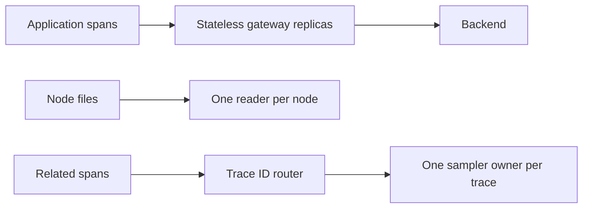
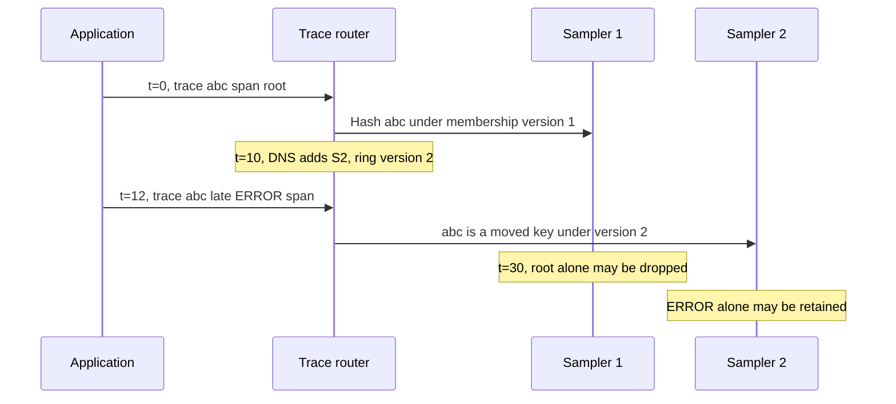

# Scale Collectors Without Breaking The Pipeline

> **Who this is for**: Engineers who need Collector availability and throughput beyond one replica and must preserve correct sampling, scraping, and export behavior.

Read **[Service Discovery And Clients](04_service_discovery_and_clients.md)**
first. Scaling cannot compensate for an incorrect endpoint or protocol.

---

## 1. 🧭 Classify The Pipeline Before Adding Replicas

Collector components fall into three operational classes:

| Class | Examples | Scaling rule |
| --- | --- | --- |
| Stateless transport and transforms | OTLP receiver, attribute/resource transforms, filtering, batching, most exporters | Add replicas behind a load balancer. |
| Scrapers/readers | Prometheus receiver, file log receiver, kubelet and host receivers, Kubernetes cluster receivers | Partition ownership or use one logical active reader; blind replication often duplicates data. |
| Trace/service state | Tail sampling, span-metrics aggregation, service-graph aggregation | Route related data to the same replica before processing it. |

An in-memory sending queue contains state, but ordinary gateway replicas can
still scale independently because queued requests do not require coordination.
That queue's data is lost with the pod unless persistent storage is configured.



Gateway queues are private pending requests, so replicas need no shared trace
decision. File checkpoints and sampler trace buffers instead identify an owner;
replicating those owners blindly creates duplicates or splits a decision.

> ⚠️ **Watch out:** Horizontal scaling changes correctness, not just capacity, when a receiver or processor owns state.

---

## 2. 📊 Scale On Telemetry Pressure

CPU and memory are useful symptoms, but the most direct signals are Collector
internal metrics:

| Signal | Meaning | Response |
| --- | --- | --- |
| `otelcol_exporter_queue_size / otelcol_exporter_queue_capacity` | Fraction of exporter queue occupied | Investigate sustained growth; consider scale-out around 60–70% if the backend has capacity. |
| `otelcol_exporter_enqueue_failed_spans` and signal equivalents | New telemetry could not enter the exporter queue | Data loss is occurring; page or escalate immediately. |
| `otelcol_receiver_refused_spans` and signal equivalents | Pipeline refused accepted client work | Capacity, memory limiting, or downstream backpressure is affecting clients. |
| `otelcol_exporter_send_failed_spans` and signal equivalents | Export attempts failed | Check backend, auth, TLS, rate limits, and network before adding replicas. |
| Accepted vs. sent rates | Ingress compared with successful egress | A widening sustained difference indicates buffering, filtering, sampling, or failure. |
| Pod CPU, memory, restarts, OOM kills | Runtime pressure | Correlate with queues, batch size, tail state, and traffic. |
| Receiver/component-specific metrics | Scrape duration, target count, tail sampling drops, load-balancer backend latency | Scale or repartition the component that owns the pressure. |

Rate-based PromQL should use the exact signal suffixes present in your deployed
version. For example:

```promql
max by (exporter) (
  otelcol_exporter_queue_size
  /
  clamp_min(otelcol_exporter_queue_capacity, 1)
)
```

```promql
sum by (receiver) (
  rate(otelcol_receiver_refused_spans[5m])
)
```

```promql
sum by (exporter) (
  rate(otelcol_exporter_send_failed_spans[5m])
)
```

Development-level internal metric names can change between Collector releases.
Diff the exposed `/metrics` output and update recording/alert rules during every
upgrade.

---

## 3. 📐 Establish Capacity With A Load Test

Do not copy a universal "spans per Collector" number. Capacity depends on:

- signal mix and serialized record size;
- span attributes and links, log-event attributes and bodies, and metric cardinality;
- receivers and exporters;
- transform, redaction, enrichment, and sampling work;
- batch and queue settings;
- backend latency, throttling, and compression;
- CPU architecture, runtime limits, and network bandwidth.

Use production-shaped telemetry and measure the sustainable point at which:

```text
accepted rate ≈ sent rate
queue ratio remains low and stable
refused/enqueue-failed rate = 0
memory stays below limiter and cgroup thresholds
backend stays within its ingest quota
```

Keep headroom for burst traffic, a backend slowdown, one unavailable replica,
and rolling updates. A three-replica deployment that only works while all three
are healthy is not resilient.

---

### Work the loss of one replica before choosing HPA limits

Assume a production-shaped load test measured one gateway sustaining 12,000
spans/s with zero refusals, stable queues and a healthy backend. The normal
arrival rate is 18,000 spans/s. Three replicas offer 36,000 spans/s, so each
handles 6,000 at 50% of its measured limit. Losing one replica leaves 24,000:
each survivor handles 9,000, or 75%. Remaining headroom is 6,000 spans/s across
the tier, so an increase to 22,000 can fit, while 26,000 cannot. This is an
illustrative measured input, not a benchmark of every Collector configuration.
Repeat the test for your signal mix and policy cost.

A three-replica fleet tested only at 30,000 input fails the same outage: two
survivors offer 24,000, leaving 6,000 spans/s refused or queued. Nominal aggregate
capacity is insufficient evidence of resilience. Choose requests/limits and
minimum replicas from the degraded state, then test the actual distribution:
a sticky gRPC client can overload one survivor even when total capacity fits.

Now hold input at 18,000 while the backend quota falls to 10,000 spans/s. Four
gateways offer more compute but still send through that shared quota; backlog
grows by 8,000 spans/s. HPA cannot repair this case. Compare CPU/refusal with
export latency/throttling and backend quota before selecting an action.

For a planned scale-down, first stop sending **new** requests to the departing
pod using the owning load-balancer/readiness policy, then allow existing
connections/work to settle. Observe its queue reaching zero and accepted/sent
convergence, and only then terminate it within measured grace time. Recheck
capacity on the two survivors and emit a fresh canary throughout. A PDB limits
some voluntary disruptions; it neither drains exporter queues nor protects
against every node failure. Kubernetes readiness withdrawal may not close
existing gRPC connections, so verify connection draining at your chosen proxy.
If a backend outage prevents drain, postpone scale-down or retain that replica's
compatible persistent volume; deleting an in-memory queue abandons its backlog.

## 4. 🔄 Scale A Stateless Gateway

Start a production gateway with at least three replicas when the environment
has enough failure domains and traffic to justify it. Spread pods across hosts
and zones, add a PodDisruptionBudget, and use rolling updates.

The upstream Helm chart can create a CPU/memory HPA:

```yaml
replicaCount: 3

autoscaling:
  enabled: true
  minReplicas: 3
  maxReplicas: 12
  targetCPUUtilizationPercentage: 70
  behavior:
    scaleUp:
      stabilizationWindowSeconds: 0
      policies:
        - type: Percent
          value: 100
          periodSeconds: 60
    scaleDown:
      stabilizationWindowSeconds: 600
      policies:
        - type: Percent
          value: 25
          periodSeconds: 60
```

CPU is a safe initial HPA input for a stateless tier, not a complete scaling
policy. Add an external/custom metric based on a stable recorded queue ratio
only after the metrics adapter and label cardinality are understood.

Keep scale-down conservative. Removing a pod discards its in-memory queue and
interrupts long-lived connections. Persistent queues reduce restart loss but
require per-replica volumes and StatefulSet-style storage lifecycle decisions.

### Long-lived OTLP/gRPC connections

Kubernetes Service load balancing normally selects a backend when a connection
is established. One long-lived gRPC connection can stay on one Collector, so a
small number of high-volume clients may not rebalance when replicas are added.

Options:

- use an L7 gRPC-aware proxy or service mesh with an understood policy;
- have clients maintain multiple/recycled connections when their exporter
  supports it;
- use OTLP/HTTP when it fits the performance and proxy requirements;
- send applications to node agents, creating more upstream connections from
  agents to gateways.

Do not churn every healthy connection merely to make a dashboard look even.
Scale based on saturation and loss, not perfect per-pod symmetry.

---

## 5. 🔀 Scale Tail Sampling With Two Tiers

The tail-sampling processor buffers spans by trace ID. Round-robin routing can
split one trace across several replicas, creating incomplete traces and
inconsistent decisions.

Use a stateless routing tier with the Contrib/Kubernetes
`load_balancing` exporter, then a sampling tier:

```text
applications
  -> otel-trace-router Service
  -> load_balancing exporter hashes traceID
  -> headless Service returns sampler pod IPs
  -> otel-tail-sampler replicas
  -> trace backend
```

Router configuration:

```yaml
receivers:
  otlp:
    protocols:
      grpc:
        endpoint: 0.0.0.0:4317

processors:
  memory_limiter:
    check_interval: 1s
    limit_percentage: 75
    spike_limit_percentage: 15
  batch:
    timeout: 1s

exporters:
  load_balancing/samplers:
    routing_key: traceID
    protocol:
      otlp:
        tls:
          insecure: true
    resolver:
      dns:
        hostname: otel-tail-sampler-headless.observability.svc.cluster.local

service:
  pipelines:
    traces:
      receivers: [otlp]
      processors: [memory_limiter, batch]
      exporters: [load_balancing/samplers]
```

Sampler configuration:

```yaml
receivers:
  otlp:
    protocols:
      grpc:
        endpoint: 0.0.0.0:4317

processors:
  memory_limiter:
    check_interval: 1s
    limit_percentage: 75
    spike_limit_percentage: 15
  tail_sampling:
    decision_wait: 30s
    num_traces: 50000
    expected_new_traces_per_sec: 500
    maximum_trace_size_bytes: 4194304
    decision_cache:
      sampled_cache_size: 100000
      non_sampled_cache_size: 500000
    policies:
      - name: keep-errors
        type: status_code
        status_code:
          status_codes: [ERROR]
      - name: sample-normal
        type: probabilistic
        probabilistic:
          sampling_percentage: 5
  batch:
    timeout: 5s

exporters:
  otlphttp/traces:
    endpoint: ${env:TRACE_BACKEND_ENDPOINT}
    headers:
      Authorization: ${env:TRACE_BACKEND_AUTHORIZATION}

service:
  pipelines:
    traces:
      receivers: [otlp]
      processors: [memory_limiter, tail_sampling, batch]
      exporters: [otlphttp/traces]
```

Use a **headless Service** for the sampling tier so DNS returns individual pod
addresses. A normal ClusterIP returns one virtual IP and prevents the exporter
from discovering the replica set.

Important limits:

- `num_traces` must cover concurrent traces during `decision_wait`; exceeding it
  can evict traces before a decision.
- `maximum_trace_size_bytes` protects the tier from pathological traces.
- adding or removing sampler replicas changes the hash ring; traces active
  during the change may be split;
- DNS views can differ briefly between router replicas;
- router and sampler tiers should be separate workloads for failure isolation;
- the new component name is `load_balancing`; older releases may expose the
  deprecated alias `loadbalancing`. Validate against the pinned image.

Follow one trace across a membership change:



This shows one possible moved key, not a guarantee every trace moves. With
stable membership, root and ERROR would join at S1 before its 30-second
decision. Now each sampler has partial knowledge; keep-errors cannot recover
root from S2. Two routers with different DNS snapshots can cause the same split
without an intentional scale event. Neither a normal ClusterIP nor merely
longer decision_wait reunites the buffers.

For a planned change, first measure the longest span arrival window, provision
spare capacity, pause new trace starts in a controlled test, wait for active
traces plus the decision window to settle, then change membership consistently
and resume. Test late spans and incomplete traces before relying on that
procedure. With continuous production traffic, document a bounded transient
loss objective or engineer stable logical ownership; DNS hashing alone provides
no zero-loss resharding promise. Sampler restart also loses its in-memory buffer.

Autoscale this tier slowly. Keep router capacity ahead of sampler capacity and
watch tail-sampling early-drop/late-span metrics during every replica change.

---

## 6. 📡 Scale Scrapers By Ownership

Scrapers pull data, so ordinary replication creates duplicate collection:

| Receiver/job | Ownership pattern |
| --- | --- |
| Container log files | One DaemonSet pod per node; checkpoints on a durable host path if restart continuity matters. |
| Host/kubelet metrics | One DaemonSet pod per node. |
| Prometheus targets | Explicit sharding or Operator Target Allocator. |
| Kubernetes cluster metrics/events | One replica or tested leader election. |
| Static external endpoint | Assign it to one shard unless duplicate scraping is intentional and deduplicated downstream. |

The Operator's Target Allocator distributes Prometheus scrape targets across a
Collector set. It is useful when target count changes dynamically and the
platform already owns the Operator. It is not a reason to move unrelated OTLP
gateway traffic into the scraping deployment.

Scale a Prometheus scraping shard when scrape duration approaches the scrape
interval, targets are timing out, or per-shard resource use reaches the tested
limit. Preserve stable ownership during resharding where the backend is
sensitive to stale markers or duplicate samples.

---

## 7. 🗄️ Design Backpressure And Durability

Remote exporters should use retries and sending queues. Size them from a
recovery objective:

```text
required buffered requests
  ≈ peak outgoing requests per second
    × tolerated backend outage seconds
```

Then measure actual bytes per queued request. `queue_size` is commonly requests
or batches, not spans or bytes, and the exact queue semantics depend on the
exporter helper version.

Work one outage numerically. Measured traffic is 100 exported requests/s,
with 200 spans/request and 64 KiB of serialized payload/request. A 60-second
backend outage needs 100 × 60 = **6,000 requests**. A 25% sizing margin gives
7,500 request slots; a request-count queue of 2,000 covers only 20 seconds.
The payload alone occupies 6,000 × 64 KiB = **375 MiB**, or 468.75 MiB at the
sizing margin. This is a lower bound: object, serialization and storage overhead
must be measured. A 512 MiB pod cannot safely fit that backlog plus its normal
working set and limiter headroom.

After recovery, a backend serving 150 requests/s while new input continues at
100 drains only 50 queued requests/s. Catch-up takes 6,000 / 50 = **120 seconds**.
At output 100 there is no drain; at output 80 the queue still grows. More gateway
replicas cannot repair a shared backend quota. Compare this outage plus retry
schedule to max_elapsed_time; capacity without an adequate retry window is not
a delivery guarantee.

For disk storage, reserve capacity for serialized backlog plus database/WAL
overhead, compaction and filesystem headroom. Give each replica one writable
volume. On restart attach that same volume; on scale-down decide retention
before deleting its pod/PVC. Never have independent Collectors concurrently
share one file-storage directory. Test full disk, permission denial and downgrade
recovery. Chapter 2 shows the lifecycle; its `--persistent` lab verifies process restart with the same directory, while
volume loss and format downgrade remain external gates.

In-memory queue:

- fast and simple;
- absorbs short backend stalls;
- loses buffered data on pod termination;
- consumes memory that must fit below the cgroup limit.

Persistent queue using `file_storage`:

- survives process/pod restart when the same volume returns;
- adds disk latency, capacity, permissions, and corruption/recovery concerns;
- requires a per-replica volume and an intentional retention policy;
- still loses data when the disk fails/fills or retry policy expires.

External durable queue:

- decouples Collector tiers and long backend outages;
- adds another stateful system, serialization path, cost, latency, and on-call
  surface;
- is justified only by a measured durability requirement.

> 💡 **Key insight:** A growing queue can mean the backend is the bottleneck; adding Collectors can increase pressure on the failing backend and make recovery slower.

---

## 8. ✅ Resilience Tests

Run these before declaring the deployment highly available:

1. Delete one gateway pod during peak-shaped traffic; verify no sustained
   refusal and acceptable loss.
2. Drain a node and verify PDB, topology spread, DaemonSet locality, and
   application retry behavior.
3. Block the backend for the tolerated outage; verify queue growth, alerting,
   retry, and recovery without unbounded memory/disk growth.
4. Return backend `429`, `401`, and `5xx`; distinguish retryable throttling from
   permanent credential failure.
5. Roll config and image versions; verify canary telemetry throughout.
6. Scale stateless gateways up and down; inspect gRPC load distribution.
7. Scale tail samplers; measure incomplete traces and late spans during hash-ring
   changes.
8. Restart a scraper and verify checkpoint/target ownership avoids gaps and
   duplicates within the stated objective.

Document acceptable loss. "Telemetry is best effort" is not a measurable
reliability policy.

---

## Recap and practice

Scale according to the state owner and bottleneck. Buffer capacity buys finite
time; recovery needs output capacity above continuing input.

<details><summary>Backend returns 429, CPU is low and the queue grows. Double gateways?</summary>
A shared quota is the bottleneck. More exporters may increase pressure. Restore
quota/capacity or reduce admitted traffic, while preserving a measured finite
buffer. CPU is not evidence that downstream capacity exists.
</details>

<details><summary>At 100 input requests/s and 120 output, how long to drain 6,000?</summary>
Net drain is 20 requests/s, so 300 seconds. Using 6,000/120 incorrectly ignores
5 minutes of continuing incoming work.
</details>

**Try it:** use 150 input requests/s, 90 seconds outage, 32 KiB/request and
200 output requests/s after recovery. Compute slots with 25% margin, payload
bytes, catch-up time, and which extra measurements are required before choosing
a pod memory limit. Explain what changes if one sampler is added mid-trace.

<details><summary>Worked solution for try it</summary>

Backlog is 150 × 90 = 13,500 requests; 25% margin requires 16,875 slots. Payload is 421.875 MiB, or 527.34375 MiB with margin, before runtime/storage overhead. Net drain is 200 − 150 = 50 requests/s, so catch-up takes 270 seconds. Measure normal working set, object overhead, limiter headroom and retry lifetime. Adding a sampler can move active trace ownership and split root/late spans even when compute headroom increases.

</details>

## 🔗 Official References

- [Scaling the Collector](https://opentelemetry.io/docs/collector/scaling/)
- [Gateway deployment pattern](https://opentelemetry.io/docs/collector/deploy/gateway/)
- [Collector resiliency](https://opentelemetry.io/docs/collector/resiliency/)
- [Collector internal telemetry](https://opentelemetry.io/docs/collector/internal-telemetry/)
- [Load-balancing exporter](https://github.com/open-telemetry/opentelemetry-collector-contrib/tree/main/exporter/loadbalancingexporter)
- [Tail-sampling processor](https://github.com/open-telemetry/opentelemetry-collector-contrib/tree/main/processor/tailsamplingprocessor)
- [Operator Target Allocator](https://github.com/open-telemetry/opentelemetry-operator/tree/main/docs/target-allocator)

**Next**: [Part 6: Security, Operations, And Upgrades](06_security_operations_and_upgrades.md)
