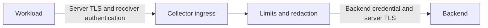
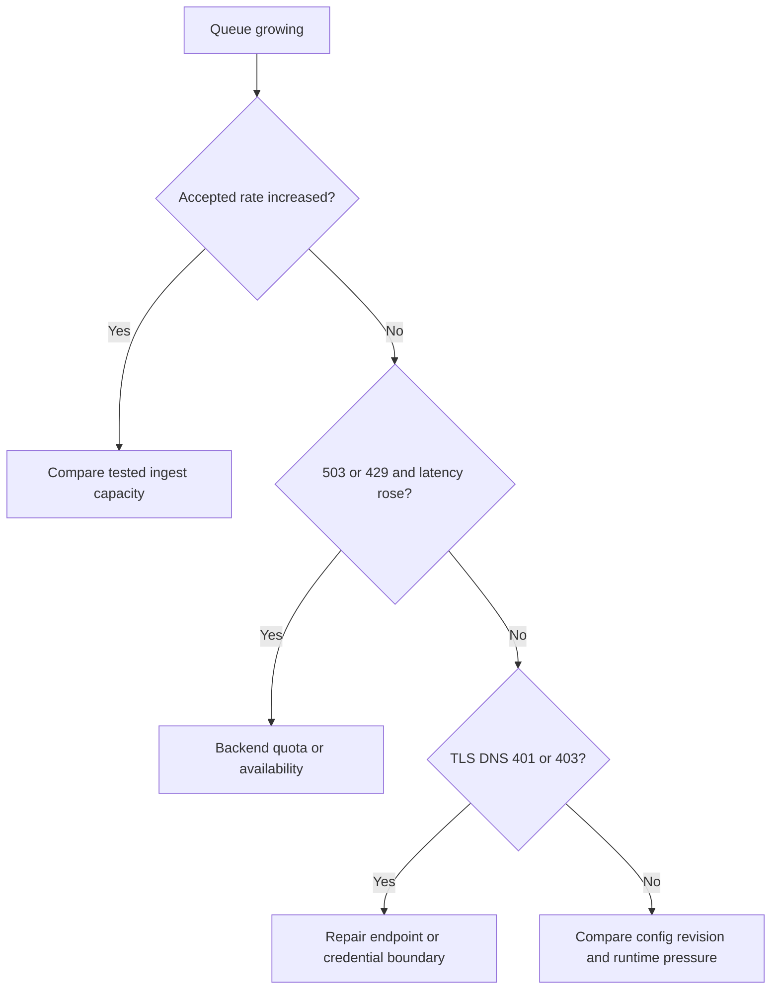
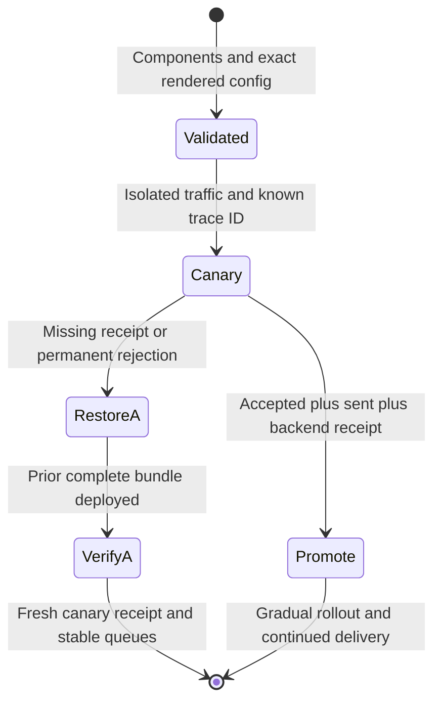

# Secure, Operate, and Upgrade Collector Deployments

> **Who this is for**: Engineers responsible for production readiness, security review, on-call support, and safe Collector changes.

This is the final deployment chapter. It assumes the topology, installation,
client endpoint, and scaling model from the preceding guides are already
defined.

---

## 1. 🔒 Draw Trust Boundaries Around Telemetry

Telemetry is not harmless metadata. It can contain credentials, personal data,
customer prompts and outputs, SQL, URLs, network topology, error messages, and
internal identifiers.

The two credentials belong to separate trust boundaries:



A valid backend token authenticates the Collector to the backend. It does not
authenticate a workload to the receiver. An attacker reaching ingress can still
inject records or exhaust capacity unless that first arrow is protected.


For every receiver and exporter, record:

| Control | Required decision |
| --- | --- |
| Network reachability | Which namespaces, nodes, CIDRs, clusters, or external clients can connect? |
| Encryption | Plaintext inside a defined trust zone, server TLS, or mTLS? Which CA and rotation path? |
| Authentication | Workload identity, client certificate, bearer/OIDC extension, proxy authentication, or isolated network? |
| Authorization | Which source may send which signal and volume? Are separate Collector endpoints required? |
| Data policy | Which bodies and attributes are prohibited, hashed, truncated, or routed to restricted backends? |
| Backend credential | Secret source, least-privilege scope, owner, expiry, and rotation procedure? |
| Denial-of-service protection | Request/body limits, memory limiter, queues, rate limiting, replica capacity, and external load-shedding? |

Do not expose OTLP receivers to the public internet without an authenticated,
rate-limited TLS layer and an explicit external-ingestion requirement.

---

## Exercise receiver TLS and authentication locally

Run the controlled lab from chapter 2 with its TLS/auth switch:

```bash
python3 examples/local/deployment_canary.py /absolute/path/to/otelcol-contrib --secure
```

It needs OpenSSL supporting `req -addext`. It generates a one-day localhost
certificate and disposable htpasswd entry, then validates and starts the exact
Contrib 0.157.0 binary. The generated receiver fragment is:

```yaml
extensions:
  basicauth/server:
    htpasswd:
      file: /absolute/lab-directory/htpasswd
receivers:
  otlp:
    protocols:
      http:
        endpoint: 127.0.0.1:19418
        tls:
          cert_file: /absolute/lab-directory/cert.pem
          key_file: /absolute/lab-directory/key.pem
        auth:
          authenticator: basicauth/server
service:
  extensions: [health_check, basicauth/server]
```

This is a fragment; the complete lab adds exporters and pipelines. The
component ID is `basicauth/server`: `auth-basic` is not a registered component.
Server auth uses an **htpasswd hash**, while `client_auth` belongs to outgoing
client authentication. Do not combine the two modes in one extension. The lab's
SHA hash is a disposable compatibility fixture; use a reviewed strong password
hash and secret-mounted file in deployment.
[Pinned authenticator documentation](https://github.com/open-telemetry/opentelemetry-collector-contrib/blob/v0.157.0/extension/basicauthextension/README.md).

The hostile tests omit credentials, supply a wrong password, and use an
untrusted certificate. The first two must receive 401, the TLS test must fail
certificate verification, and backend receipt count must remain zero. Then the
intended sender trusts this localhost certificate and supplies correct credentials;
its exact trace must arrive. TLS encrypts Basic credentials; encoding the header
in base64 alone provides no secrecy. This proves a local receiver boundary, not
workload authorization, rate limits, certificate rotation or vendor backend TLS.

## 2. 🔒 Use Least Privilege In Kubernetes

Apply these defaults unless a documented receiver requires an exception:

- non-root container;
- read-only root filesystem;
- all Linux capabilities dropped;
- RuntimeDefault seccomp;
- no host network, host PID, privileged mode, or host paths;
- no service-account token mount for a pure OTLP gateway;
- namespace-scoped network ingress;
- egress only to DNS, required Collector tiers, secret endpoints, and backends;
- separate ServiceAccounts and RBAC for node, cluster, and gateway Collectors.

A gateway that only receives OTLP and exports to a backend may not need
Kubernetes API access. The Kubernetes attributes processor does require API
permissions; use the chart's reviewed preset or define the minimum `get`,
`list`, and `watch` rules rather than granting `cluster-admin`.

NetworkPolicy is additive and CNI-dependent. A policy sketch:

```yaml
apiVersion: networking.k8s.io/v1
kind: NetworkPolicy
metadata:
  name: otel-gateway
  namespace: observability
spec:
  podSelector:
    matchLabels:
      app.kubernetes.io/instance: otel-gateway
  policyTypes: [Ingress, Egress]
  ingress:
    - from:
        - namespaceSelector:
            matchLabels:
              observability-access: allowed
      ports:
        - {protocol: TCP, port: 4317}
        - {protocol: TCP, port: 4318}
    - from:
        - namespaceSelector:
            matchLabels:
              kubernetes.io/metadata.name: monitoring
      ports:
        - {protocol: TCP, port: 8888}
  egress:
    - to:
        - namespaceSelector:
            matchLabels:
              kubernetes.io/metadata.name: kube-system
      ports:
        - {protocol: UDP, port: 53}
        - {protocol: TCP, port: 53}
    # Add the backend's approved network destination and port here.
```

For an illustrative private backend assigned `10.60.4.20` on HTTPS 443,
replace the final comment with the following approved-destination rule:

```yaml
    - to:
        - ipBlock:
            cidr: 10.60.4.20/32
      ports:
        - {protocol: TCP, port: 443}
```

This is a destination-specific fragment, not permission to use that address in
an arbitrary cluster. Ask the network owner for the actual routing destination,
including whether the CNI evaluates policy before or after address translation.
A gateway with Kubernetes enrichment additionally needs approved API-server
reachability (typically 443); DNS-only plus backend-only egress breaks that
processor. A pure transport gateway can remove the enrichment/API requirement.
In a disposable cluster, prove the intended sender can reach OTLP, an unintended
namespace cannot, DNS resolves, and exporter canaries reach the approved backend.
Those CNI tests remain unverified here; the local TLS/auth tests prove a separate
application-layer boundary.

Standard NetworkPolicy does not select an external FQDN. Backend egress may
need approved CIDRs, an egress gateway, a CNI-specific policy, or a private
endpoint. Test DNS and backend TLS after applying policy.

---

## 3. 🔒 Keep Secrets And Payloads Out Of Configuration

Collector configuration supports environment expansion:

```yaml
exporters:
  otlphttp/backend:
    endpoint: ${env:OTLP_BACKEND_ENDPOINT}
    headers:
      Authorization: ${env:OTLP_BACKEND_AUTHORIZATION}
```

Environment variables avoid committing a value but are not a complete secret
system. They can appear in process inspection, rendered deployment output,
support bundles, or debug logs depending on the platform. Prefer workload
identity or a secret-store integration when supported; otherwise restrict
Secret access and log output.

Redact as early as possible:

1. Application: never record prohibited content.
2. Node/sidecar Collector: remove content before it leaves the workload trust
   zone.
3. Gateway: enforce destination-specific policy before fan-out.
4. Backend: apply retention, access, and deletion controls.

Collector deletion by attribute key cannot detect a token buried inside an
allowed JSON string. Use application-side allowlisting or a carefully tested
transform for structured content.

Never enable `debug` exporter verbosity, zPages, pprof, or raw payload logging
on a public interface during an incident. Time-box access and remove the debug
configuration after collecting the required evidence.

---

## 4. 📊 Monitor The Collector As A Production Service

The default operational views should answer:

```text
Is telemetry arriving?
Is it leaving?
Is anything being refused or dropped?
Are queues growing?
Is a backend failing or throttling?
Is the Collector near memory, CPU, disk, or restart limits?
```

Minimum dashboard:

| Area | Metrics or evidence |
| --- | --- |
| Ingress | Accepted spans, metric points, and log records by receiver. |
| Rejection | Refused records by receiver. |
| Egress | Sent records by exporter. |
| Failure | Enqueue failures and send failures by exporter and signal. |
| Buffer | Queue size, capacity, and ratio by exporter. |
| Process | CPU, resident memory, Go runtime pressure, restarts, OOM kills. |
| Stateful components | Tail-sampling early drops/late spans, scraper targets and duration, load-balancer backend health/latency. |
| Backend | Ingest success, throttling/quota, latency, and availability from the backend side. |
| Canary | A periodic uniquely identifiable telemetry record visible in the backend. |

Alert on rates over an appropriate window, not a single transient retry:

- any sustained receiver refusal;
- any sustained exporter enqueue failure;
- sustained permanent send failure;
- queue ratio above the warning threshold and still increasing;
- missing accepted telemetry when traffic is known to exist;
- repeated restart/OOM;
- persistent canary absence;
- disk space or WAL corruption for persistent queues;
- tail-sampling early drop or scraper ownership failure.

The `health_check` extension is for process probes. Do not make Kubernetes
liveness depend on backend availability: a backend outage would restart every
Collector, throw away in-memory queues, and amplify the incident.

> 💡 **Key insight:** Backend failure belongs in alerts and queue behavior, not liveness probes.

---

## 5. 🔍 Incident Triage

Work from the loss boundary inward.

### No telemetry anywhere

```bash
kubectl --namespace observability get pods,services,endpointslices
kubectl --namespace observability get events --sort-by=.lastTimestamp
kubectl --namespace observability logs deployment/otel-gateway \
  --since=15m --all-pods=true
```

Check:

1. application exporter errors and endpoint;
2. Service DNS and endpoints;
3. Collector readiness and config;
4. receiver accepted/refused counters;
5. exporter queue/failure/sent counters;
6. network, TLS, auth, and backend status/quota.

### Controlled backend 401 versus 503

The same lab first delivers trace 02, then holds trace 03 behind a 503 backend.
Accepted input rises while receipt does not. Restoring 200 before the retry
window expires releases trace 03. Finally trace 04 meets backend 401: input is
accepted, but the pinned exporter marks the backend rejection permanent and the
record does not reappear merely because 200 is restored. Fixing ingress auth
cannot repair that second credential boundary. Repair the backend credential,
then emit a **new** canary; replay needs an explicitly owned source of records.
Transient send attempts do not necessarily increment a final permanent-failure
counter for every retry, so read retry logs alongside the queue and receipt.

### Queue is growing

This investigation tree orders observations; multiple causes can coexist:



Queue occupancy identifies pending work, not its cause. A low-CPU gateway with
unchanged input and backend 503 belongs on the backend branch; adding gateways
adds exporters without restoring backend service. Distinguish:

- ingest spike: accepted rate increased;
- Collector saturation: CPU/memory/refusal rose while backend remained healthy;
- backend saturation: send latency/failures/throttling rose;
- network/auth problem: TLS, DNS, `401`, `403`, or permanent failure logs;
- configuration change: batch, queue, routing, or endpoint changed.

Do not immediately increase queue size. That delays loss while consuming more
memory or disk and can hide an unrecoverable backend outage.

### Only some traces are incomplete

Check:

- propagation and application span lifecycles;
- head sampling consistency;
- tail sampling and trace-ID-aware routing;
- sampler scaling or rolling updates;
- late spans relative to `decision_wait`;
- per-tenant or destination routing;
- backend limits on spans or payload size.

### Emergency debugging

Use a canary replica or isolated port-forward. Capture:

- image digest and chart/Operator version;
- rendered config revision with secret values removed;
- component list;
- relevant internal metrics;
- Collector logs around the failure;
- Kubernetes events and resource pressure;
- backend error/request IDs.

Avoid redeploying a verbose debug exporter across every replica. It adds load
and may disclose payloads at the worst possible time.

---

## 6. 🔄 Upgrade Image, Chart, And Config Separately

Treat an upgrade as three changes even if one pull request contains them:

```text
Collector binary/components
Helm chart or Operator/controller
Collector configuration and telemetry policy
```

Safe sequence:

1. Read Collector Core, Contrib/distribution, chart, and Operator release and
   upgrade notes between current and target versions.
2. Inventory current component IDs and stability levels. Pay attention to
   renamed components such as snake-case migrations.
3. Verify the target image signature and pin its digest.
4. Run `components` and `validate` with the target image.
5. Render the exact pinned chart and diff Kubernetes resources plus embedded
   Collector config.
6. Run configuration tests with representative telemetry and prohibited-data
   fixtures.
7. Deploy one canary or a low-risk environment.
8. Verify receive, failure, queue, sent, canary, sampling, and backend results.
9. Roll gradually while preserving disruption budget and capacity.
10. Keep the previous image, chart, config, and secret schema ready for rollback.

Do not combine a distribution change, topology change, tail-sampling policy
change, and backend migration in one unobservable rollout.

For an Operator-managed Collector, decide whether the Operator may migrate
managed resources automatically. `upgradeStrategy: none` makes the application
team responsible for the Collector version/config; automatic strategy makes
Operator upgrades capable of changing managed Collectors. Neither is safe
without an owner and tests.

> ⚠️ **Watch out:** Rolling back a StatefulSet or persistent queue may not roll back on-disk formats or queued request semantics; test downgrade and recovery when persistence is part of the design.

---

### A failed canary is a rollback trigger

Keep a release bundle containing image digest, chart version, values/config
revision, secret **references/schema** and observed delivery baseline. For
example, bundle A is the validated .157/chart .168 baseline, with one fresh canary accepted,
sent and found by exact trace ID, zero refusal/enqueue failure, and a stable
queue under the tested traffic. Bundle B changes
only an exporter destination. Its pod becomes Ready, but its canary is absent
and backend 401 rises. Kubernetes readiness cannot promote B.

The ordering below keeps broad promotion behind delivery:



For B, stop promotion, preserve redacted config/logs/metrics, restore A's image,
chart and values through the owning release process, and verify a fresh canary
before routing normal traffic back. A changing Secret needs a compatible
reference/schema; rolling back values cannot restore an overwritten secret.
With persistent queues, do not blindly downgrade their on-disk format: attach a
tested compatible volume or drain through the supported version first. The
local 401 test reproduces the delivery failure; live canary deployment and
rollback commands remain a disposable-cluster gate, not executed evidence here.

## Recap and practice

Ingress identity, egress credentials, process health and delivery are separate
proof obligations. A queue can buffer a temporary failure; it cannot turn a
permanent credential rejection into successful delivery.

<details><summary>Should liveness fail when the backend is unavailable?</summary>
No. Restarting a healthy buffering Collector discards in-memory requests and
creates churn without repairing the backend. Alert on delivery and queue policy;
keep liveness tied to process health.
</details>

<details><summary>B is Ready but its canary meets 401. Which rollback evidence matters?</summary>
Restore the prior compatible bundle, then require a new canary receipt, stable
queues and restored sent counters. Readiness alone repeats the failed gate.
</details>

**Try it:** change the lab's exporter endpoint to an unused local port. Identify
which trust boundary fails, which counters can still rise, and the evidence
needed before restoring that candidate to service.

<details><summary>Worked solution for try it</summary>

An unused exporter port fails the Collector→backend hop. Receiver accepted counts can rise and the application can get 200, while sent stays flat and retries/queue occupancy grow. Restore the prior compatible endpoint bundle, then require a fresh canary receipt and stable queues before promotion.

</details>

## 7. ✅ Pre-Production Checklist

### Artifact and configuration

- [ ] Image repository, version, digest, signature verification, and component manifest are recorded.
- [ ] Chart or Operator version is pinned.
- [ ] Exact config validates with the exact image.
- [ ] Unused receivers, ports, extensions, and RBAC are removed.
- [ ] Processor order, redaction, routing, sampling, batch, retry, and queue behavior are reviewed.
- [ ] No secret value exists in Git, rendered artifacts, or CI logs.

### Reliability and scale

- [ ] Topology and every receiver/processor statefulness classification are documented.
- [ ] Requests/limits come from a representative load test with failure headroom.
- [ ] Replicas, spread, PDB, rollout, and termination grace meet the availability objective.
- [ ] gRPC connection distribution is tested if used.
- [ ] Scrapers have explicit target/node ownership.
- [ ] Tail sampling has trace-aware routing and change-safe capacity.
- [ ] Queue duration, restart durability, disk limits, and acceptable loss are quantified.
- [ ] Backend quota and throttling behavior are known.

### Security

- [ ] OTLP ingress is reachable only by intended senders.
- [ ] TLS/authentication matches every trust boundary.
- [ ] Backend credentials are least-privilege, rotatable, and separately owned.
- [ ] Container, ServiceAccount, RBAC, host access, NetworkPolicy, and egress follow least privilege.
- [ ] Sensitive-data tests cover span attributes, log-event attributes and bodies, exceptions, prompts, tool arguments, and outputs.
- [ ] Debug endpoints and exporters are disabled or tightly restricted.

### Operations

- [ ] Internal metrics are scraped and dashboards show ingress, egress, loss, queues, and resources.
- [ ] Alerts and backend canary reach the owning on-call.
- [ ] Runbook covers no data, partial data, queue growth, auth/TLS failure, OOM, backend outage, and rollback.
- [ ] Pod deletion, node drain, backend outage, throttling, rolling upgrade, and scale tests passed.
- [ ] Ownership, service-level objective, change path, and last verification date are recorded.

---

## 🔗 Official References

- [Collector configuration security best practices](https://opentelemetry.io/docs/security/config-best-practices/)
- [Collector hosting security best practices](https://opentelemetry.io/docs/security/hosting-best-practices/)
- [Handling sensitive data](https://opentelemetry.io/docs/security/handling-sensitive-data/)
- [Collector internal telemetry](https://opentelemetry.io/docs/collector/internal-telemetry/)
- [Collector troubleshooting](https://opentelemetry.io/docs/collector/troubleshooting/)
- [Collector resiliency](https://opentelemetry.io/docs/collector/resiliency/)
- [Collector chart upgrade notes](https://github.com/open-telemetry/opentelemetry-helm-charts/blob/main/charts/opentelemetry-collector/UPGRADING.md)
- [Operator getting started and upgrades](https://github.com/open-telemetry/opentelemetry-operator/tree/main/docs/getting-started)

**Next**: Return to the [OpenTelemetry Guide](../README.md) or apply the deployment
to the [Collector, Prometheus, Langfuse, and alerts example](../../examples/03_collector_prometheus_langfuse.md).
